# Video2UnityAvatar-Pipeline

[](https://github.com/chaeee01/Video2UnityAvatar-Pipeline/actions/workflows/tests.yml)

[Software Maestro] 좀비 영상 한 편을 입력하면 유니티 아바타 에셋(캐릭터 + 애니메이션)으로 자동 변환하는 파이프라인.

**공개 페이지**: <https://chaeee01.github.io/Video2UnityAvatar-Pipeline/> — 파이프라인 한 바퀴 · 납품 캐릭터 10종 · 실제 게임 내 플레이 장면 · 품질 개선 기록 (`site/`)

**납품처 게임**: [Empty House (Steam)](https://store.steampowered.com/app/5029430/Empty_House/?l=koreana) — 캐릭터 · 동작 에셋 납품처 (실제 게임 내 장면은 공개 페이지)

## 숫자로 보는 파이프라인 (실측·실청구)

| 산출물 | 전통 제작 | 본 파이프라인 (실측) |
|---|---|---|
| 캐릭터 1종 (리깅 포함) | 모델링·텍스처 3일~4주 + 리깅 수일 | 약 6~8분 · 약 $2 |
| 동작 클립 1편 (8~10초) | 키프레임 1~1.5일 / 모캡 $50~200+ | 약 2분 · 약 $1.7 |
| 영상 → Unity FBX 세트 | 외형·동작 결합 공정 (일 단위) | 약 8~10분 · 약 $4 · 명령 하나 |

- 시간: 한 서버에서 명령 하나로 실행한 벽시계 실측(2026-11-21, 캐릭터 3회 364 · 481 · 438초 · 동작 클립 2회 117 · 118초) — 영상 생성과 서버 기동은 제외.
  메쉬 생성(TRELLIS.2) 단계가 실행마다 달라진다(2026-11-21 210 · 326 · 276초, 11/07 457초 — GPU 구간만 10.1분)
- GPU $0.90/시간(전 기간 RunPod 총 $132: GPU $95 + 스토리지 $37) · 영상 생성 편당 $1.52(Omni, 현행; 제공 종료 전 Veo $0.80)
- 레시피 확립 후 생성 성공률 100% (11월 17/17, 전체 기간 92%)
- 출처·상세: 공개 페이지 링크 (https://chaeee01.github.io/Video2UnityAvatar-Pipeline/)

## 문서 길잡이

처음 왔다면 이 순서로 읽는다.

1. **README** (이 문서) — 무엇을 하는 파이프라인인지, 설계 개요, 실행 방법 요약
2. **[`docs/PROJECT_STATUS.md`](docs/PROJECT_STATUS.md) §8 "최근 작업"** — 지금 어디까지 왔는지. 결정과 실측의 기록 원본
3. **[`docs/RUNBOOK.md`](docs/RUNBOOK.md)** — 영상 1편 → Unity 에셋 실행 절차(Pod 준비 · 단계별 확인 포인트 · 흔한 실패 · 원커맨드 실행)
4. **[`docs/CONVENTIONS.md`](docs/CONVENTIONS.md)** — 경로 · CLI · 좌표 · 단위 규약과 틀리기 쉬운 곳

참고: [`docs/ROADMAP.md`](docs/ROADMAP.md) 일정 · 마일스톤, [`docs/ORCHESTRATOR_DESIGN.md`](docs/ORCHESTRATOR_DESIGN.md) 오케스트레이터 설계,
[`docs/VISION.md`](docs/VISION.md) 제품 방향. `docs/HANDOFF.md` · `docs/2026-09-22_발표준비_중_발견한_불일치.md` 는 9월 시점의 기록 문서다.

## 파이프라인 설계

### 현재 설계 (v4)
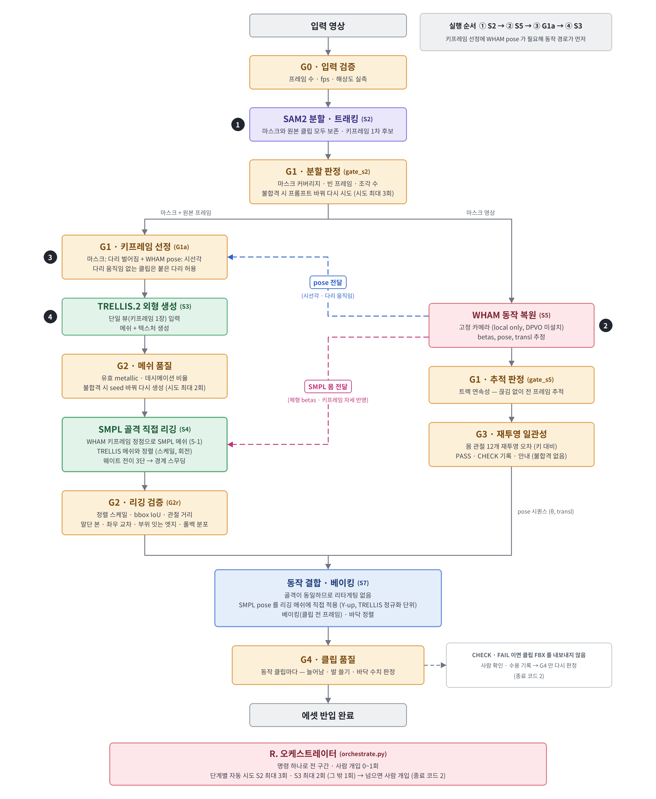

```
입력 영상
  → G0 · 입력 검증                프레임 수 · fps · 해상도 실측
  → SAM2 분할 · 트래킹 (S2) ①     마스크와 원본 클립 모두 보존 · 키프레임 1차 후보
  → G1 · 분할 판정 (gate_s2)      마스크 커버리지 · 빈 프레임 · 조각 수
                                  불합격 시 프롬프트 바꿔 다시 시도 (시도 최대 3회)
      │
      ├─[마스크 영상] 동작 경로
      │   → WHAM 동작 복원 (S5) ②        고정 카메라 (local only, DPVO 미설치)
      │                                  betas, pose, transl 추정
      │        ├┄ pose 전달 (시선각 · 다리 움직임) ┄┄┄┄┄┄┄┄┄┄┄┄┄┄┄→ G1a
      │        └┄ SMPL 몸 전달 (체형 betas · 키프레임 자세 반영) ┄┄┄→ S4
      │   → G1 · 추적 판정 (gate_s5)     트랙 연속성 — 끊김 없이 전 프레임 추적
      │   → G3 · 재투영 일관성           몸 관절 12개 재투영 오차 (키 대비)
      │                                  PASS · CHECK 기록 · 안내 (불합격 없음)
      │        └─ pose 시퀀스 (θ, transl) ─→ S7
      │
      └─[마스크 + 원본 프레임] 외형 경로
          → G1 · 키프레임 선정 (G1a) ③   마스크: 다리 벌어짐 + WHAM pose: 시선각
                                         다리 움직임 없는 클립은 붙은 다리 허용
          → TRELLIS.2 외형 생성 (S3) ④   단일 뷰(키프레임 1장) 입력 · 메쉬 + 텍스처 생성
          → G2 · 메쉬 품질               유효 metallic · 데시메이션 비율
                                         불합격 시 seed 바꿔 다시 생성 (시도 최대 2회)
          → SMPL 골격 직접 리깅 (S4)     WHAM 키프레임 정점으로 SMPL 메쉬 (5-1)
                                         TRELLIS 메쉬와 정렬 (스케일, 회전)
                                         웨이트 전이 3단 → 경계 스무딩
          → G2 · 리깅 검증 (G2r)         정렬 스케일 · bbox IoU · 관절 거리
                                         말단 본 · 좌우 교차 · 부위 잇는 엣지 · 폴백 분포
  → 동작 결합 · 베이킹 (S7)       골격이 동일하므로 리타겟팅 없음
                                  SMPL pose 를 리깅 메쉬에 직접 적용 (Y-up, TRELLIS 정규화 단위)
                                  베이킹(클립 전 프레임) · 바닥 정렬
  → G4 · 클립 품질                동작 클립마다 — 늘어남 · 발 쓸기 · 바닥 수치 판정
                                  ┄→ CHECK · FAIL 이면 클립 FBX 를 내보내지 않음
                                     사람 확인 · 수용 기록 → G4 만 다시 판정 (종료 코드 2)
  → 에셋 반입 완료

R. 오케스트레이터 (orchestrate.py)   명령 하나로 전 구간
   단계별 자동 시도 S2 최대 3회 · S3 최대 2회 (그 밖 1회) → 넘으면 사람 개입 (종료 코드 2)
실행 순서  ① S2 → ② S5 → ③ G1a → ④ S3   키프레임 선정에 WHAM pose 가 필요해 동작 경로가 먼저
```

그림과 도식은 지금 구현된 모습의 개요다 — **G4 는 동작 트랙(`--motion`)에서 클립마다 돈다**(외형 트랙은 베이킹 뒤 FBX 로 끝난다). 트랙 구분과 단계 목록은 [RUNBOOK](docs/RUNBOOK.md) 1.5절(원커맨드 · 동작 트랙) · 5.6절(G4)이 원본이다. 11/14 판 그림(설계 당시)은 [pipeline_v4_final.png](docs/assets/pipeline_v4_final.png).

WHAM 의 SMPL 몸(체형 포함)을 외형 경로의 리깅에 그대로 사용해
두 경로의 골격을 SMPL로 통일한다. 골격이 동일하므로 골격 간 리타겟팅
단계가 구조적으로 제거된다.

**실행 순서는 동작 경로가 먼저다 — `S2 → S5 → G1a → S3`** (2026-10-08 변경).
외형에 쓸 키프레임을 고르는 데 WHAM pose 가 필요해서다: S2 가 마스크만으로 1차 후보를
내고, S5 뒤의 G1a 가 **시선각**(얼굴이 카메라를 향하는가)과 **다리 움직임**으로 다시
매긴다. 다리가 붙었거나 고개를 숙인 프레임으로 만든 메쉬는 리깅에서 깨진다. 경위와
근거는 [ORCHESTRATOR_DESIGN.md 10절](docs/ORCHESTRATOR_DESIGN.md).

### 설계 변천
| 버전 | 핵심 구성 | 전환 사유 |
|---|---|---|
| v1 (기획, 미실행) | SAM2 + SuGaR + WHAM, 가우시안 LOD 렌더링 | 조사 단계에서 SuGaR의 동적 인물 부적합 확인, 배경 3D 불필요 → 착수 전 배제 |
| v2 | Mixamo 리깅 + SMPL→Mixamo 리타겟팅 | 세 방식(Unity Humanoid, 행렬 계산, 컨스트레인트) 모두 자세 붕괴로 실패 → 폐기 ([상세](docs/PROJECT_STATUS.md#3-단계별-검증-결과)) |
| v3 | 품질 게이트(G0-G4)·재시도 오케스트레이터 추가 | 평가·재시도 체계 확립, 리깅 방식은 v2 유지 |
| v4 (현재) | SMPL 골격 직접 리깅, WHAM 의 SMPL 몸(체형 포함)을 리깅에 그대로 사용해 골격 통일 | 리타겟팅 단계의 구조적 제거 |

<details><summary>v1 구조도 (기획)</summary>

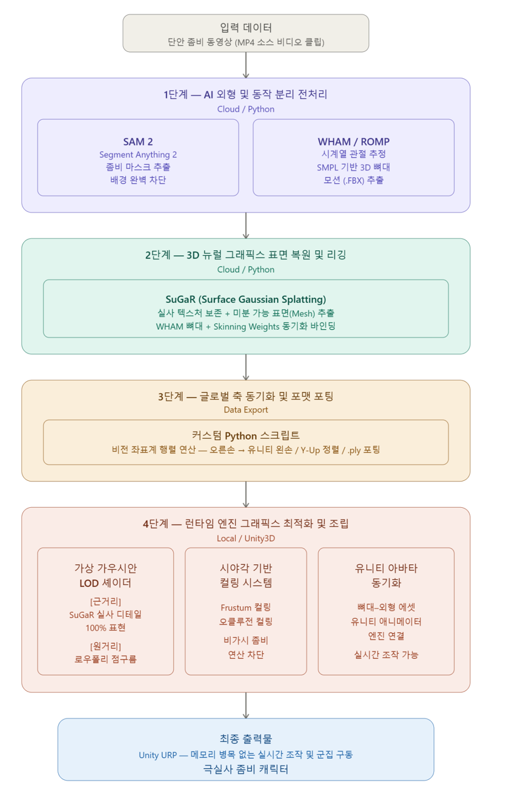
</details>

<details><summary>v2 구조도 (리타겟팅 방식)</summary>

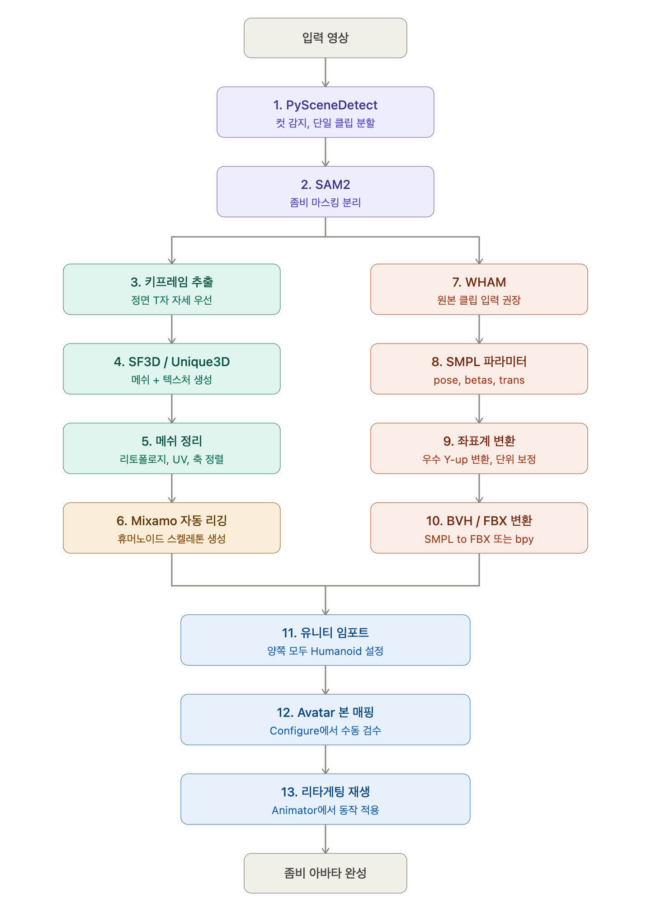
</details>

<details><summary>v3 구조도 (게이트 추가)</summary>

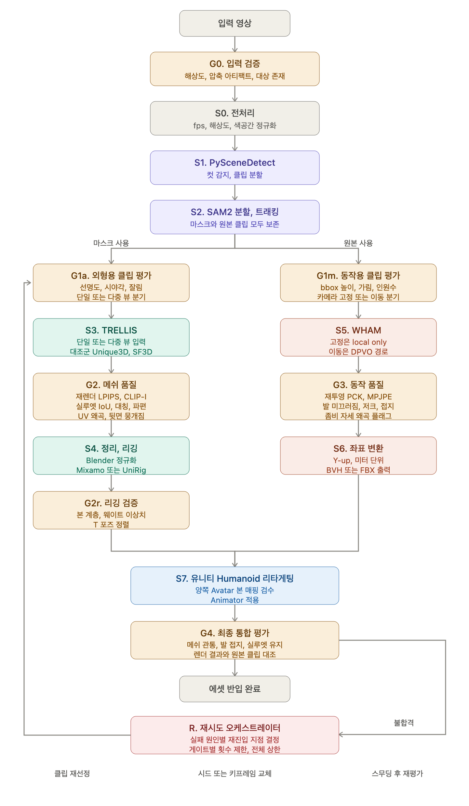
</details>

상세 이력과 각 결정의 검증 근거는 [`docs/PROJECT_STATUS.md`](docs/PROJECT_STATUS.md)에 있습니다.
폐기한 리타겟팅 시도는 [`scripts/deprecated/README.md`](scripts/deprecated/README.md)를 참고하세요.

## 레포 구조

| 경로 | 내용 |
|---|---|
| `docs/` | 프로젝트 문서 — 읽는 순서는 위 "문서 길잡이" |
| `scripts/` | 파이프라인 단계 스크립트(SAM2 · TRELLIS.2 · WHAM · 리깅 · 베이크), 게이트(`gate_*.py`), 오케스트레이터(`orchestrate.py`), 환경 setup |
| `scripts/deprecated/` | 폐기된 시도 — SMPL→Mixamo 리타겟팅 계열 |
| `tools/review/` | 검토 · 일괄 베이크 도구(`bake_character.sh`, G4 모아 보기 등) |
| `tools/site/` | 공개 페이지 소재 생성 · 조립 |
| `site/` | 공개 페이지(GitHub Pages, `.github/workflows/pages.yml` 로 자동 배포) |
| `.github/workflows/` | `pages.yml` 공개 페이지 배포 · `tests.yml` 시험 자동 실행(push 마다, ubuntu-24.04 · Python 3.9) |
| `docker/` | 환경 이미지 Dockerfile — 환경별(`Dockerfile.env` · `Dockerfile.env-split`), sshd 층(`Dockerfile.sshd` · `start.sh`), 통합(`Dockerfile.all`) — 와 빌드 스크립트 (GHCR 비공개) |
| `tests/` | 게이트 · 오케스트레이터 · 리깅 도구 시험 |
| `tests/ci/` | CI 러너(`test_script_suite.py`) — 스크립트형 시험을 하나씩 실행해 종료 코드 확인, 미러 · Blender 가 필요한 7개는 건너뜀 |
| `requirements-ci.txt` · `pytest.ini` | CI 시험 의존성(버전 고정) · pytest 수집 범위(`tests/ci`) |
| `notebooks/sam2/` | SAM2 전처리 Colab 시행착오 노트북 (try1-try6) |
| `pipeline/qa/` | 빈 자리(`.gitkeep`) — 게이트와 오케스트레이터는 `scripts/` 에 구현됐다 |

시험 로컬 실행: `pip install -r requirements-ci.txt` 환경에서 `pytest tests/ci -v -rs`

## 실행 방법

레포별 의존성이 충돌(torch 1.11-2.5, CUDA 11.3-12.4)해 환경을 하나로 합치지 않고 sam2 · trellis2 · wham 으로 나눈다.
GPU 단계(S2 · S3 · S5, 리깅 5-1 SMPL 메쉬 생성)와 Blender 단계(리깅 · 베이크 5-2~5-5, S7, FBX)를 RunPod(RTX 4090, EU-RO-1) 한 Pod 에서
**명령 하나**로 잇는다 — 오케스트레이터가 구간 경계에서 그 Pod 이 Blender 4.5 LTS 를 실행할 수 있는지 판정하고, 가능하면 이어서 돈다.
맥북은 재생 영상 검수와 Unity 반입에 쓴다. Pod 에서 GPU 구간만 돌리고 맥북 Blender 로 `--resume` 해 이어받는 방식도 그대로 된다.

- **Pod — 이미지 Pod(기본)**: GHCR 비공개 v3 통합 이미지 `ghcr.io/chaeee01/v2ua-all:v3-20261121-d160513`(sam2 · trellis2 · wham
  세 환경 + sshd + Blender 4.5.12 LTS) 하나로 영상 1편 → FBX 를 한 Pod 에서 끝낸다(2026-11-21 검증 — 외형 트랙 · 동작 트랙).
  v2 통합 이미지(`v2-20261107-0aa8002`, Blender 없음)와 환경 하나씩 든 `v2ua-{sam2v,trellis2,wham}` 은 보조 · 단독 대조용.
  템플릿: GHCR `read:packages` 자격증명 · Start Command 비움(이미지의 `/start.sh` 가 sshd 를 띄운다) · `PUBLIC_KEY` · TCP 22 ·
  볼륨 마운트 `/vol`. `bash -c "sleep infinity"` 는 sshd 가 없는 v1 이미지에서만 필요하다.
  SMPL 계열 3개(라이선스상 이미지에서 제외) · HF 모델 캐시 · 입출력 데이터는 볼륨에서 붙인다.
  → [RUNBOOK 1-A](docs/RUNBOOK.md#1-a-이미지-pod-기본)
- **Pod — 볼륨 Pod(보조)**: 볼륨 `/workspace` 에 설치된 micromamba 환경을 쓴다 — 환경 아카이브 · 디버깅용.
  → [RUNBOOK 1-B](docs/RUNBOOK.md#1-b-볼륨-pod-보조--아카이브--디버깅)
- **원커맨드 실행** — 영상 1편 → FBX 를 한 명령으로:

  ```bash
  python3 scripts/orchestrate.py --video /workspace/data/00_raw/<샘플>.mp4 --name <샘플>          # 외형 트랙 → 캐릭터 FBX
  python3 scripts/orchestrate.py --motion --character <캐릭터> --video <클립>.mp4 --name <클립>   # 동작 트랙 → 클립 FBX
  python3 scripts/orchestrate.py --name <샘플> --resume --dry-run                         # 실행 없이 명령 · 분기만
  ```

  Blender 를 실행할 수 없는 Pod 이면 GPU 구간 뒤에서 종료 코드 2 로 멈추고 사유와 두 갈래(그 Pod 에 Blender 를 갖춰
  `--resume` / run 폴더를 맥북으로 회수해 `python3 scripts/orchestrate.py --name <샘플> --resume`)를 알린다.
  v3 이미지는 `BLENDER` 가 이미지에 지정돼 있어 따로 줄 것이 없다. Blender 가 없는 v2 이미지로 띄웠을 때만 Blender 4.5 LTS
  리눅스판과 apt 4종을 갖춰 `BLENDER` 로 가리킨다([RUNBOOK 1-A](docs/RUNBOOK.md#1-a-이미지-pod-기본) 6 — 보조 절차).

  옵션 · 종료 코드 · 한계는 [RUNBOOK 1.5절](docs/RUNBOOK.md#15-원커맨드-실행--orchestratepy), 단계별 수동 절차는 RUNBOOK 2~7절.

## 상태

- 검증 완료: WHAM 동작 복원, TRELLIS 외형 복원, **SMPL 골격 직접 리깅(S4)**, 유니티 에셋 반입.
  영상 한 편이 Unity 에셋까지 관통하는 수동 파이프라인이 완성됐다 (M1, 8/28)
- 검증 완료: **TRELLIS 로컬 설치**(9/9 TRELLIS.2 전환), **품질 게이트**(G0/S2·G2·G2r 9/15, S5 트랙 10/12, G4 늘어남·발 쓸기 10/22 + 바닥 10/26), **원커맨드 E2E 오케스트레이터**(10/11)
- **납품 현황 (2026-11-02)**: 캐릭터 10종(좀비 6 · 플레이어 4, char_shuffle = 플레이어 4번), **동작 클립 115편** — walker 26 · stalker 35 · listener 27 · player 14 · lurker 4 · oiler 4 · char_shuffle 1 · dog 4(Mixamo). 10/17 게임팀 Unity 반입 확인, 10/26 피격 · 넘어짐 · 일어나기 12편, 11/02 걷기 · 달리기 13편 추가
- 검증 완료: **환경 이미지 3종**(EH-229, 11/05) — GHCR 비공개, 이미지 Pod 에서 S2 마스크 · S5 pkl 완전 일치, S3 정점 일치
- **공개 페이지**(11/06 공개, 11/08 v17) — GitHub Pages, 소재 34점(페이지 사용 30) · 6.79 MB (2026-11-21 `site/assets/` 재집계)
- 백로그: EH-211 T포즈 rest 통일, gate_s2 보강

## 검증 결과

### 최신 결과 (2026-10~11)

#### 납품 캐릭터 10종
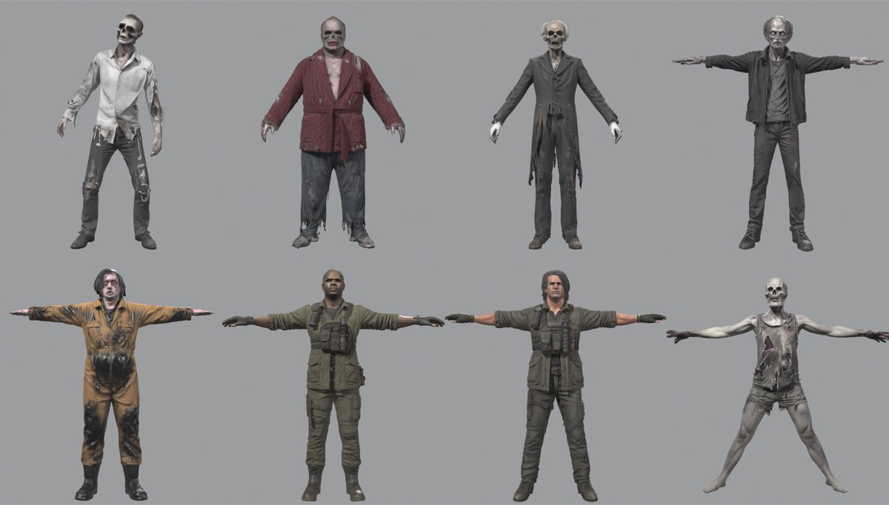

좀비 6종(walker · listener · stalker · lurker · oiler · dog)과 플레이어 4종의 TRELLIS.2 메쉬 — 같은 조명 · 정면.
동작 클립은 115편을 납품했다(2026-11-02 기준). 실제 게임 내 재생 장면은 공개 페이지에 있다.

#### 품질 게이트와 수리
G4 클립 품질 게이트(`scripts/gate_g4.py`)로 납품 클립을 역검증했다 — 10/22 늘어남 · 발 쓸기 판정: 납품 86편(dog 제외) PASS 78 · ACCEPTED 8 · CHECK 0 · FAIL 0.
10/26 바닥 판정(추가 12편 포함, 결함 클립을 바닥 정렬판으로 교체한 뒤): 최종 98편 PASS 85 · ACCEPTED 13 · CHECK 0. 아래 두 그림은 게임팀 피드백(미끄러짐)과 파일럿 육안 검토(웨이트 전이 — G2r 은 무경고였다)로 찾아 고친 사례다 (각 그림 위: 수리 전 · 아래: 수리 후).

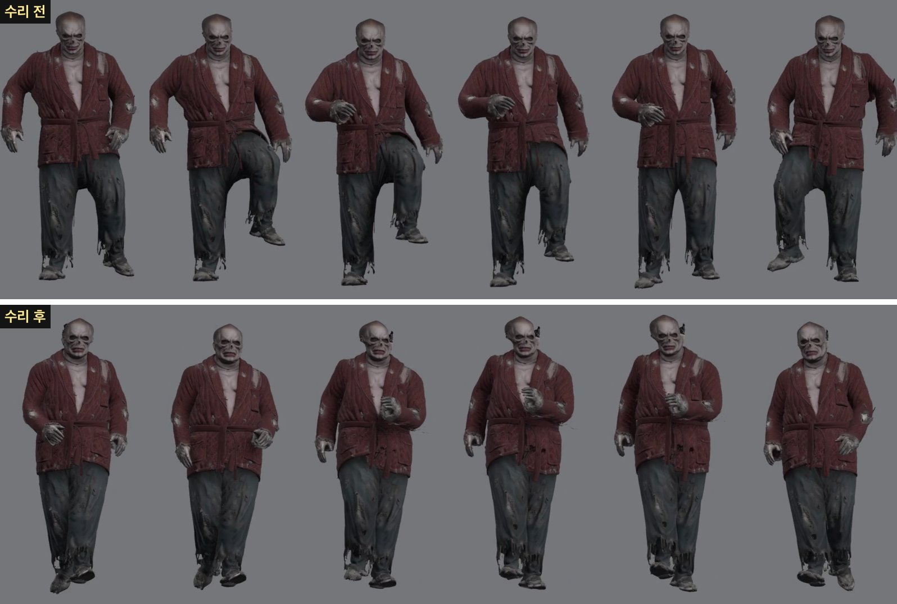

listener `run` 미끄러짐(10/19) — 위: 수리 전(무릎만 드는 제자리걸음) · 아래: 수리 후(이식판), 같은 시점 6프레임.
접지한 발이 몸 아래로 뒤로 쓸리지 않았다(골반 기준 쓸기 −0.003 / −0.051).
stalker `run_fwd` 의 동작을 listener 리그에 구운 이식판(−0.82 / −0.79)으로 교체.

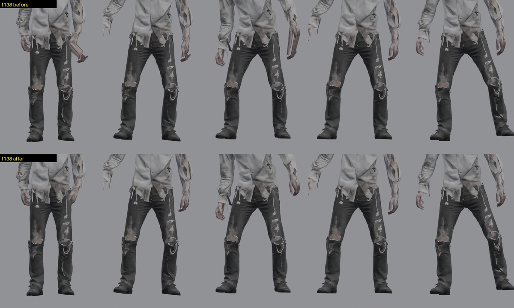

웨이트 전이 부위 제약(10/12, walker 파일럿 f138) — 하반신 확대, 위: 제약 전 · 아래: 제약 후(프레임 0 · 64 · 96 · 138 · 176).
팔을 벌리면 왼손과 허벅지 사이가 판자처럼 늘어났다 — 팔 메쉬 안의 작은 조각이 다리 본을 받은 오배정. 부위가 다른 작은 섬을
메쉬 연결로 되돌리자 ⑤ 엣지 561 → 0, 늘어난 엉덩이–팔 엣지 532 → 0, 판자 사라짐.

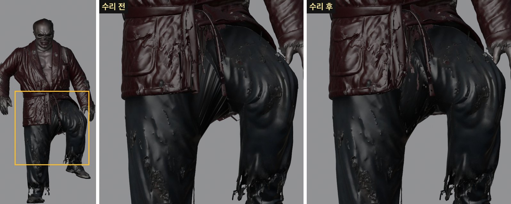

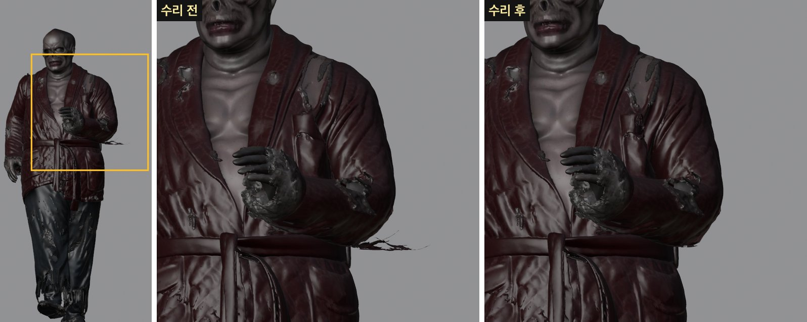

웨이트 경계 스무딩(5-4b, 10/21) — 1차 전이의 딱 잘린 경계를 본 쌍 경계 N겹 안에서만 고른다.
위: listener 달리기(run_04b) f34 — 수리 전(리그 `listener_apose_06`) · 수리 후(가랑이 경계 스무딩 L_Hip:R_Hip 10겹 · 40회, 리그 `listener_apose_06_wfix_a`).
다리 사이의 늘어난 막이 사라졌다 — 04b 가랑이 0.10 초과 늘어난 엣지 471 → 0, 전체 579 → 72, 최장 0.179 → 0.119.
아래: listener 달리기(run — 이식판 `listener_x_stalker_run_fwd`) f62 — 수리 전(리그 `listener_apose_06`, 가랑이도 수리 전) · 수리 후(가랑이 + 겨드랑이 경계 스무딩
L/R_Shoulder:Spine1·2 20겹 · 160회, 리그 `listener_apose_06_wfix` — 10/21 채택). 허리 높이에서 소매 옆으로 찢겨 나온 조각이 사라졌다 —
run · run_slow 왼쪽 겨드랑이 0.10 초과 266 · 257 → 0(run 에서 늘어남이 가장 큰 프레임은 f51, 그림은 조각이 실루엣 밖으로 보이는 f62).
왼쪽 전신 컷의 상자가 근접 영역. 출처 · 카메라는 [docs/assets/seam_figures_1121.md](docs/assets/seam_figures_1121.md).

#### 이미지 재현 (11/07)
v2 통합 이미지 Pod 에서 walker_walk_02 를 원커맨드 Pod 구간 → 맥 `--resume` → FBX 까지 관통했다. S2 마스크는 참조와
192/192 픽셀 일치, S5 는 같은 masked.mp4 입력에서 pkl 완전 일치. 상세는 [PROJECT_STATUS](docs/PROJECT_STATUS.md) 11/06~07 항목.

### 초기 검증 (2026-08, M1)

#### 동작 복원 (WHAM)
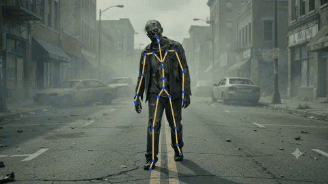

WHAM이 추정한 SMPL 파라미터에서 공식 J_regressor로 관절을 추출해 원본 영상에 2D 재투영한 결과입니다.
스켈레톤이 좀비 위에 정합하는 것으로 동작 복원이 정상임을 확인했습니다 (`scripts/overlay_vis.py`).

#### 외형 파이프라인 → Unity 반입 (v2 · 폐기 경로)
> **v2 · 폐기 경로의 기록이다.** 아래는 Mixamo 리깅으로 Unity Humanoid 반입을 확인한 초기 검증이며,
> 현재(v4)는 SMPL 골격 직접 리깅을 쓴다 — 아래 "통합" 절.

| Mixamo 애니메이션 | 에셋스토어 애니메이션 (호환성) |
|---|---|
| 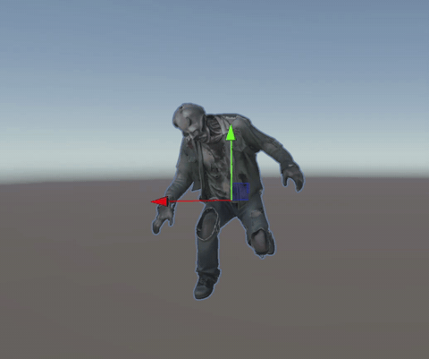 | 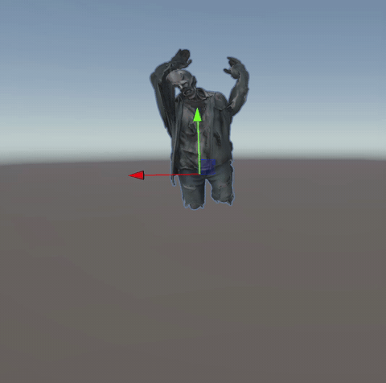 |

TRELLIS 생성 메쉬 → Mixamo 리깅 → 텍스처 → Unity Humanoid 반입.
제3자 애니메이션이 그대로 재생되어 표준 Humanoid 규격 충족을 확인.

#### 통합 (SMPL 리깅 + WHAM 동작) — 완료
| 원본 영상 | Unity 재생 (리타겟팅 없음) |
|---|---|
| 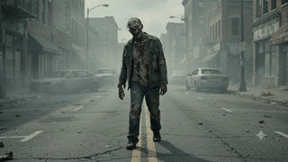 | 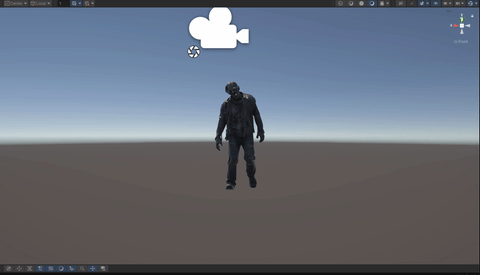 |

영상에서 추정한 WHAM 동작(69프레임)을 SMPL 골격으로 리깅된 TRELLIS
좀비에 직접 적용해 Unity에서 재생. 골격 통일(v4 설계)로 리타겟팅
단계 없이 원본 보행 패턴이 재현된다.
