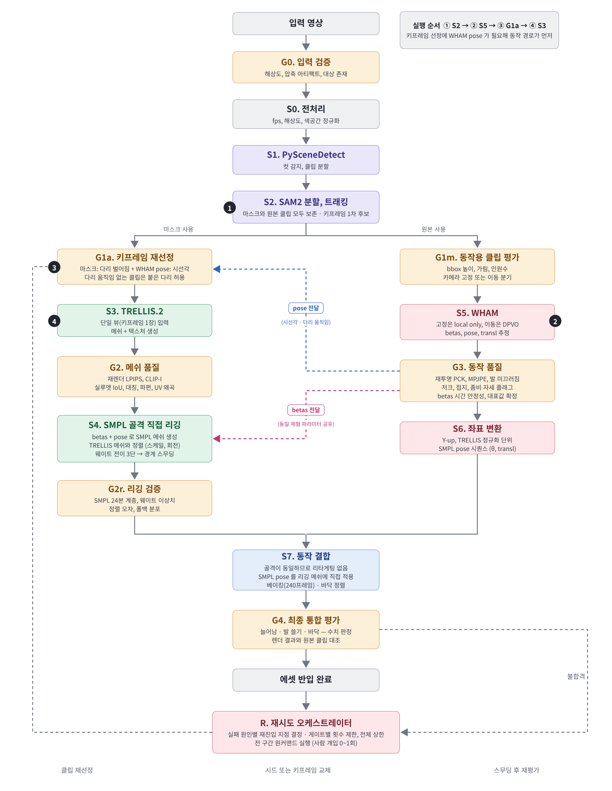
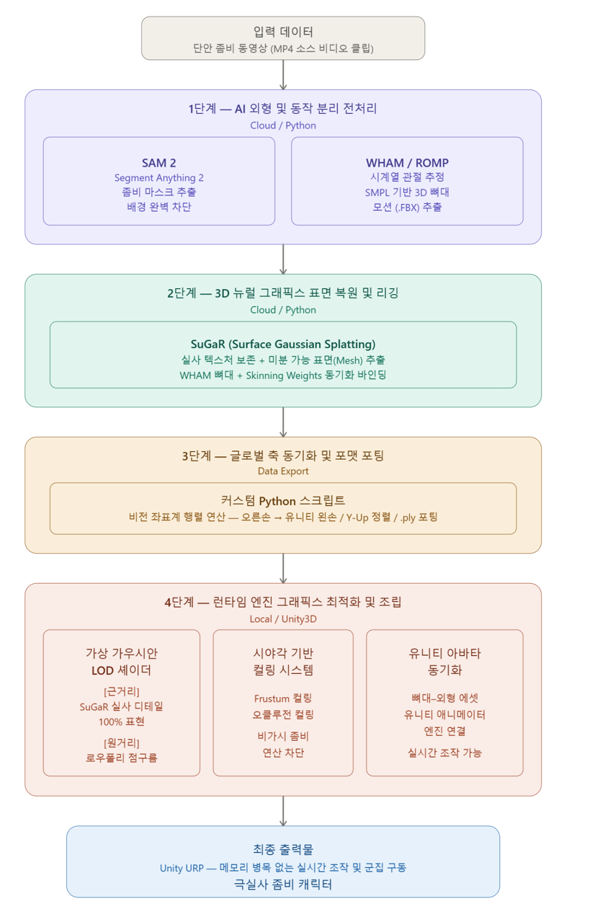
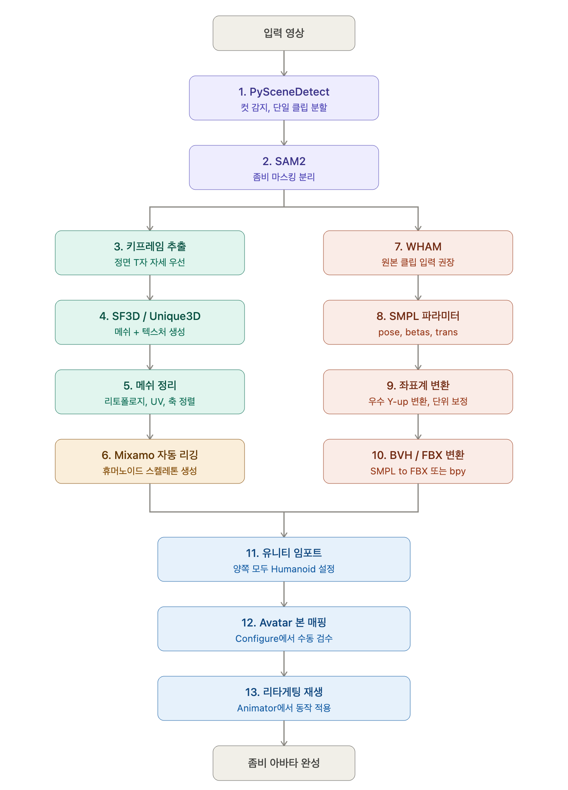
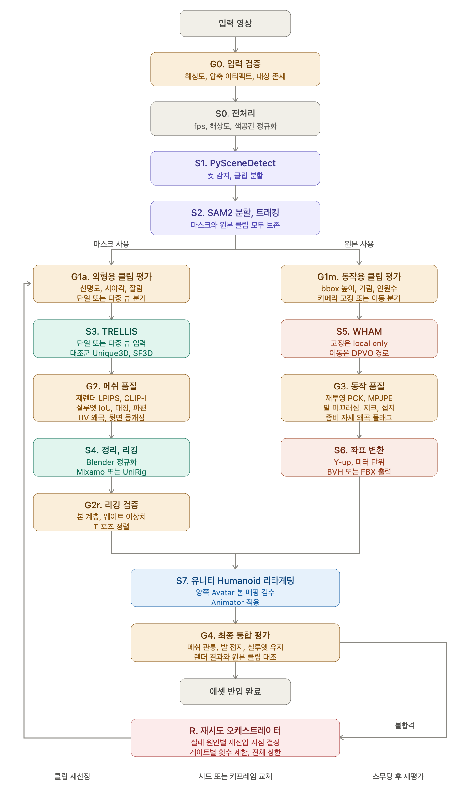
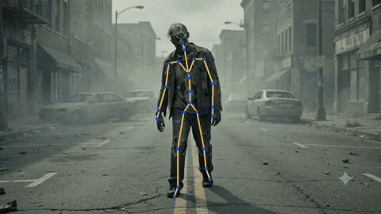
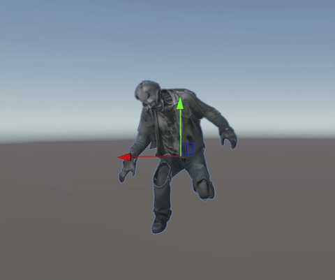
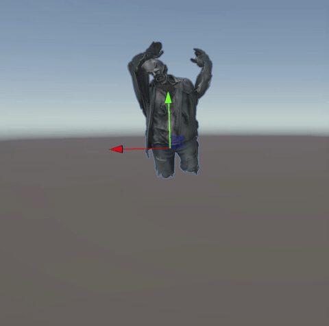
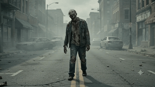
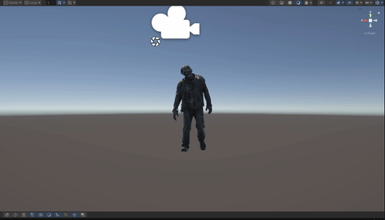

# Video2UnityAvatar-Pipeline

[Software Maestro] 좀비 영상 한 편을 입력하면 유니티 아바타 에셋(캐릭터 + 애니메이션)으로 자동 변환하는 파이프라인.

**공개 페이지**: <https://chaeee01.github.io/Video2UnityAvatar-Pipeline/> — 파이프라인 한 바퀴 · 납품 캐릭터 10종 · 실제 게임 내 플레이 장면 · 문제 해결 기록 (`site/`)

**납품처 게임**: [Empty House (Steam)](https://store.steampowered.com/app/5029430/Empty_House/?l=koreana) — 캐릭터 · 동작 에셋 납품처 (실제 게임 내 장면은 공개 페이지)

## 숫자로 보는 파이프라인 (실측·실청구)

| 산출물 | 전통 제작 | 본 파이프라인 (실측) |
|---|---|---|
| 캐릭터 1종 (리깅 포함) | 모델링·텍스처 3일~4주 + 리깅 수일 | 기계 ~11분 · 약 $2 |
| 동작 클립 1편 (8~10초) | 키프레임 1~1.5일 / 모캡 $50~200+ | ~6분 · 약 $1.7 |
| 영상 → Unity FBX 세트 | 외형·동작 결합 공정 (일 단위) | ~17분 · 약 $4 · 개입 0~1회 |

- GPU $0.90/시간(전 기간 RunPod 총 $132: GPU $95 + 스토리지 $37) · 영상 생성 편당 $1.52(Omni, 현행; 제공 종료 전 Veo $0.80)
- 레시피 확립 후 생성 성공률 100% (11월 17/17, 전체 기간 92%)
- 출처·상세: 공개 페이지 링크 (https://chaeee01.github.io/Video2UnityAvatar-Pipeline/)

## 문서 길잡이

처음 왔다면 이 순서로 읽는다.

1. **README** (이 문서) — 무엇을 하는 파이프라인인지, 설계 개요, 실행 방법 요약
2. **[`docs/PROJECT_STATUS.md`](docs/PROJECT_STATUS.md) §8 "최근 작업"** — 지금 어디까지 왔는지. 결정과 실측의 기록 원본
3. **[`docs/RUNBOOK.md`](docs/RUNBOOK.md)** — 영상 1편 → Unity 에셋 실행 절차(Pod 준비 · 단계별 확인 포인트 · 흔한 실패 · 원커맨드 실행)
4. **[`docs/CONVENTIONS.md`](docs/CONVENTIONS.md)** — 경로 · CLI · 좌표 · 단위 규약과 틀리기 쉬운 곳

참고: [`docs/ROADMAP.md`](docs/ROADMAP.md) 일정 · 마일스톤, [`docs/ORCHESTRATOR_DESIGN.md`](docs/ORCHESTRATOR_DESIGN.md) 오케스트레이터 설계,
[`docs/VISION.md`](docs/VISION.md) 제품 방향. `docs/HANDOFF.md` · `docs/2026-09-22_발표준비_중_발견한_불일치.md` 는 9월 시점의 기록 문서다.

## 파이프라인 설계

### 현재 설계 (v4)


```
입력 영상
  → G0  입력 검증          해상도, 압축 아티팩트, 대상 존재
  → S0  전처리             fps / 해상도 / 색공간 정규화
  → S1  PySceneDetect      컷 감지, 클립 분할
  → S2  SAM2               분할·트래킹 (마스크와 원본 클립 모두 보존)
      │
      ├─[원본]──→ G1m 동작용 클립 평가   bbox 높이, 가림, 인원수
      │           → S5  WHAM             betas, pose, transl 추정
      │           → G3  동작 품질        재투영 PCK, MPJPE, 발 접지 ─┬─ pose 전달 ─┐
      │           → S6  좌표 변환        Y-up, TRELLIS 정규화 단위  │              │
      │                                                             │ betas 전달   │
      └─[마스크]→ G1a 키프레임 재선정    다리 벌어짐, 시선각 ←──────┼──────────────┘
                  → S3  TRELLIS          단일/다중 뷰 → 메쉬 + 텍스처 │
                  → G2  메쉬 품질        LPIPS, CLIP-I, 실루엣 IoU, UV 왜곡
                  → S4  SMPL 골격 직접 리깅  ←──────────────────────┘
                     betas + pose로 SMPL 메쉬 생성
                     TRELLIS 메쉬와 정렬 → 웨이트 전이
                  → G2r 리깅 검증        SMPL 24본 계층, 정렬 오차
  → S7  동작 결합            골격이 동일하므로 리타게팅 없음
                             SMPL pose를 리깅 메쉬에 직접 적용
  → G4  최종 통합 평가       메쉬 관통, 발 접지, 원본 클립 대조
  → 에셋 반입 완료
       └→ (불합격 시) R. 재시도 오케스트레이터 → 실패 원인별 게이트 재진입
```

WHAM이 추출한 체형 파라미터(betas)를 외형 경로의 리깅 단계에 전달해
두 경로의 골격을 SMPL로 통일한다. 골격이 동일하므로 골격 간 리타게팅
단계가 구조적으로 제거된다.

**실행 순서는 동작 경로가 먼저다 — `S2 → S5 → G1a → S3`** (2026-10-08 변경).
외형에 쓸 키프레임을 고르는 데 WHAM pose 가 필요해서다: S2 가 마스크만으로 1차 후보를
내고, S5 뒤의 G1a 가 **시선각**(얼굴이 카메라를 향하는가)과 **다리 움직임**으로 다시
매긴다. 다리가 붙었거나 고개를 숙인 프레임으로 만든 메쉬는 리깅에서 깨진다. 경위와
근거는 [ORCHESTRATOR_DESIGN.md 10절](docs/ORCHESTRATOR_DESIGN.md).

### 설계 변천
| 버전 | 핵심 구성 | 전환 사유 |
|---|---|---|
| v1 (기획, 미실행) | SAM2 + SuGaR + WHAM, 가우시안 LOD 렌더링 | 조사 단계에서 SuGaR의 동적 인물 부적합 확인, 배경 3D 불필요 → 착수 전 배제 |
| v2 | Mixamo 리깅 + SMPL→Mixamo 리타게팅 | 세 방식(Unity Humanoid, 행렬 계산, 컨스트레인트) 모두 자세 붕괴로 실패 → 폐기 ([상세](docs/PROJECT_STATUS.md#3-단계별-검증-결과)) |
| v3 | 품질 게이트(G0-G4)·재시도 오케스트레이터 추가 | 평가·재시도 체계 확립, 리깅 방식은 v2 유지 |
| v4 (현재) | SMPL 골격 직접 리깅, betas 전달로 골격 통일 | 리타게팅 단계의 구조적 제거 |

<details><summary>v1 구조도 (기획)</summary>


</details>

<details><summary>v2 구조도 (리타게팅 방식)</summary>


</details>

<details><summary>v3 구조도 (게이트 추가)</summary>


</details>

상세 이력과 각 결정의 검증 근거는 [`docs/PROJECT_STATUS.md`](docs/PROJECT_STATUS.md)에 있습니다.
폐기한 리타게팅 시도는 [`scripts/deprecated/README.md`](scripts/deprecated/README.md)를 참고하세요.

## 레포 구조

| 경로 | 내용 |
|---|---|
| `docs/` | 프로젝트 문서 — 읽는 순서는 위 "문서 길잡이" |
| `scripts/` | 파이프라인 단계 스크립트(SAM2 · TRELLIS.2 · WHAM · 리깅 · 베이크), 게이트(`gate_*.py`), 오케스트레이터(`orchestrate.py`), 환경 setup |
| `scripts/deprecated/` | 폐기된 시도 — SMPL→Mixamo 리타게팅 계열 |
| `tools/review/` | 검토 · 일괄 베이크 도구(`bake_character.sh`, G4 모아 보기 등) |
| `tools/site/` | 공개 페이지 소재 생성 · 조립 |
| `site/` | 공개 페이지(GitHub Pages, `.github/workflows/pages.yml` 로 자동 배포) |
| `docker/` | 환경 이미지 3종 Dockerfile · 빌드 스크립트 (GHCR) |
| `tests/` | 게이트 · 오케스트레이터 · 리깅 도구 시험 |
| `notebooks/sam2/` | SAM2 전처리 Colab 시행착오 노트북 (try1-try6) |
| `pipeline/qa/` | 빈 자리(`.gitkeep`) — 게이트와 오케스트레이터는 `scripts/` 에 구현됐다 |

## 실행 방법

레포별 의존성이 충돌(torch 1.11-2.5, CUDA 11.3-12.4)해 환경을 하나로 합치지 않고 sam2 · trellis2 · wham 으로 나눈다.
GPU 단계(S2 · S3 · S5, 리깅 5-1 SMPL 메쉬 생성)는 RunPod(RTX 4090, EU-RO-1), 나머지 리깅 · 베이크(5-2~5-5, S7)는 맥북 Blender 4.5 LTS 에서 돈다.

- **Pod — 이미지 Pod(기본)**: 환경마다 GHCR 비공개 이미지(`ghcr.io/chaeee01/v2ua-{sam2v,trellis2,wham}`)로 Pod 을 띄운다.
  템플릿에 GHCR 읽기 자격증명 · Start Command `bash -c "sleep infinity"` · 볼륨 마운트 `/vol` 이 필요하고,
  SMPL 계열 3개(라이선스상 이미지에서 제외) · HF 모델 캐시 · 입출력 데이터는 볼륨에서 붙인다.
  → [RUNBOOK 1-A](docs/RUNBOOK.md#1-a-이미지-pod-기본)
- **Pod — 볼륨 Pod(보조)**: 볼륨 `/workspace` 에 설치된 micromamba 환경을 쓴다. 원커맨드 Pod 구간은 여기서 돈다.
  → [RUNBOOK 1-B](docs/RUNBOOK.md#1-b-볼륨-pod-보조--아카이브--디버깅--원커맨드-pod-구간)
- **원커맨드 실행** — Pod 과 맥북에서 같은 스크립트를 돌리고 완료 마커로 이어받는다:

  ```bash
  python scripts/orchestrate.py --video /workspace/data/00_raw/<샘플>.mp4 --name <샘플>   # Pod 구간
  python3 scripts/orchestrate.py --name <샘플> --resume                                   # 맥북 구간 (run 폴더 회수 후)
  python3 scripts/orchestrate.py --name <샘플> --dry-run                                  # 실행 없이 명령 · 분기만
  ```

  옵션 · 종료 코드 · 한계는 [RUNBOOK 1.5절](docs/RUNBOOK.md#15-원커맨드-실행--orchestratepy), 단계별 수동 절차는 RUNBOOK 2~7절.

## 상태

- 검증 완료: WHAM 동작 복원, TRELLIS 외형 복원, **SMPL 골격 직접 리깅(S4)**, 유니티 에셋 반입.
  영상 한 편이 Unity 에셋까지 관통하는 수동 파이프라인이 완성됐다 (M1, 8/28)
- 검증 완료: **TRELLIS 로컬 설치**(9/9 TRELLIS.2 전환), **품질 게이트**(G0/S2·G2·G2r 9/15, S5 트랙 10/12, G4 늘어남·발 쓸기 10/22 + 바닥 10/26), **원커맨드 E2E 오케스트레이터**(10/11)
- **납품 현황 (2026-11-02)**: 캐릭터 7종 + player 동작, **동작 클립 115편** — walker 26 · stalker 35 · listener 27 · player 14 · lurker 4 · oiler 4 · char_shuffle 1 · dog 4(Mixamo). 10/17 게임팀 Unity 반입 확인, 10/26 피격 · 넘어짐 · 일어나기 12편, 11/02 걷기 · 달리기 13편 추가
- 검증 완료: **환경 이미지 3종**(EH-229, 11/05) — GHCR 비공개, 이미지 Pod 에서 S2 마스크 · S5 pkl 완전 일치, S3 정점 일치
- **공개 페이지**(11/06) — GitHub Pages, 소재 32점 · 약 6.6 MB
- 백로그: EH-211 T포즈 rest 통일, gate_s2 보강, G4 · 5-4b 오케스트레이터 통합

## 검증 결과

### 동작 복원 (WHAM)


WHAM이 추정한 SMPL 파라미터에서 공식 J_regressor로 관절을 추출해 원본 영상에 2D 재투영한 결과입니다.
스켈레톤이 좀비 위에 정합하는 것으로 동작 복원이 정상임을 확인했습니다 (`scripts/overlay_vis.py`).

### 외형 파이프라인 → Unity 반입 (v2 · 폐기 경로)
> **v2 · 폐기 경로의 기록이다.** 아래는 Mixamo 리깅으로 Unity Humanoid 반입을 확인한 초기 검증이며,
> 현재(v4)는 SMPL 골격 직접 리깅을 쓴다 — 아래 "통합" 절.

| Mixamo 애니메이션 | 에셋스토어 애니메이션 (호환성) |
|---|---|
|  |  |

TRELLIS 생성 메쉬 → Mixamo 리깅 → 텍스처 → Unity Humanoid 반입.
제3자 애니메이션이 그대로 재생되어 표준 Humanoid 규격 충족을 확인.

### 통합 (SMPL 리깅 + WHAM 동작) — 완료
| 원본 영상 | Unity 재생 (리타게팅 없음) |
|---|---|
|  |  |

영상에서 추정한 WHAM 동작(69프레임)을 SMPL 골격으로 리깅된 TRELLIS
좀비에 직접 적용해 Unity에서 재생. 골격 통일(v4 설계)로 리타게팅
단계 없이 원본 보행 패턴이 재현된다.
