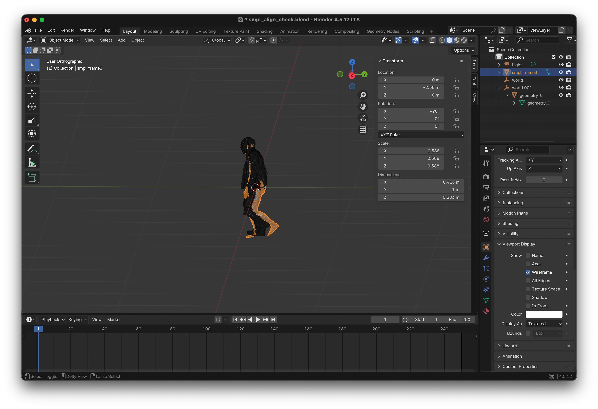
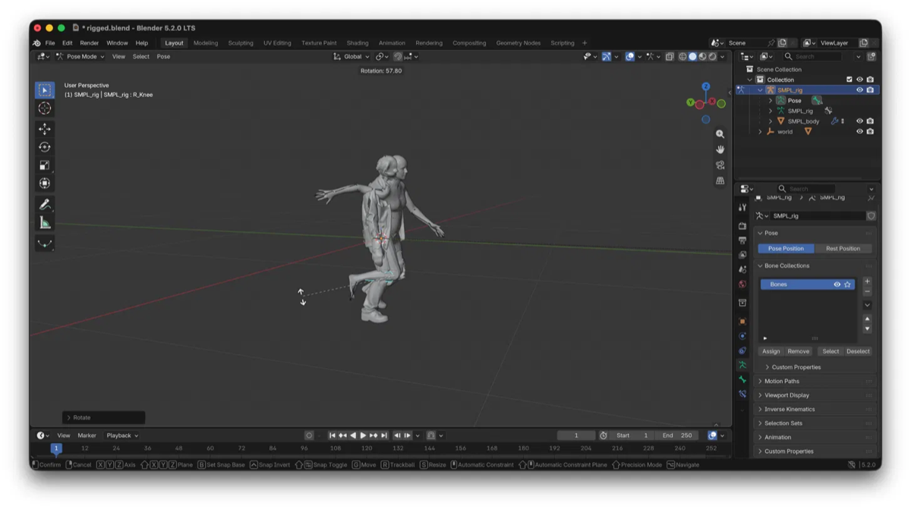
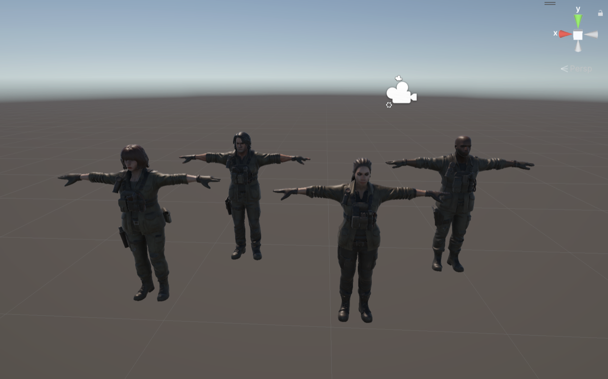
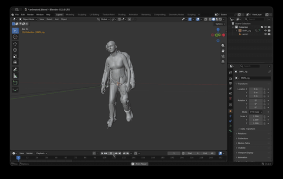
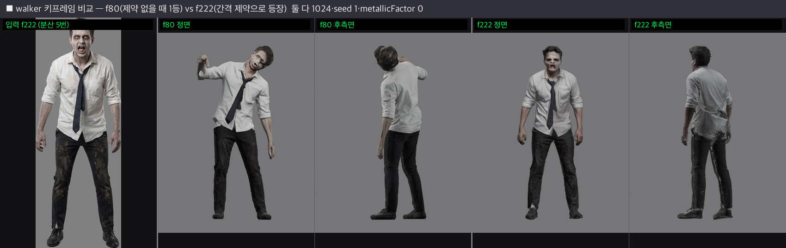
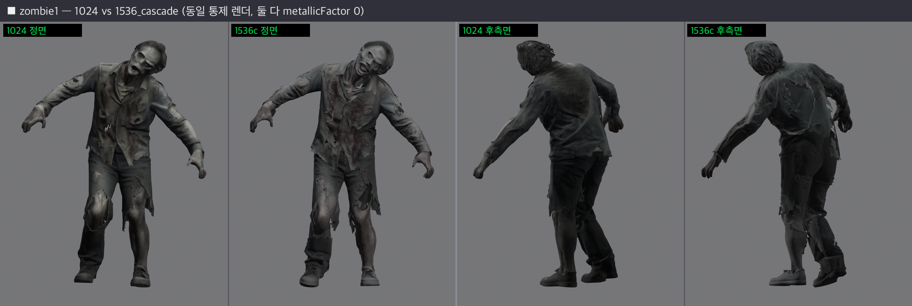
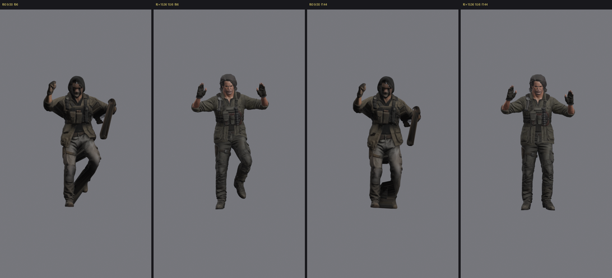
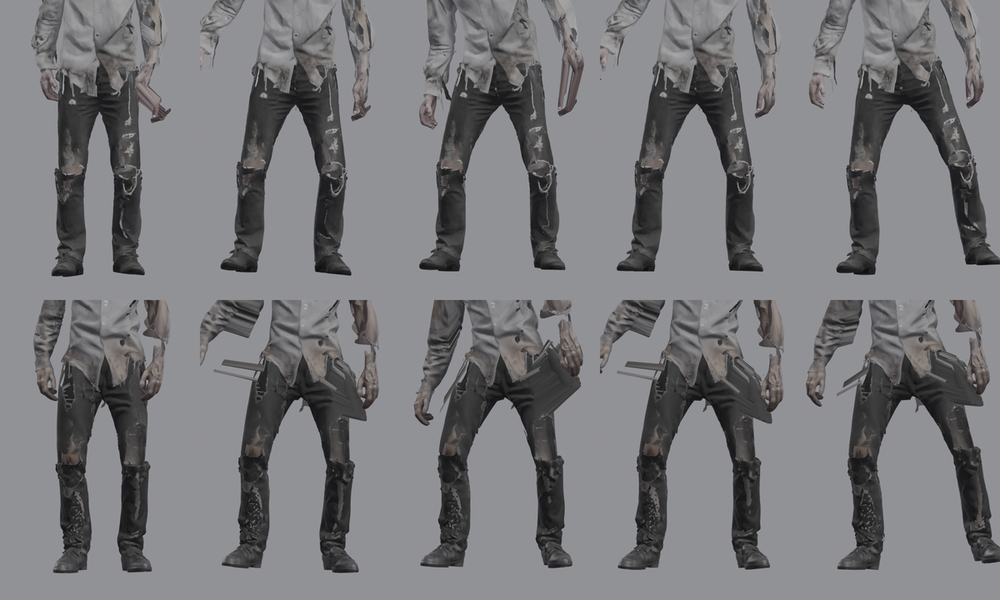
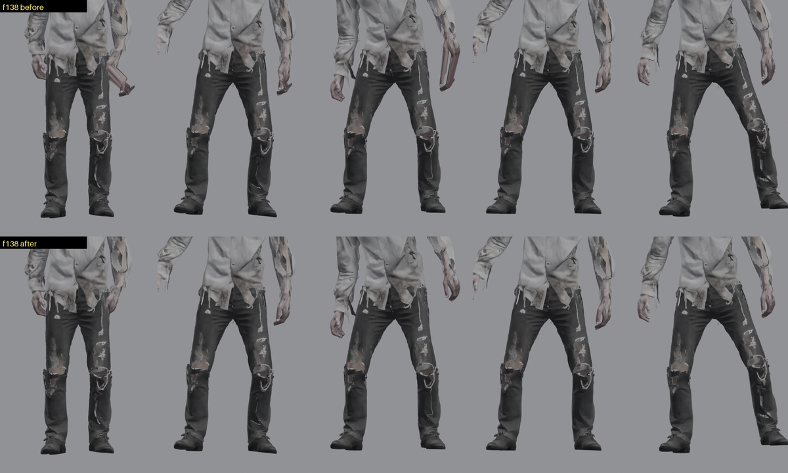

# 좀비 영상 → 유니티 아바타 파이프라인 — 진행 상황 정리

작성일: 2026-08-11 (최종 갱신: 2026-11-20)
레포: [Video2UnityAvatar-Pipeline](https://github.com/chaeee01/Video2UnityAvatar-Pipeline) — 초기 이름 `3DGS-Character-Generation-Pipeline`에서 개명. SuGaR(3DGS) 기반 복원을 설계에서 제외하면서 이름이 실제 구성과 어긋나 정리함.
목표: 좀비 영상 한 편을 입력하면 SAM2로 객체를 분리하고, TRELLIS로 외형을, WHAM으로 동작을 복원한 뒤 유니티 에셋(아바타 + 애니메이션)으로 반입하는 파이프라인 구축.

---

## 1. 최종 파이프라인 설계

기획(v1) 이후 세 차례 개정을 거쳐 확정된 v4 구조. 버전별 구조도는 [`assets/`](assets/)에 있다 ([v1](assets/pipeline_v1.png) · [v2](assets/pipeline_v2.png) · [v3](assets/pipeline_v3.png) · [v4](assets/pipeline_v4.png) — 설계 당시 그림. 현재 구현은 [pipeline_v4_current.png](assets/pipeline_v4_current.png), 2026-11-21).

```
입력 영상
  → G0 입력 검증
  → S0 전처리 (fps/해상도 정규화)
  → S1 PySceneDetect (컷 분할)
  → S2 SAM2 (마스킹·트래킹)
      ├→ G1m 동작용 클립 평가 → S5 WHAM → G3 동작 평가 → S6 좌표변환
      │                                   ├─ pose 전달 ─→ G1a
      │                                   └─ betas 전달 ─→ S4
      └→ G1a 키프레임 재선정 → S3 TRELLIS → G2 메쉬 평가 → S4 SMPL 골격 직접 리깅
  → S7 동작 결합(리타게팅 없음) → G4 최종 통합 평가 → (불합격 시 게이트별 재진입)
```

실행 순서는 **`S2 → S5 → G1a → S3`** 다(2026-10-08 변경). 키프레임을 고르는 데 WHAM pose
(시선각·다리 움직임)가 필요해 동작 경로가 먼저 돈다. 근거는 8절 10/7·10/8 항목.

### 버전별 설계 변경 이력

| 버전 | 핵심 구성 | 전환 사유 |
|---|---|---|
| v1 (기획, 미실행) | SAM2 + SuGaR + WHAM, 가우시안 LOD 렌더링 | 조사 단계에서 SuGaR의 동적 인물 부적합 확인(정적 장면 전제), 최종 목표가 아바타라 배경 3D 불필요 → 착수 전 배제 |
| v2 | Mixamo 자동 리깅 + Unity Humanoid 리타게팅 | 실행 결과 근육 변환에서 관절 동작 소실, 루트 회전만 잔존 → 폐기 (3절) |
| v3 | 품질 게이트(G0-G4)·재시도 오케스트레이터 추가 | 평가·재시도 체계 확립. 리깅 방식은 v2 유지 |
| v4 (현재) | SMPL 골격 직접 리깅, betas 전달로 골격 통일 | 리타게팅 단계의 구조적 제거 (4절) |

각 버전에 공통으로 적용된 결정:
- Unique3D/SF3D → TRELLIS 교체 — MIT 라이선스(상업 이용 가능), 단일/다중 뷰 지원, 유지보수 활발. Hunyuan3D는 한국 지역 사용 제한으로 배제.
- 외형용(G1a)과 동작용(G1m) 평가 분리(v3 이후) — 두 모델이 요구하는 입력 조건이 다르기 때문(외형: 선명한 1프레임 / 동작: 가림 없는 시퀀스).

---

## 2. 인프라 (완료)

| 항목 | 내용 |
|---|---|
| GPU | RunPod 초당 과금. RTX 4090 ($0.69/hr, EU-RO-1) 사용 중 |
| 스토리지 | Network Volume 250GB (초기 100GB → 150GB → 2026-10-08 250GB 증설), EU-RO-1 고정. Pod 간 데이터 공유 통로 |
| 환경 구성 | 도커 이미지 대신 볼륨(`/workspace`)에 micromamba로 직접 설치. Pod을 지워도 환경이 유지되어 디버깅 사이클이 짧음. 명령이 확정되면 Dockerfile로 굳힐 예정 |
| 접속 | SSH(Direct TCP) + VSCode Remote-SSH. Pod 재배포 시 IP/포트 변경됨 |
| 검증 완료 | 볼륨 영속성 테스트 통과 (Pod terminate 후 재배포해도 데이터 유지) |

운영 규칙: Pod은 작업 후 반드시 Terminate(Stop은 스토리지 2배 과금). 모든 Pod은 EU-RO-1에서 배포. 결과 파일은 terminate 전에 맥북으로 회수.

레포별 의존성이 충돌(torch 1.11-2.5, CUDA 11.3-12.4)하여 단일 환경 불가 → 환경 분리 원칙 확정. 현재 볼륨에 wham 환경(python 3.9 + torch 2.0.0+cu118) 구축 완료.

---

## 3. 단계별 검증 결과

### 동작 복원 (WHAM) — 검증 완료
- SMPL/SMPLify 계정 인증 완료. 체크포인트·바디모델 다운로드 완료 (`/workspace/repos/WHAM`).
- `zombie_sample1.mp4`(69프레임, 2.3초)로 실행 → `wham_output.pkl` 생성.
  - pose (69,72), trans (69,3), betas (69,10), verts (69,6890,3)
  - 트랙 1개(단독 추적 성공), 포즈 표준편차 0.44(동작 확실히 포착)
- 검증: SMPL 공식 J_regressor로 관절 추출 → 원본 영상에 2D 재투영 → 좀비 위에 정확히 정합. 재투영 오차가 작음을 육안 확인.
- DPVO 미설치, `--estimate_local_only` 모드(카메라 고정 전제). 카메라 이동 영상이 필요해지면 추가.

### 외형 복원 (TRELLIS) — 검증 완료
- HF Space(무료)에서 좀비 키프레임 1장 → GLB 생성. 뒷면 품질 양호, 얼굴 디테일은 아쉬우나 좀비 컨셉상 허용 범위.
- GLB → Blender → FBX 변환 → Mixamo 자동 리깅 성공(관절 마커 수동 배치).
- Unity Humanoid 매핑 통과(필수 본 15개 전부 매핑).
- 텍스처: FBX 변환 시 누락되는 문제를 GLB 바이너리에서 직접 추출(PNG 2048×2048)하여 해결. Unity Material(URP Base Map)에 연결 완료.

### 유니티 에셋 반입 — 검증 완료
- Mixamo 캐릭터(With Skin) + Mixamo 애니메이션(Without Skin) 구조로 반입.
- 텍스처 입힌 좀비가 Mixamo 좀비 애니메이션으로 정상 동작 확인.
- "외형 + 리깅 + 텍스처 + 동작"이 유니티에서 결합되는 전체 절차 검증 완료.

### WHAM 동작의 유니티 반입 — Mixamo 리타게팅 경로 폐기, v4 로 해결
- **현황 (2026-10-17)**: 아래 리타게팅 경로는 폐기했고 v4(SMPL 골격 직접 리깅, 4절)로 해결됐다 — 8/24 M1 Unity 재생, 10/17 게임팀이 납품 71편의 Unity 반입을 확인했다. 아래는 폐기 당시(8월) 기록이다.
- pkl → FBX 변환 자체는 성공: Blender bpy 스크립트로 SMPL Unity FBX 템플릿에 동작을 구움. Blender에서 팔다리 동작 정상 재생 확인.
- 실패 지점: SMPL 골격(24본) 동작을 Mixamo 골격(65본) 캐릭터로 옮기는 리타게팅. 세 가지 방식을 시도해 모두 실패.

  | 방식 | 구현 | 결과 |
  |---|---|---|
  | Unity Humanoid 리타게팅 | Unity 에디터에서 직접 시도 (스크립트 없음) | 근육(muscle) 변환 과정에서 관절 동작 소실, 루트 회전만 잔존 |
  | Blender 행렬 계산 | `retarget_smpl_to_mixamo.py` — rest 방향 offset 보정 (`offset = src_rest⁻¹ @ tgt_rest`) | 자세 붕괴(팔 엉킴). 리그별 rest 방향 예외 처리 실패 |
  | Blender 컨스트레인트 | `retarget_constraint_based.py` — world space Copy Rotation 후 NLA 베이킹 | 두 리그의 rest가 모두 T포즈라 world space 회전 복사가 성립한다는 전제였으나 마찬가지로 자세 붕괴 |

  스크립트는 `scripts/deprecated/`에 사유와 함께 보존 ([README](../scripts/deprecated/README.md)).
- 결정: 리타게팅 경로 폐기. Mixamo 리깅은 최종 파이프라인에 들어가지 않으므로 이 다리를 고치는 데 추가 투자하지 않음 (→ 4절 v4 전환).

---

## 4. v4로의 전환: SMPL 골격 직접 리깅

v2/v3의 리타게팅 실패가 역설적으로 방향을 확정함 — 골격을 SMPL로 통일하면 리타게팅 문제 자체가 소멸.
v3까지는 외형 경로(Mixamo 65본)와 동작 경로(SMPL 24본)의 골격이 달라 S7에서 반드시 리타게팅을 거쳐야 했다.
v4는 동작 경로의 betas(체형)를 외형 경로의 리깅 단계(S4)로 전달해 양쪽 골격을 SMPL로 통일하고, S7을 리타게팅이 아닌 단순 동작 결합으로 바꾼다.

```
WHAM betas(체형) + 키프레임 pose(자세) → 그 좀비와 같은 자세·체형의 SMPL 메쉬 생성
  → TRELLIS 메쉬와 정렬 (같은 자세이므로 정렬 난이도 대폭 하락 — 핵심 아이디어)
  → 웨이트 전이 (Blender Data Transfer, Nearest Face Interpolated)
  → SMPL 골격을 가진 좀비 → WHAM 동작 무변환 재생 → Unity Humanoid 반입
```

구조도: [pipeline_v4.png](assets/pipeline_v4.png) (설계 당시 그림 — 현재 구현은 [pipeline_v4_current.png](assets/pipeline_v4_current.png): 전달선은 S5 에서 나가는 "SMPL 몸 전달 (체형 betas · 키프레임 자세 반영)" 이고 G3 는 기록 · 안내만 한다) — G3에서 S4로 향하는 `betas 전달` 경로가 v3 대비 유일한 신규 연결이며, 이 한 줄이 리타게팅 단계를 제거한다.

기대 효과: Mixamo(수동, API 없음) 제거로 완전 자동화 가능. UniRig(스키닝 모델 미공개) 의존 불필요.

예상 난관: TRELLIS 형상과 SMPL pose 재현 간 미세 불일치, 팔-몸통 근접부 웨이트 번짐(→ G1a에서 팔 벌린 키프레임 선정이 중요), SMPL 몸체 밖 요소(너덜거리는 옷)의 웨이트 처리.

---

## 5. 입력 영상 조건 (확정)

클립 전체(WHAM): 90프레임(3초) 이상·600프레임 이하, 30fps, 720p+, 인물 1명, 컷 전환 없음, bbox 높이 256px+, 가림 30% 미만, 발끝까지 프레임 안, 카메라 고정.

키프레임(TRELLIS): 클립 내 1장 이상 — 전신, 모션블러 없음, 팔이 몸통에서 떨어진 자세, 정면-3/4 측면.

충돌 해소: "팔을 벌린 채 걷는 좀비"가 양쪽 조건을 동시에 만족. 방위각 45° 이상 차이 나는 양질 프레임 2장 이상이면 다중 뷰 경로.

※ 현재 테스트 영상(69프레임)은 기준 미달. 실제 제작 시 5-10초 클립 필요.

---

## 6. 자산 목록

### 스크립트 (작성 완료)

작성된 스크립트는 모두 **레포 `scripts/`에 통합됨** (폐기분은 `scripts/deprecated/`). 볼륨·맥북에 흩어져 있던 사본을 회수해 단일 출처로 정리했다.

| 파일 | 용도 | 상태 |
|---|---|---|
| setup_wham.sh / run_wham.sh | WHAM 볼륨 설치·실행 | 검증됨 |
| overlay_vis.py | SMPL 2D 재투영 검증 | 검증됨 |
| quick_vis.py | SMPL 스켈레톤 프리뷰 (matplotlib 애니메이션) | 검증됨 |
| wham_to_smplfbx.py | WHAM pkl → 변환용 형식 | 검증됨 |
| smpl_pkl_to_fbx.py | pkl → FBX (bpy) | 변환 성공, 리타게팅 미해결 |
| retarget_smpl_to_mixamo.py / retarget_constraint_based.py | SMPL→Mixamo 리타게팅 (행렬 offset / 컨스트레인트) | 폐기 (`scripts/deprecated/`) |
| generate_smpl_mesh.py | SMPL 메쉬 생성 (키프레임 자세 + T포즈 + 관절 추출) | 검증됨 |
| align_smpl_to_trellis.py | TRELLIS-SMPL 자동 정렬 (bbox 기반 스케일·이동, IoU 검증) | 검증됨 |
| create_smpl_armature.py | SMPL 아마추어 생성·바인딩 (관절 좌표계 자동 보정) | 검증됨 |
| glb_tex.py | GLB 텍스처 추출 | 검증됨 |
| check_tex.py | Blender 텍스처 진단 | 검증됨 |
| setup_trellis.sh / run_trellis.py | TRELLIS 로컬 설치·실행 | 미실행 (Space로 대체 중), 레포 미반입 |
| gate1-3, orchestrator, config.yaml | 품질 게이트·자동화 골격 | 코드만 존재, 미연결. 자리는 `pipeline/qa/`에 확보 |

### 데이터 (Network Volume + 맥북)
- `/workspace/data/05_wham/zombie_sample1/` — wham_output.pkl, overlay.mp4 등
- 맥북: wham_output.pkl, zombie_anim2.fbx(동작 정상), GLB 원본, zombie_tex_0/1.png(구 버전 출력명, 현재는 `{glb명}_tex_N.png` 규칙), Mixamo FBX 2종
- Unity 프로젝트: 텍스처 연결된 좀비 + Mixamo 애니메이션 작동 상태

### 도구·계정
- Blender 5.2(FBX 임포터 조명 버그 있음) + 4.5 LTS(우회용) 공존 설치
- SMPL/SMPLify 계정(인증 완료), HF 계정, Mixamo(Adobe) 계정, RunPod($49+ 잔여)

---

## 7. 리스크·이슈

- **SMPL 라이선스**: 무료 버전은 비상업 연구용. 유니티 에셋 상용 배포 시 Meshcapade 상업 라이선스 필요. 프로젝트 성격 확정 전 반드시 검토.
- **SMPL prior의 좀비 자세 왜곡**: 짧은 테스트에서는 동작이 보존됐으나, 극단적 자세(기어가기, 관절 꺾임)에서 정상 자세로 회귀할 가능성. 실전 영상으로 추가 검증 필요.
- **Blender 5.2 FBX 임포터 버그**(조명 객체 파싱 실패) — 4.5로 우회 중.
- 리깅 자동화의 대안(UniRig)은 스키닝 모델 미공개 상태. SMPL 직접 리깅이 실패할 경우의 백업 부재.

---

## 7.5. 알려진 불일치 · 결정 기록 (2026-09-22)

발표 준비 중 문서와 코드가 어긋난 지점 12건을 찾아 정리했다. 전수 목록과 근거는
[2026-09-22 불일치 정리](2026-09-22_발표준비_중_발견한_불일치.md)에 있고, 여기에는
**결정된 것과 남은 것**만 적는다.

### 결정 4건

1. **평균 betas 경로 — 제거하지 않는다.** `generate_smpl_mesh.py` 의 `mean_betas` 는
   `smpl_tpose.obj` 와 `joints["tpose"]` 에만 쓰이고 리깅 본류는 WHAM 의 프레임 f 정점을
   그대로 쓴다(현재 미소비). 죽은 코드로 지우는 대신 **EH-211(T포즈 rest 리그 재생성)의
   입력 후보**로 명기해 둔다. 본류 연결은 M2 전에는 하지 않는다 — 검증된 경로를 흔든다.
2. **FBX 단위 — export 에서 미터를 복원한다.** `global_scale = 1/정렬스케일`(약 1.70).
   다만 **구현은 M2 E2E 이후**다. 그전까지는 RUNBOOK 6절에 적은 대로 정규화 단위로 내보내고
   Unity 에서 수동 보정하는 것이 현행 절차다.
3. **관절-TRELLIS 표면 거리 — G2r 후보로 등록.** 현재 G2r 의 관절 거리는 SMPL_body 기준이라
   "뼈가 좀비 메쉬 안에 있는가" 를 보지 못한다. **W5 목요일(9/24) 게이트 작업에서 실측한 뒤
   임계를 정한다.**
4. **max-dist 비교 실험 — M2 이후 백로그.** 0.08 의 선정 근거가 커밋·주석·문서 어디에도 없다.
   0.05 / 0.08 / 0.12 를 1차 수신률·폴백률·오대응 육안으로 비교한다.
   같은 백로그에 **`--max-dist` help 문자열 추가**도 둔다 (코드 수정이라 이번 문서 정합에서는
   제외했다). 승인된 문구는 그대로 쓴다:

   ```python
   help="1차 정밀 전이 반경 (정렬 공간 단위, 신장 약 1.0 기준). 근거 미기록 — 0.05/0.08/0.12 비교 예정"
   ```

### 에셋 현황 (파이프라인 검증 이력)

| 대상 | 도달 단계 |
|---|---|
| zombie1 | **관통 완료** — 외형 + 리그 + 동작 + Unity |
| walker · stalker · dog | 메쉬 + 텍스처 (동작 미검증) |
| listener | SAM2 실패 — 층진 의상으로 단일 포인트 선택 불가, 다중 포인트 대기 |

좀비 3·4호와 플레이어 캐릭터 4종은 **게임 팀 요청 별도 산출물**(이미지 입력, 메쉬 + 텍스처만)이며
파이프라인 검증 이력이 아니다.

### 최종 발표 대비 메모

중간보고서는 제출본이라 고치지 않는다. **최종 발표·보고서 준비 시 아래를 반영한다.**

- **"좀비 4종 관통" 은 과대 기술이다.** 위 표대로 관통은 zombie1 하나이고, 3종은 외형까지,
  1종은 SAM2 에서 막혔다.
- **웨이트 전이 94.7% 표기는 단계 누락이다.** 1차 93.2% 와 폴백 1.5% 만 적어 합이 94.7% 로
  보이는데, 실제로는 BFS 전파 5.3% 가 빠진 3단 구조이고 합은 100%(무배정 0%)다.
- **정렬 스케일 0.589 의 "3회 재현" 을 정렬 정확도 근거로 쓰지 않는다.** 정규화의 결과라
  인간형이면 당연히 비슷하게 나온다. 정확도는 IoU 와 웨이트 1차 수신률로 말한다.
- **"betas 와 pose 로 SMPL 메쉬 생성"** → "WHAM 이 출력한 키프레임 시점 SMPL 메쉬 사용".
- **"WHAM pose 를 그대로 적용"** → "골격 간 변환 없이 적용. 구현은 기준 프레임 대비 상대 회전".

---

## 8. 최근 작업

<!-- 항목은 날짜 오름차순. 새 항목은 맨 아래에 추가 -->

- **2026-08-13 — 레포 정리 완료**: 브랜치 통합(SAM2 노트북 6개를 main으로 merge 후 원격 브랜치 4개 삭제), 구조 재편(`docs/` `notebooks/sam2/` `scripts/` `pipeline/qa/` `docker/`), 흩어져 있던 스크립트 8종 회수, 레포 개명 및 README 갱신.
- **2026-08-18**: TRELLIS-SMPL 정렬 검증 통과. 자세 일치 육안 확인 — 상체 기울기·스트라이드·팔 위치 대응, 어긋남은 의복 두께 수준. 파라미터: Rot X -90°, Scale 0.588 (TRELLIS 1.001/SMPL 1.702), Location Y -2.58.

<p align="center"></p>

- **2026-08-20**: 정렬 자동화 검증 — 자동 계산이 수동 측정 재현 (scale 0.5884, offset Y -2.629, bbox IoU 0.717). IoU가 정렬 게이트 판정 지표 후보로 확보됨.

| 항목 | 수동 측정 (08-18) | 자동 계산 (08-20) | 판정 |
|---|---|---|---|
| 스케일 | 0.588 | 0.5884 | 일치 |
| 이동 Y | -2.58 | -2.629 | 일치 (육안 측정 오차 수준) |
| 이동 X/Z | — | 0.013 / 0.021 | 육안으로 못 잡던 미세 오프셋 보정 |
| 겹침 | 육안 확인 | IoU 0.717 | 기준(0.5) 상회 |

이미지는 08-18 수동 정렬 캡처와 시각적으로 동일하여 생략. 정렬 상태는 `~/Desktop/aligned.blend` 참조.

### 설계 판단 두 가지

**웨이트 바인딩**: SMPL 공식 LBS 웨이트는 볼륨의 SMPL_NEUTRAL.pkl에만 있어 로컬 작업에서는 Blender Automatic Weights로 바인딩. SMPL 몸체는 토폴로지가 균일해 자동 웨이트 품질이 실용 수준. 스크립트에 `--weights` 옵션을 두어 추후 공식 웨이트(npy)로 교체 가능하게 설계.

**관절 좌표계 자동 보정**: joints json(OBJ 원본 좌표)과 정렬된 메쉬의 좌표계 차이를 수동으로 추정하지 않고, 후보 회전 4개를 시험해 관절-메쉬 최근접 거리 최솟값을 자동 선택. 리타게팅 단계에서 축 추정 실패를 세 차례 겪은 데 대한 재발 방지 설계.

| 후보 회전 | 평균 관절-메쉬 거리 | 판정 |
|---|---|---|
| identity | 0.0279 | ✅ 선택 |
| X+90 | 3.2521 | 탈락 |
| X-90 | 3.2275 | 탈락 |
| X180 | 5.0325 | 탈락 |

선택 후보와 차순위가 100배 차이로 판정 명확. 거리 0.028은 관절 중심과 피부 표면 간 해부학적 간격 수준으로, 관절이 메쉬 내부 정위치에 배치됨을 의미.

**포즈 시험 통과**: L_Shoulder·R_Shoulder·R_Knee 회전 시 해당 부위 메쉬가 관절 경계에서 분리되어 자연스럽게 변형됨을 육안 확인.

<p align="center"></p>

- **2026-08-21**: 캐릭터 에셋 4종 완성 (외형+리깅+텍스처, 애니메이션 없음). 좀비 파이프라인의 외형 경로가 신규 입력 4종에 그대로 재현됨. Mixamo 텍스처 소실 → GLB 추출 재연결 패턴도 동일.

<p align="center"></p>

- **2026-08-24**: 4단계 통과 — WHAM 69프레임이 리깅 좀비에서 원본 영상과 동일 패턴으로 재생. 웨이트 전이는 3단 방식(정밀 전이 + BFS 전파 + 직선거리 폴백) 확정. 발견: 찢어진 옷자락은 본체와 분리된 고립 섬(5.4만 정점)이라 자동 전이의 구조적 예외 — 별도 과제로 분리, G1a/G2 게이트에 부유 지오메트리 플래그 요건 추가.

<p align="center"></p>

- **2026-08-24**: M1 달성 — Unity 반입 완료. Generic Rig로 임포트(rest가 T포즈가 아니므로 Humanoid 근육 변환 회피), Animator 재생으로 원본 영상 동작 재현 확인. 수동 파이프라인 전 구간(영상→SAM2→TRELLIS/WHAM→SMPL 리깅→Unity) 관통.
- **2026-08-25**: SAM2 RunPod 이전 완료 — Colab 의존 제거, 전 단계가 볼륨+레포 체계로 통일. 발견: 테스트 영상 실측 24fps, 키프레임 자동 후보에 수동 선택 프레임(f7) 포함 — G1a 설계 참고.
- **2026-08-27**: 좀비 영상 4종 소싱 완료 — Gemini 생성으로 확보 (저작권·초상권 무결). 스펙: 4종 동일 규격 240프레임/24fps/720p/10초, 전 항목 합격. 내용 검증: 1인·컷 없음·팔 벌린 키프레임·카메라 고정·AI 아티팩트 없음 육안 확인. 미결 2건: ①AI 생성 영상의 WHAM 적합성 미검증 — W2 좀비 2호 리허설이 첫 시험, 실패 시 직접 촬영 폴백 ②720p는 하한 — TRELLIS 품질 확인 후 필요시 1080p 재생성.
- **2026-08-28 — W1 주간 마무리 (M1 달성)**: 수동 파이프라인이 영상→에셋 전 구간을 관통했다. M1 체크리스트 다섯 항목(WHAM 동작 Unity 재생 · 통합 데모 GIF · main 머지 · runbook · SAM2 레포 반입)이 8/27에 모두 충족되어 목표 8/31보다 4일 앞섰다. 핵심은 v4의 SMPL 골격 직접 리깅이 실증된 것으로, 정렬 IoU 0.717 · 관절-메쉬 거리 0.028 · 웨이트 무배정 0%로 리타게팅 없이 WHAM 동작이 재생됐다. SAM2가 Colab에서 볼륨으로 옮겨오면서 전 단계가 레포+볼륨 체계로 통일됐고, 입력 영상 4종도 확보했다. W2(9/1-9/5) 목표는 자동화의 전제 조건인 **TRELLIS 로컬 설치**(Space 의존 제거)와 스크립트 CLI·경로 규약 표준화, 그리고 runbook 리허설을 겸한 좀비 2호 수동 제작이다. 2호 제작이 AI 생성 영상의 WHAM 적합성을 가리는 첫 시험이기도 하다.
- **2026-09-02**: TRELLIS 로컬 설치 검증 완료 (W2 화 목표) — 볼륨 micromamba trellis 환경(py3.10 / torch 2.4.0+cu121 / CUDA 툴체인 내장), 스모크 111s · VRAM 9.7GB · Space 품질 동등. Space 의존 제거. 실질 생성 26s. 발견: 설치 병목은 볼륨 I/O(36분). TRELLIS.2 전환 검토는 백로그(P3). 검증 중 발견·수정 2건 — [8/8] 검증 루프가 `__version__` 없는 패키지(utils3d)에서 죽는 버그, transformers 무핀 설치(→ `<5` 고정).
- **2026-09-03**: 경로 규약 확정 + 스크립트 CLI 표준화 (W2 목) — `data/` 번호를 실행 순서대로 재배열(`05_wham`→`04_wham`, `06_smpl_mesh`→`05_smpl_mesh`, `01_pre`·`06_rig`·`07_unity` 신설)하고 `docs/CONVENTIONS.md`·`config.yaml`을 신규 작성했다. 폴더 번호와 S번호는 독립된 식별자로 못박았다. 스크립트 6건의 인자를 규약에 맞췄고(출력 `--out` 통일, 샘플명 기본값 제거, `--smpl`/`--frame` 이름 충돌 해소), RUNBOOK을 신번호와 TRELLIS 로컬 절차로 갱신했다. 발견: `pipeline/qa/`의 게이트·오케스트레이터·config.yaml은 **문서 기록과 달리 실물이 없었다**(맥북에도 없음 확인) — W4 게이트는 검증된 스크립트의 판정 로직(정렬 IoU, 웨이트 무배정률, 키프레임 후보 점수, 재투영) 기반 신규 설계로 간다.
- **2026-09-04 — 좀비 2호 리허설 (부분 달성)**: S2-S5 + 5-1 관통, AI 생성 영상의 WHAM 적합성 확정.
  리깅 사슬(5-2-6)은 이월. 환경 표류 사건과 품질 이슈 상세는 아래를 편다.

<details><summary>2026-09-04 상세 — 실측치 · 환경 표류 사건 · 품질 이슈</summary>

- **2026-09-04 — 좀비 2호 리허설 (부분 달성)**: zombie1으로 S2-S5 + 5-1을 관통했다. SAM2 마스크 240/240, TRELLIS 87s(정점 5,307/면 7,276, peak VRAM 9.79GB), WHAM 49s(트랙 1개, 포즈 표준편차 0.4162), SMPL 메쉬 생성까지 완료. **AI 생성 영상의 WHAM 적합성이 확정**돼 8/27 미결 ①을 종결했다 — overlay 육안 판정에서 스켈레톤이 전 구간 정합했고 손목·손끝만 가끔 이탈(WHAM 말단 관절 특성, 허용). 판정 기준 "몸통·대관절 엄격, 말단 관대"를 G3 설계 메모로 남겼다. 리깅 사슬(5-2-6, 맥북 Blender)은 이월. 어긋남 7건을 기록해 RUNBOOK 5곳과 스크립트 2건을 고쳤다.

  **환경 표류 사건**: WHAM이 첫 실행에서 `torchvision.ops.nms` C++ ops 로드 실패로 죽었다. 원인은 **8/5에 pytorch3d를 micromamba로 수동 설치하면서 torch가 2.0.0 → 1.12.1로 조용히 다운그레이드**된 것이다. `setup_wham.sh`가 명시한 조합(torch 2.0.0 + torchvision 0.15.1)에서 이탈했는데, `nms`는 YOLO 검출 경로에서만 쓰여 8/5·8/18 실행에서는 드러나지 않았다. 복구 과정에서 두 가지를 더 밟았다 — ① `pip install --force-reinstall`이 **numpy를 1.22.3 → 2.0.2로 끌어올려** torch·scipy의 numpy 1.x ABI가 깨졌고(핀 복원으로 해결), ② conda가 지운 `pyyaml`의 **pip 메타데이터가 고아로 남아** `pip install pyyaml`이 "이미 설치됨"으로 건너뛰었다(`--force-reinstall --no-deps`로 해결). 복구 후 검증 5종(버전/import/nms/YOLO 실검출/SMPL 로드) 전부 통과. `run_wham.sh`가 파이프 종료 코드 문제로 실패를 "완료"로 보고하던 버그도 이날 발견·수정했다(pipefail + 산출물 존재 검사). **교훈: `setup_wham.sh`·`setup_sam2`에도 `setup_trellis.sh`의 [8/8] 급 import·조합 검증 단계가 필요하다.** 스크립트 밖 수동 설치가 환경을 표류시키고, 그 표류는 특정 코드 경로를 밟기 전까지 드러나지 않는다.

  **품질 이슈(미해결)**: TRELLIS 결과의 머리가 부풀고 뒤통수가 뭉개졌다. `input_0.png`는 깨끗해 마스킹 문제가 아니며, 단일 뷰의 뒷면 상상 한계 + 720p(bbox 682px → 518² 다운스케일)로 인한 얼굴 정보 부족으로 추정한다. 1080p 재생성 비교 시험은 별도 카드. **G1a/G2 설계 메모: TRELLIS용 bbox 높이 하한은 WHAM 기준(256px)보다 높아야 한다.** 또 하나 — SAM2 키프레임 topk 5장이 **연속 프레임(f227-f231)에 몰려** 다중 뷰로 쓸 수 없었다. G1a는 후보를 구간별 최고점으로 뽑아야 한다.

</details>

- **2026-09-07 — 좀비 2호 완주 + 리허설 종료**: Pod 재검증 2건(`run_wham.sh` pipefail·산출물 검사, `generate_smpl_mesh.py` 샘플명 유추)이 통과해 두 커밋의 "Pod 검증 전" 꼬리표를 해제했다. 리깅 사슬을 맥북에서 전 구간 관통했다 — **정렬 bbox IoU 0.797**(기준선 0.717), **관절-메쉬 거리 0.0293**(기준선 0.028, 차순위와 90배 차이로 identity 선택), **웨이트 무배정 0%**, 240프레임 베이킹 후 Unity Generic Rig 반입·재생까지 확인해 **2호 재현에 성공**했다. S6 좌표 관례도 종결 — Unity 기본 카메라 기준 후면을 향하는 것은 월드 배치 관례이며 걷는 방향과 몸 방향이 일치함을 확인했다(루트 회전 오차 의혹 해소). 9/4에 확정한 AI 생성 영상 적합성 판정의 시각 근거도 자산으로 반입했다([WHAM 재투영 오버레이](assets/zombie1_wham_overlay.png)).

  **고립 섬 비재현**: zombie1의 TRELLIS 메쉬는 연결 요소가 148개로 보였으나 거리 병합(1e-4) 시 **1개**로 합쳐졌다 — 전부 glTF 임포트의 UV 심 정점 분리였고 물리적 고립 섬은 0개다. zombie_sample1의 "찢어진 옷자락 5.4만 정점 고립 섬"은 재현되지 않았다. 다만 그쪽은 Space 출력(고밀도)이고 이쪽은 `simplify 0.95`(5,307 정점)라 직접 비교는 성립하지 않는다 — **"이 메쉬 밀도에서는 나타나지 않는다"**가 정확하다. G2의 부유 지오메트리 플래그는 simplify 값 조건부로 설계한다.

  **TRELLIS 1 vs 2 동일 입력 실증** ([비교 이미지](assets/trellis1_vs_2_f228.png)): 같은 `key1_f00228`을 Space(microsoft/TRELLIS.2 공식)에 넣은 결과와 로컬 1세대 결과를 같은 카메라·조명으로 렌더해 대조했다. **Q1 재진단** — ① 얼굴 뭉개짐은 **입력 해상도 기인**(2세대도 동일하게 나타남 → 720p 한계 확정, G1a/G2의 bbox 높이 하한 상향 근거) ② **뒤통수·손목 부풀음은 1세대 iso-surface의 닫힌 표면 전제가 원인**(2세대 O-Voxel에서 사라짐). 부풀음과 고립 섬의 공통 뿌리가 여기 있다. 이 건은 **EH-218로 이관**하고 우선순위 상향을 제안한다. 교란 변수: 두 메쉬의 정점 수가 5,307 vs 92,673으로 17배 차이나(로컬만 simplify 0.95 적용) 각진 면 차이는 밀도 탓일 수 있다 — `simplify 1.0` 통제 실험이 필요하다.

  **어긋남 8-11**: ⑧ `convert_wham_npz.py`가 출력 폴더를 만들지 않아 규약 경로 첫 실행에서 죽음 ⑨ RUNBOOK 5-2에 육안 확인 수단 없음(캡처 스크립트 `render_align_check.py` 신규) + 5-3 포즈 시험이 웨이트 전이 전이라 대상이 안 움직임(5-4로 이동) ⑩ `transfer_weights.py`의 BFS가 UV 심에서 끊겨 표면상 이어진 곳도 직선거리 폴백으로 떨어짐(zombie1 3.0%, 무해 — 기록만) ⑪ `export_unity_fbx.py` 안내가 Humanoid로 RUNBOOK의 Generic과 반대. ⑧⑨⑪ 수정 완료, ⑩은 CONVENTIONS 미정리 목록에 기록.

<p align="center"><br>
<sub><b>1세대(TRELLIS 1) 리깅 재생 (9/7)</b> — 원본 영상(좌) vs 리깅 좀비(우)</sub></p>

- **2026-09-09 — TRELLIS.2 전환 완료**: 1세대에서 2세대로 갈아끼우고 zombie1 을 영상→Unity 전 구간 재관통했다. 이틀(9/8-9/9)에 걸친 작업이고, 라이선스 확인 → 환경 구축 → 스모크 → 통제 실험 → 관통 순서로 진행했다.

  **라이선스 관문**: 전환 착수 전 30분짜리 확인이 3-4일의 방향을 갈랐다. TRELLIS.2 는 코드 LICENSE·모델 카드 모두 **MIT**(sell 포함)로, 프로젝트 페이지의 "research purposes" 문구는 페이지 자료 대상 일반 고지이며 산출물에 첨부된 라이선스가 우선한다고 판단해 분기 A(상용 가능)를 택했다. 전환 과정에서 **DINOv3**(Meta 자체 라이선스, royalty-free·고지 준수 의무)와 **RMBG-2.0**(CC BY-NC, 상업 불가)이 새 의존으로 드러났다. RMBG 는 알파 있는 입력에서 런타임 미호출이라 제거 가능하고(소스 `preprocess_image()` 근거), **실제 상용화 병목은 여전히 SMPL 단독**이다 — Meshcapade Commercial 등급 구매(Micro 연 €1,500)가 실행 항목이다.

  **설치 — 수정 3건, 전부 우리 스크립트 결함**: ① flash-attn 이 prebuilt 휠을 받아 놓고 pip 캐시로 `os.rename` 하다 죽었다. 받은 위치(`/tmp`, 컨테이너 로컬)와 `PIP_CACHE_DIR`(`/workspace`, MooseFS)가 다른 디바이스라 **EXDEV**(Errno 18)다 — 1세대에서 얻은 "캐시를 볼륨에 두라"가 여기서는 역효과였다. 휠 URL 직접 설치로 27초에 해결. ② `build_ext` 가 배포명을 import 명으로 겸용해 `nvdiffrec`(실제 `nvdiffrec_render`)와 `FlexGEMM`(실제 `flex_gemm`)의 **성공한 빌드를 실패로 판정**했다. ③ `transformers` 5.16.1 에서 `DINOv3ViTModel` 구조가 `model.model.layer` 로 중첩돼 `AttributeError`. TRELLIS.2 개발기(2025-11-12) 최신 4.x 인 **4.57.3 으로 핀**을 복원했다 — 무핀 upstream 은 작성 시점 버전의 암묵 전제다.

  **게이트 4연속 사건**: DINOv3 게이트 → RMBG 게이트 → transformers 구조 변경 → EXR 코덱 부재. 네 번 모두 스모크 직전·직후에 막혔고 각각 다른 층위(접근 권한 / 접근 권한 / API 버전 / 빌드 옵션)였다. 외부 모델을 갈아끼우는 작업은 모델 자체보다 **주변 의존의 층위별 관문**이 비용을 만든다는 것이 이번 전환의 실물 교훈이다.

  **스모크 실측 (RTX 4090)**: 512 → 로드 155s / 생성 22s / GLB 20s / 총 196s / **peak VRAM 2.62GB**. 1024 → 로드 158s / 생성 53s / GLB 51s / 총 262s / **peak VRAM 3.13GB**. 해상도를 2배로 올려도 VRAM 은 0.5GB 만 늘었다 — `low_vram=True` 가 모델을 CPU 에 두고 필요할 때만 올려 **VRAM 이 해상도의 병목이 아니다**. 비용은 시간에 붙는다. **A100 없이 4090(24GB)으로 충분**함이 확정됐다.

  **통제 실험 — 논증 완결**: 9/7 비교에서 남은 교란 변수(정점 5,307 vs 671,643, 약 127배)를 제거하기 위해 1세대만 단순화를 끄고(`--simplify 0.0`) 같은 입력·같은 seed 로 재생성했다. 정점이 **22배(117,223)** 로 늘었는데도 뒤통수는 여전히 매끈한 덩어리였고 찢어진 옷의 구멍·얇은 자락이 나타나지 않았다. **부풀음·뭉개짐은 밀도가 아니라 표현 체계 탓**이다 — 1세대 iso-surface 의 닫힌 표면 전제가 열린 경계를 표현하지 못하고, 2세대 O-Voxel 이 이를 해결한다는 가설이 실증됐다.

  **관통 수치 (2세대 512, 1세대 기준선과 대조)**: 정렬 스케일 **0.5892**(기준선 0.5906) — 서로 다른 생성 모델·127배 밀도 차이에도 0.24% 안에서 일치해 **G2r 의 스케일 상수 0.55-0.65 가 세대 불변**임이 3번째로 검증됐다. bbox IoU 0.743(기준선 0.797, 2세대는 열린 자락 탓 소폭 하락이 정상). 관절-메쉬 거리 **0.0292**(기준선 0.0293). 웨이트 전이는 **27초**에 무배정 0%, 1차 수신률 78.6% → **93.2%**, 직선거리 폴백 3.0% → **1.5%** — **고밀도 메쉬가 리깅에 부담이 아니라 이득**이라는 역전 실측이다. 어긋남 #10(BFS 의 UV 심 단절)도 고밀도에서 실질 영향이 자연 완화된다. FBX 43.2MB(1세대 3.9MB), 정점 671,643.

  **Q2′ (미해결, 허용)**: 찢어진 옷의 부유 조각이 어깨 회전 시 **부채꼴로 늘어난다**. 1세대 Q2(자락이 팔을 따라감)와 같은 뿌리(부유 조각의 단일 본 리깅 한계)이나 증상이 변형됐고 1세대보다 덜 두드러진다. 좀비 컨셉상 허용. 개선안(조각별 지배 본 통일 후처리, 엔진 천 물리)은 백로그이며 **입력 해상도(EH-220)와는 무관**하다.

  **잔여 이월**: 1536_cascade 실측(A100 재고 시), 1024 의 metallic 이 1.0 으로 나오는 건 규명(512 는 정상), 표준 해상도 결정.

<p align="center"></p>

<p align="center"></p>

<p align="center"><br>
<sub><b>2세대(TRELLIS.2) 리깅 재생 (9/9)</b> — 원본 영상(좌) vs 리깅 좀비(우)</sub></p>

- **2026-09-10 — 4샘플 일반화 검증 (720p)**: 지금까지 zombie1 한 샘플로만 관통했기에, 샘플이 늘었을 때 절차·수치가 어디까지 버티는지 처음 측정했다. 결론은 **가정의 절반이 깨졌다**는 것이다.

  **입력이 1080p 가 아니었다**: EH-220 은 "1080p 에서 얼굴이 뭉개지지 않는가" 가 핵심 질문이었는데, 받은 4종(listener·walker·stalker·dog)이 전부 **1280x720** 이었다. 기존 zombie1 과 해상도가 같아 대조가 성립하지 않는다. Gemini 웹 UI 가 1080p 를 명시해도 720p 로 강제 출력한다는 것을 확인했고(업스케일 흔적 없는 네이티브 720p), 업스케일 대체는 기각했다 — 생성된 디테일이 실험 질문 자체를 오염시킨다. **세션 목적을 "파이프라인 일반화 검증" 으로 재정의**하고 진행했다. 오늘 결과가 향후 1080p 확보 시 대조군이 된다.

  **S2 SAM2 — 4종 중 2종 실패(50%)**: 실패 원인은 한 줄로 설명된다. **열린 겉옷 안으로 보이는 속옷을 찍으면 그 조각만 잡힌다.** walker(흰 셔츠가 최외곽)와 dog(층진 의상 없음)는 통과했고, stalker 는 겉옷으로 좌표를 옮겨 통과했다. **listener 는 속옷(파자마 3.00%)·겉옷(가운 6.04%)·얼굴(0.81%) 세 좌표 모두 부분 선택**이라 오늘 배치에서 제외했다. 단일 포인트로 층진 의상 인물의 전신 마스크를 얻을 방법이 없다는 실증이며, 오늘 가장 값진 데이터다.

  **S3 TRELLIS.2 512 — 3종 생성**: walker 247s / stalker 183s / dog 222s, 전부 무사고. 육안 판정은 walker 통과(3종 중 최상), stalker 는 형상 정상이나 metallic 열화로 표면 디테일 소실, dog 는 형상 합격에 번들거림은 G4 로 이월. 기는 자세의 후면·찢어진 옷 구현이 우수했다.

  **metallic 규명 종결**: "1024 경로의 구조적 결함" 이라는 전제가 틀렸다. **stalker 가 512 에서 254.7 로 포화**해 해상도만의 문제가 아님이 드러났고, walker 를 입력 고정한 채 해상도만 바꿔(512 0.2 → 1024 143.4) **해상도도 독립 변수**임을 확인했다. 결론은 **둘 다 변수** — 512 는 입력 재질감을 추종하고, 1024 는 metallic 을 계통적으로 끌어올린다(균일 상수에 가깝다). 코드상 512 만 별도 텍스처 모델(`tex_slat_flow_model_512`)을 쓰고 1024·cascade 계열은 모두 1024 모델을 공유한다.

  **게이트 설계 재료 5건**: ① 마스크 지표 3종(커버리지 — 성공 9-12% vs 실패 0.5-3.0%, 빈 프레임 수, 조각 수)이 실패 탐지에 유효 ② G1a 최소 간격 20프레임 필요 — 후보 뭉침이 **6샘플 전수 재현**(zombie1 227-231 연속)되고 분산 비용은 0.0011-0.0209 로 사실상 0 ③ G1a 점수에 자세 항 필요 — 현 점수가 bbox 크기·채움의 대리 지표라 "가장 펼친 자세" 를 고르는데 그것이 단축·자기가림으로 단일 뷰 재구성에 최악이다(walker top5 5장이 전부 팔 뻗은 같은 순간이라 **후보 전멸**) ④ G2 metallic 게이트 — B 평균 > 32 불합격, 4샘플 중 2건이 걸린다 ⑤ 게이트 임계값은 절대값이 아니어야 한다.

  **검증 중 발견·수정 4건**: ⓐ 오버레이 생성기를 고치며 `python3 ... > 같은파일` 로 리다이렉션해 파이썬이 읽기 전에 파일이 비워졌다(1바이트) ⓑ `candidates.json` 의 키가 `topk` 인데 `candidates` 로 읽어 후보가 빠졌다 ⓒ 첫 프레임 추출에서 `$n_f0` 가 한 변수로 해석돼 4장이 한 파일에 덮어써졌다 ⓓ **Pod 레포를 `git pull` 하지 않아 구버전 `run_trellis2.py` 가 돌았다** — `params.json` 의 정점·면 수가 `to_glb` 이전 값으로 기록됐다(9/11 에 발견·정정).

<p align="center"><br>
<sub><b>4샘플 외형 대조 (9/10)</b> — 입력 키프레임 / 생성 정면 / 생성 후측면</sub></p>

<p align="center"><br>
<sub><b>metallic 보정 시연 (9/10)</b> — metallicFactor 1.0 → 0.0, 밝기는 2배지만 디테일은 안 돌아온다</sub></p>

- **2026-09-11 — 표준 해상도 1024 확정**: 금요일 결정 안건이었는데, **수치가 준비한 답을 육안 관찰이 뒤집었다.** 과정 자체가 기록할 가치가 있다.

  **의사결정 과정**: ① 목요일까지 모은 수치(metallic 4건·시간 분산·정점 수)로는 "512 안전, 1024 는 metallic 위험" 이 자연스러운 결론이었다 ② 사용자가 산출물을 육안 재검토해 **512 의 결함 2건**(바지 구멍 안 표면 이상, 색 표백)을 발견했다 ③ 재현 확인에 들어가 **둘 다 실재**함을 확인했고, 기전은 관찰과 달랐다 ④ 결정 구도가 "512 안전 vs 1024 품질" 에서 **"512 형상 융합(관리 수단 없음) vs 1024 metallic(방어 체계 있음)"** 으로 재편됐고 결론이 뒤집혔다.

  **① 형상 — 누락이 아니라 융합**: 위상을 UV 심 병합 후 재니 512·1024 **둘 다 수밀**이었다(경계 에지가 전체의 0.03%, 최대 구멍 7에지 핀홀). 표면이 없어진 게 아니다. 허벅지 높이 수평 단면의 닫힌 윤곽 수가 **512 는 4개, 1024 는 19개** — 512 에서 바지와 허벅지가 한 껍질로 합쳐진다. 찢어진 구멍이 깊이 없는 텍스처 무늬가 되는 것이다.

  **② 색 — 표백 확인**: 통제 렌더의 인물 채도로 zombie1 입력 12.4% → **512 3.8%(−69%)** / 1024 12.5%(입력과 일치), walker 입력 9.4% → **512 4.1%(−56%)** / 1024 7.1%. 1024 가 어두운 것은 metallic 탓이고 색 자체는 정확하다. **baseColor 텍스처 아틀라스로 재면 표백이 없는 것처럼 보인다** — 셰이딩 전 값이라 대리 지표로 쓰면 안 된다(실제로 한 번 잘못 판정했다).

  **1024 관통 (`--force-dielectric` 실전 첫 적용)**: 정렬 스케일 **0.5914** — 상수 0.55-0.65 의 **5번째 검증**. bbox IoU 0.760(512 는 0.743), 관절-메쉬 거리 0.0293. 웨이트 전이는 1차 수신률 **93.2% 로 512 와 동일**, 무배정 0%, 직선거리 폴백은 1.49% → **3.67%(2.5배)** 로 올랐다 — 천이 분리되는 만큼 연결 요소가 늘어난(48 → 245) 대가다. **포즈 시험 통과**로 허용 범위임을 확인했다(L_Shoulder −60°에서 허리 자락이 팔을 따라가지 않음). 메쉬 정점 수는 **797,746**(512 는 671,643) — 9/30 재실행에서 확인해 보완 기록한다.

  **확정**: 기본값 `--pipeline-type 1024` + `--force-dielectric`, 512 는 속도 우선·게이트 통과 조건부 옵션. 512 가 이기는 축은 폴백 하나뿐이고 그마저 통과 범위다. 단 보정은 응급 처치이지 복구가 아니므로(채도가 12.5% → 6.0% 로 깎인다) G2 는 불합격 시 **재생성을 먼저** 시도한다.

  **검증 중 발견·수정 3건**: ⓐ `params.json` 의 정점·면 수가 `to_glb` 이전 값이었다(9/10 Pod 구버전) — 실제는 walker 629,699 / stalker 638,166 / dog 796,400 이고, **"정점 5.3배 분산" 은 사실이 아니다(실제 1.27배)**. 면 수가 93만-99만에 몰리는 이유는 `decimation_target` 이 상한으로 작동하기 때문이며, **산출물의 절대 정점·면 수는 게이트 판별력이 거의 없다** ⓑ "웨이트 전이 27초" 가 재현되지 않는다 — `transfer_weights.py` 에 자체 계측이 없고, 오늘 동일 조건에서 512·1024 **모두 4초**다 ⓒ 포즈 시험 스크립트가 없어 즉석 작성했는데 SMPL 대리 몸체가 함께 렌더돼 판정을 오염시킬 뻔했다.

<p align="center"><br>
<sub><b>해상도·metallic 4열 대조 (9/11)</b> — 입력 / 512 / 1024 원본 / 1024+force-dielectric</sub></p>

<p align="center"><br>
<sub><b>1024 포즈 시험 (9/11)</b> — 폴백 3.67% 가 자락을 잘못 끌지 않음을 확인</sub></p>

- **2026-09-14-15 — 게이트 5종 구현·검증 (W4 월·화, 예정보다 하루 단축)**: 사람이 눈으로 보던 확인 포인트를 수치 판정으로 대체했다. `gate_s2.py`(마스크) · `gate_g2.py`(외형) · `gate_g2r.py`(정렬·리깅) 신규, `run_sam2.py` 에 `--keyframe-min-gap`. 세 게이트가 같은 JSON 스키마를 쓰고 종료 코드로 분기할 수 있다.

  **오탐 시험이 이번 작업의 중심이다**. 게이트가 좋은 산출물을 불합격시키거나 나쁜 것을 통과시키는지 볼 방법이 없으면 게이트를 신뢰할 수 없다는 원칙을 그대로 실행했다. `gate_s2` 는 볼륨 실데이터 **9건 전수 9/9**, G2·G2r 은 **16/16** 정답이었다. 시험지는 전부 기존 실측이다.

  **게이트 결함 1건을 사전 검거했다**: `--force-dielectric` 후처리 사본이 metallic 을 측정하지 못한 채 **"측정 불가" 덕에 통과**하고 있었다. GLB 파일명이 달라져(`zombie1_1024_dielectric.glb`) 텍스처(`zombie1_1024_tex_1.png`)를 이름으로 못 찾은 것이다. 측정 실패를 통과로 처리하면 게이트가 조용히 무력해진다 — 텍스처 탐색을 인덱스 기반으로 바꾸고, `metallicFactor` 가 0 이면 확정 0 으로 처리하고, 그래도 못 재면 **불합격**시키도록 고쳤다. 이 경로를 잠그는 시험 케이스(빈 텍스처 폴더)를 함께 넣었다. **운영 전에 잡았다는 것이 요점이다.**

  **SAM2 결정론성 확인**: 게이트 시험지를 맞추려고 9/10 에 실패했던 3건(listener 속옷·겉옷, stalker 셔츠)을 같은 좌표로 재생성했는데 기대값을 그대로 재현했다 — 3.00→3.002, 6.04/조각3.11→6.039/3.117, 0.52/빈54/조각2.48→0.516/**54**/2.475. 5일 뒤, 다른 GPU(4090→A100)에서 **빈 프레임 수까지 일치**했다. 덕분에 `PARTS_MAX`·`EMPTY_MAX` 가 실물로 검증됐다 — listener 겉옷 사례는 커버리지 6.039% 로 임계값 7.0 에 가까운데 **조각 수 3.117 이 결정적으로 갈랐다**.

  **f80 융합 사례 — "깨끗함 = 융합" 역설**: G1a 간격 제약의 실효를 보려고 walker 를 f80(제약 없을 때 1등, 팔을 카메라 쪽으로 뻗은 프레임)과 f222(정면 직립)로 각각 생성해 비교했다. TRELLIS 는 입력 자세 그대로 메쉬를 만들어서, f80 은 후측면에서 팔·머리·어깨가 한 덩어리로 융합됐다. 그런데 **위상 수치는 반대를 가리켰다** — f80 이 연결 요소 1개, f222 가 102개다. f80 의 "깨끗함" 이 곧 융합이다. 그래서 **연결 요소 수를 품질 지표로 쓰지 않기로 확정**했다. 방향이 거꾸로 붙는 지표다.

  같은 실험이 **G1a 자세 항의 실루엣 접근을 기각**했다. solidity 가 f80 0.514 / f222 0.644 인데 실제로 융합된 쪽은 f80 이다 — 실루엣의 오목함은 "팔이 옆에 있다" 와 "팔이 앞에 있다" 를 구분하지 못한다. 그건 깊이 문제이고 실루엣에는 깊이가 없다. 자세 항을 넣으려면 2D 키포인트(팔-몸통 이미지 공간 겹침, 투영 팔 길이 대 기대 길이 비)가 필요하다. 간격 제약만으로 f222 가 후보에 들어와 실용적으로는 동작하므로 재설계 메모로 남겼다.

  **표준 워크플로 완전 검증**: `--force-dielectric` 과 기본 1024 를 인자 없이 돌려 파이프라인 안에서 확인했다. 로그에 `metallicFactor [1.0] -> 0.0`, `params.json` 에 `pipeline_type: 1024` · `force_dielectric: true` · `vertices_source: glb`. MR 텍스처 B 가 **98.875** 였는데 유효 metallic 0.0 으로 G2 를 통과했다 — 보정이 없었으면 임계 32 를 크게 넘겨 불합격이었을 값이다.

  **1536_cascade 청산**: A100 실측으로 비용 곡선이 닫혔다(정점 862,996 / 면 922,851 / peak VRAM 5.96GB / 492초). **A100 이 필요했던 것이 아니다** — 5.96GB 는 24GB 의 25% 다. 1024 대비 정점은 8% 늘었을 뿐이고 **면 수는 오히려 줄었다**(`decimation_target` 100만이 상한으로 작동). 품질은 동일하지 않고 **부위별 트레이드오프**다 — 정면과 찢어진 옷은 1536 이 낫고(가장자리가 날카롭고 얼룩이 또렷하다), 후측면의 머리카락·팔다리는 1536 이 열화된다. cascade 가 입력에 보이지 않는 영역에서 불안정할 가능성이 있다. **표준은 1024 유지**, 1536 은 정면 클로즈업이 중요한 샘플에 한해 케이스별 옵션으로 남긴다.

  **검증 중 발견·수정 4건**: ⓐ 게이트의 "측정 불가 = 통과" 경로(위) ⓑ Pod 이 원격에서 삭제된 `feature/trellis2` 브랜치에 체크아웃된 채 main 보다 9 커밋 뒤처져 있었다 — 지운 브랜치가 Pod 에 유령으로 남는다. RUNBOOK 1절에 레포 최신화 항목이 없던 것을 채웠다 ⓒ 9/10 재실행 스크립트가 `rm -rf` 로 출력 폴더를 비워 실패 사례 3건의 마스크가 사라져 있었다 — **실패 산출물이 게이트의 시험지**라는 것을 그때는 몰랐다. 재실행은 별도 폴더에 쓴다 ⓓ 임시 wip 커밋을 `reset --soft` 로 되돌렸는데 이미 푸시된 상태라 히스토리가 갈라졌다. `--force` 를 쓰지 않는 원칙이라 `-s ours` 병합으로 이었다.

<p align="center"><br>
<sub><b>키프레임 비교 (9/15)</b> — f80(제약 없을 때 1등)은 팔·머리·어깨가 융합, f222(간격 제약으로 등장)는 분리</sub></p>

<p align="center"><br>
<sub><b>해상도 비교 (9/16)</b> — 1024 vs 1536_cascade. 동일하지 않고 부위별 트레이드오프다</sub></p>

---

- **2026-09-29 — sam2 재현 절차 복원 + 환경 아카이브 (EH-226)**: W4 에서 이월된 Docker 항목을 처리했다. 결론부터: **Pod 안에서는 이미지를 만들 수 없다.** `docker` 바이너리·데몬·소켓이 모두 없고, `/.dockerenv` 와 cgroup `/docker/77f15c…` 로 **Pod 자체가 컨테이너**임이 확인됐다. 컨테이너 루트도 30GB뿐이라, 기결정한 볼륨 tar 방식과 실측이 같은 방향을 가리켰다. 이미지화는 M2 이후 GitHub Actions 경로로 EH-229 에 이월했다.

  `sam2` 는 수동 설치라 번역할 원본 스크립트가 없었으므로 **Pod 환경을 역추적**했다(`micromamba env export` + `pip freeze`). python 3.10.21 / torch 2.5.1+cu121 / torchvision 0.20.1+cu121 / hydra-core 1.3.5 / iopath 0.1.10 / numpy 2.2.6 / opencv-python-headless 5.0.0.93 / pillow 12.3.0 / tqdm 4.70.0, sam2 레포 커밋 `2b90b9f`. 나머지 22개 패키지는 전이 의존이라 핀에서 제외했다. `scripts/setup_sam2.sh` 를 기존 setup 3종과 같은 구조로 신규 작성했고 `[8/8]` 검증 블록(버전 핀 → import → 모델 로드 → 합성 프레임 2장 추적)을 넣었다.

  **원본과 일부러 다르게 한 것 2건.** 둘 다 복원 완전성이 목적이다. ① ffmpeg 를 환경에 내장했다 — 원본은 시스템 `/usr/bin/ffmpeg` 를 쓰는데 볼륨 tar 에는 담기지 않고, `run_sam2.py` 는 ffmpeg 가 없으면 에러로 멈춘다. ② sam2 를 비-editable 로 설치했다 — editable 은 `__editable___sam_2_1_0_finder.py` 에 레포 절대 경로를 박아 환경을 그 경로에 묶는다.

  ②는 **복원 시험이 찾아낸 결함**이다. 처음 아카이브를 다른 경로에 풀었더니 `[8/8]` 이 통과했는데, 실은 복원본이 원본 `/workspace/repos/sam2` 를 참조한 **거짓 통과**였다. 원본이 없는 기계에서는 `import sam2` 부터 실패한다. 비-editable 로 바꾸고 "sam2 가 환경 안에 있는가" 검사를 `[8/8]` 에 추가했다.

  **최종 검증**: 원본을 `_orig` 로 치우고(trap 으로 자동 복귀) 아카이브를 **정규 경로**에 복원해 `[8/8]` 전부 통과, `zombie_walker` 240프레임 재실행 결과 첫 프레임 마스크가 기존 산출물과 **완전 일치**(80,882px, 다른 픽셀 0, **IoU 1.000000**), 키프레임 후보도 f80·f164·f117·f139·f222 로 동일. 복귀 후 파일 수·항목 md5 가 기록과 일치함을 확인했다. 실측 — 처음부터 설치 **17.5분**, 아카이브 10.3GB→**4.0GB/287초**, 복원 **694초**.

  검증 도중 `cv2` 가 FAIL 로 잡혔는데 환경이 아니라 **검증 코드의 오탐**이었다(`cv2.__version__` 은 `5.0.0`, 배포 버전만 `5.0.0.93`). `importlib.metadata` 기준으로 고쳤다. `sam2._C` 부재는 원본 환경도 동일해 정상이며, 다음 세션이 쫓지 않도록 검증 출력에 명시했다.

- **2026-09-30 — 오케스트레이터 구현 (W5 수, GPU 없이 4단계까지)**: 9/29 설계 승인본을 구현했다. Pod 을 쓰지 않고 맥북에서 dry-run 과 가짜 볼륨 시험까지 끝냈다 — 게이트가 산출물만 읽으므로 분기·재개를 전부 시험할 수 있고, Pod 시간은 E2E 1회에만 쓴다.

  **선행 작업**: `create_smpl_armature.py`·`transfer_weights.py` 에 기계 판독용 JSON 출력을 추가했다(`rigged_params.json`·`transferred_params.json`). 표준출력을 파싱하는 것은 깨지기 쉬워서다. **기존 출력은 한 줄도 바꾸지 않았다.** zombie1_1024 재실행 대조에서 관절거리 0.0293 · 1차 93.2% · 폴백 3.67% · 무배정 0% 가 9/11 기록과 전부 일치했고, JSON → `gate_g2r` 연결도 PASS 로 확인했다.

  **`scripts/orchestrate.py`**: 단계 정의표(Pod 6 + 맥북 5), run 폴더(`run.json`·`attempts.json`·`done/`·`gates/`·`logs/`), 게이트 분기(G0 즉시 종료 / S2 좌표 3회 / G2 seed 2회 / G2r 정지+진단), 종료 코드 0·1·2. 산출물은 규약 경로에 그대로 두고 run 폴더는 실행 기록만 담는다.

  **시험 결과** — a: S2 FAIL 3회 재시도 후 코드 2. b: 정상 이어받기와 "마커는 있는데 산출물 없음" 정지 양쪽. c: zombie1_1024 산출물 위에서 5-3→5-4→G2r 을 Blender 로 실제 실행해 **PASS**, 다섯 지표가 1단계 대조값과 소수점까지 일치 — 오케스트레이터 래퍼가 결과에 간섭하지 않음의 증명이다.

  **실전 전에 결함 6건을 잡았다.** 둘은 조용히 통과했을 것들이라 적어 둔다. ① 게이트가 crash(종료 코드 127)했는데 "판정 JSON 없음 → FAIL" 로 읽고 3회 재시도했다 — 게이트 규약은 PASS 0 / FAIL 1 이므로 그 밖은 게이트가 깨진 것으로 보고 즉시 멈추게 했다. ② **Blender 는 `--python` 스크립트가 예외로 죽어도 종료 코드 0 을 낸다.** 그 탓에 실제로 실패한 5-5·FBX 에 완료 마커가 찍혔고, 재개하면 건너뛸 상태였다. "산출물 없으면 정지" 규칙을 재개 경로에만 두고 **완료 경로에 두지 않은 설계 구멍**이었다 — 이제 선언한 산출물의 실재가 완료 판정이다. 나머지 4건은 환경 래핑 누락, `--frames 0`, 맥북에 없는 `python`, 선행 명령 종료 코드 미확인.

  **E2E 1편 완주 — M2 "원커맨드 E2E" 달성 (같은 날 저녁).** `char_shuffle`(1920×1080, 192프레임, 24fps) 한 편이 Pod 원커맨드 → 맥북 `--resume` → FBX 까지 관통했다. **1080p 입력은 이번이 처음이다** — 9/10 에 Gemini 가 720p 로 강제 출력하는 것을 확인하고 남겨 둔 대조군이 확보됐다.

| 단계 | 판정 | 소요 | 수치 |
|---|---|---|---|
| G0 | PASS | — | 192프레임 / 24fps / 1920×1080 |
| S2 | FAIL×3 → PASS | 89.2초 | `900,720`, 커버리지 9.103% |
| S3 | PASS | 430.7초 | 정점 709,783, metallic 0.0 |
| S5 | 완료 | 224.7초 | pkl 16MB |
| 5-1 | 완료 | 49.4초 | `smpl_frame60` |
| 5-2 | 완료 | 0.9초 | **IoU 0.9762**, 스케일 0.6204 |
| 5-3 | 완료 | 0.5초 | 관절거리 0.028714, 차순위 112배 |
| 5-4 | PASS | 3.9초 | **폴백 3.708%**, 무배정 0% |
| 5-5 · FBX | 완료 | 3.2초 | FBX 47MB |

총 17.8분(Pod 12.2 / 맥북 8.5초). **사람 개입은 S2 좌표 1회뿐**이고 그것도 설계가 예고한 지점이다 — 설계에 없는 곳에서 멈춘 적은 없다. FBX 를 Blender 로 재임포트해 검증했다: 아마추어 1·메쉬 1, 본 24개, 액션 프레임 1-192, F커브 240개, 정점그룹 23.

  **실전에서 결함 4건을 더 잡았다**(D1 게이트 JSON 덮어쓰기, D3 구간 경계 미정지, D4 출력 폴더 미생성, 폴더형 산출물 빈 상태 검사). **D4 는 전날 넣은 산출물 검사가 값을 한 사례다** — 5-2 가 정렬을 다 하고 JSON 기록에서만 죽었는데 Blender 는 종료 코드 0 을 냈다. 종료 코드만 봤다면 완료로 기록되고 다음 단계에서 엉뚱한 곳이 터졌을 것이다. D3 는 수정했으나 **실전 검증은 다음 편에서** 한다.

  **관찰 3건** — ① 스케일 **0.6204** (기존 0.588-0.591 대비 상승): 체형별 스케일 변동의 첫 데이터. ② IoU **0.9762** 는 T포즈가 bbox 를 꽉 채운 효과이며, bbox IoU 가 자세에 의존함을 보여준다. ③ 커버리지 9.103% 는 1080p 에서 인물 비율이 낮아진 결과로, 현 임계(7.0/9.0)가 720p 표본 기준임을 드러냈다. ②③은 `gate_s2.py` 메모와 W5 게이트 작업일 재보정 대상으로 등록했다.

  **동작 확인 영상**: `render_playback.py` 로 192프레임을 텍스처째 렌더해 원본과 나란히 붙였다(`06_rig/char_shuffle/char_shuffle_original_vs_rig.mp4`). 걷기·팔 들기·상체 기울기가 원본과 대응한다. 다만 **잘못된 본에 붙은 지오메트리 2곳이 눈에 띈다** — 오른팔 옆으로 따라다니는 막대 형태와 발밑의 판형 조각이다. 폴백 3.708% 안에 섞인 고립 섬으로 보이며 EH-157 의 실물 사례다. Unity 반입·재생 확인은 사용자 수동 항목으로 남는다.

- **2026-10-01 — char_shuffle 품질 불합격 진단 + 배치 중단**: 9/30 E2E 로 FBX 까지 나왔지만 **육안 판정은 불합격**이었다(게임 투입 불가). 손 부유, 다리 조각 교차 부착, 팔을 따라다니는 막대. 기원을 단계별로 갈랐다.

  **① 마스크 혼입 아님** — f60 마스크는 조각 1개·커버리지 8.67% 로 깨끗했다. 오히려 왼쪽 허리 칼집이 **빠졌다**(혼입이 아니라 누락). **② 메쉬 분리 조각 아님** — UV 심 병합 후 연결 요소 44개 중 1번이 **98.71%**(479,390/485,678)다. 큰 분리 섬이 없고 바닥판도 칼집도 GLB 에 존재하지 않는다. 어제 세운 "장식물 조각 오배정" 가설은 **기각**한다. 입력 조건 문서의 장식물 조항은 SAM2·metallic 근거로 유지하되 **웨이트 근거로는 쓰지 않는다.**

  **③ 기원은 5-2 정렬이다.** 측정 셋이 가리킨다 — 본→메쉬 최근접 거리가 **L_Hand 0.0852 vs R_Hand 0.0123(7배)** 로 왼손 본이 메쉬 밖에 있었고, 그래서 `L_Hand`·`L_Wrist` 의 **지배 정점이 0개**이며 왼손 영역(반경 0.06)에 정점이 하나도 없다. 다리는 **L_Ankle 정점의 38.3%가 오른쪽 몸**에 배정됐다(R_Ankle 은 0.2%). "막대" 의 정체도 특정했다 — 프레임 96 에서 변위 상위 2000 정점 중 **1,880개가 `R_Hand` 지배**이고 rest 위치가 팔 끝단이다. 칼집이 아니라 소매·손이 늘어난 것이다.

  **입력 측 원인이 측정으로 확정됐다.** 자동 선정된 키프레임 **f60 은 다리 간격 0px**(붙음)이고 고개를 숙여 얼굴이 머리카락에 가렸다. 같은 영상 **f6 은 폭/높이 0.98(T포즈)·다리 간격 168px·얼굴 정면**인데 점수 2위라 선택되지 않았다. 얼굴 뭉개짐은 **해상도 문제가 아니다** — TRELLIS 는 숙인 머리를 충실히 재현했을 뿐이다. 1080p 에서도 재현됐으므로 EH-220 의 질문에 대해 **해상도는 필요조건이고 얼굴 방향이 별개 변수**임이 확인됐다.

  **Q2' — 옷 늘어남**: 팔-몸통·다리-다리 사이에 생긴 막은 웨이트만의 문제가 아니라 **근접 자세가 만든 메쉬 막 + 스키닝의 표면 보존 한계**의 복합이다. 처방은 사지가 벌어진 키프레임이다.

  **게이트 공백**: 위 결함군을 **현 게이트가 전부 통과시켰다**(폴백 3.708%, 무배정 0%, IoU 0.9762 → G2r PASS). 새 지표 3종은 `gate_g2r.py` 메모에, 키프레임 점수의 누락 항 2개는 `run_sam2.py` 메모에 등록했다. 둘 다 W5 게이트 작업일 대상이다.

  **배치는 중단됐다.** walker_attack(1080p, 192프레임) 을 원커맨드로 시작해 G0 PASS 후 **S2 좌표 시도 2에서 끊겼다** — Pod 이 terminate 되면서 run 폴더와 중간 산출물에 접근할 수 없다. 커밋·회수된 산출물이 없어 **기록할 결과가 없다.** 다음 Pod 세션 첫 작업으로 볼륨의 잔존물(walker_attack run 폴더·S2 시도 마스크)을 확인해 쓸만하면 보존하고 아니면 `_probe` 관례로 정리한다.

- **2026-10-05 — 입력 분리 실험(실험 1) + 외형 1종 선정**: 10/1 진단이 "키프레임이 기원" 으로 좁혀 준 것을 입력 측에서 갈랐다. 같은 영상에서 **① 레퍼런스 이미지 · ② f6(T포즈 수동 지정) · ③ f60(자동 선정)** 셋으로 S3 를 돌려 외형 품질만 비교했다.

| | 정점 | 면 | baseColor 선명도 | 채도 | MR_B | 생성 |
|---|---|---|---|---|---|---|
| ① ref 이미지 | 814,519 | 991,661 | **378.5** | 56.2 | 76.1 | 69.4s |
| ② f6 (T포즈) | 781,612 | 978,541 | 62.4 | 68.8 | 118.3 | 28.3s |
| ③ f60 (자동) | 709,783 | 977,011 | 38.9 | 87.9 | 141.0 | — |

  **텍스처 이득은 실재한다** — ① 이 ② 의 6.1배, ③ 의 9.7배다. 다만 입력 측 선명도(① 1704 / ② 2840 / ③ 856)와 순서가 맞지 않는다. 입력 선명도는 ② 가 가장 높은데 산출은 ① 이 압도적이다. **피사체 점유 픽셀**(① 491,531 / ② 199,677 / ③ 179,736)이 더 결정적인 변수로 보인다.

  **육안 판정은 ② 채택이다.** ① 은 수치가 가장 좋았으나 바닥 잔재·발 잘림·머리 구멍 3종이 있었고, 전부 **배경 분리 품질에 기인한 것으로 추정**된다. 여기서 교훈 하나가 나온다 — **분리 품질이 텍스처만이 아니라 메쉬 구조를 좌우한다.** 입력 전략은 "영상 + 개선된 키프레임 선정" 으로 확정하고, **v4.5 이미지 모드는 조건부 백로그로 격하**한다(배경 분리 품질이 전제 — `SAM2ImagePredictor` 검증 후 재실험).

  **수치를 육안이 뒤집은 2번째 사례**다. EH-222 소재로 메모했다.

  **SAM2 단일 이미지 마스킹 3연패.** 같은 이미지·같은 좌표군에서 커버리지가 3.17% / 87.74% / 0.14% 로 나왔다. "1프레임 클립으로 S2 재사용" 은 **기각**한다. 이날 시도는 전부 비디오 예측기 우회였고 `SAM2ImagePredictor` 는 미시도라 **1순위 후보**로 남는다. 87.74% 는 D2(커버리지 상한 50%)가 잡아내는 유형이다.

  **② 의 목 "구멍" — 결함 분류는 텍스처 투영 오류다.** 처음에 기하 결함으로 의심해 ⓐ 마스크 결손 / ⓑ 가림 영역 생성 실패를 갈랐으나 **둘 다 아니었다** — 입력 알파 내부 구멍 0px, 메쉬 경계 엣지 최대 9개(크기 0.0046, 머리카락 끝), 자홍 배경 투과 0.00%. 기하는 멀쩡하고 **색만 검었다.**

| 목 V존 | 밝기 | 채도 | 질감(표준편차) | 판정 |
|---|---|---|---|---|
| 입력 f6 | 71.7 | 89.0 | 47.0 | 기준 |
| seed0 1024 | 112.8 | 64.6 | 38.3 | **불합격** — 검은 민무늬 패치 |
| seed1 1024 | 137.2 | 66.6 | 41.1 | 정상 |
| 1536_cascade | 146.0 | 46.4 | 39.9 | 정상 |

  **오진 2건을 기록한다.** ⓐ 자홍 배경 투과 시험으로 기하 무결을 확인한 뒤 "입력의 어두운 셔츠색을 충실히 재현한 것" 이라고 결론지었다. **그 시험은 텍스처 충실도를 전혀 보지 않는다** — 입력 크롭과 출력 텍스처를 직접 맞대야 했고, 그랬다면 위치·형태 불일치가 바로 보였다. ⓑ 같은 근거로 "seed 를 바꿔도 재현될 것" 이라고 예측했으나 seed1 에서 사라졌다. **기하 시험을 텍스처 검증으로 오용한 것이 두 오진의 공통 원인이다.**

  여기서 운영 규칙이 하나 확정됐다 — **결함을 안고 하류로 내려가지 않는다.** 처음에 "가림 영역 생성 한계로 기록하고 현 GLB 로 진행" 을 제안했으나 **관통 전 해결이 선행 조건**으로 정정됐다. 리깅·웨이트 전이를 거친 뒤 발견하면 전 단계를 다시 밟아야 하고 불합격 원인이 여러 겹으로 섞인다 — 9/30→10/1 에 이미 그 비용을 치렀다.

  **R 경로(seed 재생성)의 유효 범위가 넓어졌다 — 다만 seed1 에만 해당한다.** G2 metallic 에 이어 **텍스처 투영 오류도 seed 변경으로 해소**됐다(2번째 실증). 외형 체크포인트의 기각 처방이 "seed 변경 우선" 이라는 근거가 강해진다. **1536 은 이 실증에 포함되지 않는다** — `params.json` 기록상 1536 의 seed 도 **0** 이다(`--seed` 미지정 기본값). 즉 1536 의 목 정상화는 seed 변경이 아니라 **해상도/파이프라인 차이**이고, 별개의 증거다.

  **1536 생성 시간 역전 — 형상 복잡도 종속의 3번째이자 가장 강한 사례.** 이번 4090 에서 **107.7초**, 9/15 A100·zombie1 에서 **492초**였다. **더 약한 GPU 에서 4.6배 빨랐다.** 생성 시간은 해상도가 아니라 형상 복잡도에 좌우된다는 9/15 각주를 GPU 등급 차이까지 뒤집으며 재확인한다. 같은 역전이 단계 안에서도 보인다 — 1536 의 GLB 내보내기는 **31.0초**로 1024(43.0초)보다 빨랐다. 정점이 더 많은데(833,540 vs 755,190) 더 빠르다. VRAM 은 6.35GB 로 4090 에 여유가 크다.

| f6 변형 | 정점 | 면 | 선명도 | 채도 | MR_B | 경계 엣지 | 생성 | VRAM |
|---|---|---|---|---|---|---|---|---|
| seed0 1024 | 781,612 | 978,541 | 62.4 | 68.8 | 118.3 | 1,249 | 28.3s | 3.2GB |
| seed1 1024 | 755,190 | 975,229 | 74.8 | **91.1** | **4.6** | **907** | 27.3s | 3.4GB |
| **1536_cascade** | **833,540** | 940,789 | **155.2** | 55.8 | 19.5 | 5,395 | 107.7s | 6.4GB |

  **선정은 1536_cascade 다.** 선명도가 seed1 의 2.1배이고 정점이 가장 많다. 대가는 경계 엣지 5,395개(seed1 의 6배)이며, 이는 9/15 각주의 "후측면 머리카락·팔다리가 1536 에서 열화" 와 방향이 같다. 그 대가가 하류에서 어떻게 나타나는지는 10/6 관통에서 수치로 확인됐다.

- **2026-10-06 — f6 + 1536 관통 성공, char_shuffle 품질 합격**: 10/1 에 불합격 판정된 char_shuffle 을 **키프레임만 바꿔**(f60 자동 선정 → f6 수동 지정) 리깅 사슬 전체에 다시 통과시켰다. WHAM pkl 은 9/30 것을 그대로 재사용했으므로 **동작 입력은 동일하고 외형 경로만 달라진 통제 비교**다.

<p align="center"></p>

  좌측 2열이 f60(9/30), 우측 2열이 f6+1536(10/6)이다. **오른팔 옆을 따라다니던 막대와 발밑 판형 조각이 사라졌다.**

| 지표 | f60 (9/30) | **f6 + 1536 (10/6)** | 기준 |
|---|---|---|---|
| 정점 | 709,783 | 833,540 | — |
| 정렬 스케일 | 0.6204 | **0.5667** | 0.55-0.65 |
| bbox IoU | 0.9762 | 0.8828 | ≥ 0.5 |
| 관절-메쉬 거리 | 0.028714 | **0.025636** | ≤ 0.2 |
| 차순위 배율 | 112.2배 | 115.2배 | — |
| 1차 직접 | 91.967% | 86.871% | — |
| 2차 BFS | 4.326% | 4.208% | — |
| **3차 폴백** | 3.708% | **8.921%** | 경고 8.0% |
| 무배정 | 0% | 0% | 0 |
| **좌우 교차 (L_Ankle)** | **38.3%** | **0.0%** | — |
| **지배 정점 0 본** | **L_Hand·L_Wrist** | **없음** | — |
| FBX | 47MB | 52MB | — |

  **10/1 진단이 지목한 세 결함이 전부 해소됐다.** ① 좌우 교차 배정 `L_Ankle` 38.3% → **0.0%**(최대가 `L_Hip` 1.5%), ② 지배 정점 0 인 본 2개 → **없음**, ③ 본→메쉬 최근접 거리의 절댓값이 전부 0.01 이하로 들어왔다(f60 은 `L_Hand` 0.0852 로 한 자릿수 위였다). **비대칭 배수는 여전히 6~8배가 남지만**(Elbow 8.52 · Ankle 7.90 · Hand 6.10) 절댓값이 작아 의미가 다르다 — f60 때는 본이 메쉬 밖에 있었고 지금은 전부 표면에 붙어 있다. **이 지표는 배수만 보면 오해한다. 절댓값과 함께 읽어야 한다.**

  **정렬 스케일 0.5667 은 기존 0.588-0.591 대역으로 돌아왔다.** f60 의 0.6204 는 상한(0.65)에 근접했는데 이번엔 중앙이다. SMPL 높이가 1.613 → 1.756 으로 늘어난 것은 T포즈에서 WHAM 이 체형을 더 안정적으로 추정했다는 신호로 읽는다. **IoU 0.9762 → 0.8828 하락은 악화가 아니다** — 10/1 에 기록한 bbox IoU 의 자세 의존성 그대로다. f60 은 팔을 모아 bbox 가 꽉 찼고, f6 은 T포즈로 팔을 벌려 빈 공간이 늘었다.

  **폴백 8.921% 는 G2r 경고 임계(8%)를 넘었다**(불합격은 아니다). 어디로 갔는지 재 보니 **강체 본에 몰려 있다.**

  > **정정 (2026-10-07)** — 이 자리에는 원래 "폴백의 63.6% 가 상체(가슴 장비)에 몰렸다" 는 표와 서술이 있었다. **틀린 측정이었다.** UV 심 병합 후의 고립 조각(14,152정점)을 폴백 모집단의 대리로 썼는데, 실제 폴백은 병합 전 메쉬에서 일어나며 74,357정점이다. 10/7 에 `transfer_weights.py` 가 **실제 폴백 정점 집합**을 기록하도록 고쳐 다시 쟀고, 아래가 그 값이다. 결론(무해)은 같지만 근거가 달라졌다.

| 높이 밴드 | 폴백 정점 | 폴백 중 비중 | 해당 밴드 중 |
|---|---|---|---|
| 머리 | 51,691 | **69.5%** | 22.8% |
| 상체 | 21,984 | 29.6% | 6.6% |
| 골반·허벅지 | 54 | 0.1% | 0.0% |
| 정강이 | 0 | 0.0% | 0.0% |
| 발 | 628 | 0.8% | 1.4% |

  받은 본으로 보면 **Head 43,774(58.9%) · L/R_Collar 20,231(27.2%) · Spine3 3,522 · Neck 2,727** 순이다. 머리 쪽은 머리카락이다 — 볼륨이 SMPL 두상에서 1차 전이 반경(0.08) 밖으로 나가 있고 UV 섬으로 끊겨 있어 BFS 가 닿지 못한 것으로 본다. 어깨 쪽은 쇄골 본에 붙은 장비다. 어느 쪽도 **움직임이 작은 본에, 가까운 데서**(소스거리 p90 0.0229) 웨이트를 빌렸다.

  **교훈 — 폴백은 총량이 아니라 "어느 본으로, 얼마나 멀리서" 가 품질을 예측한다.** f60 은 폴백 **3.708%** 로 경고선 한참 아래였는데 불합격이었고, f6+1536 은 **8.921%** 로 경고를 넘겼는데 육안으로 무해하다. 10/7 실측이 둘을 가른다 — 사지 본(어깨·팔꿈치·손목·손·엉덩이·무릎·발목·발)으로 간 폴백이 f60 **47.53%** / f6 **1.84%**, 소스거리 p90 이 f60 **0.0606** / f6 **0.0229** 다. f60 은 `L_Elbow` 한 본으로만 7,050정점이 갔는데, 정렬이 어긋나 SMPL 에서 멀어진 왼손 메쉬가 통째로 팔꿈치 웨이트를 빌린 것이고 10/1 에 본 "`L_Hand`·`L_Wrist` 지배 정점 0" 의 직접 원인이다. **높이 밴드는 이 구분을 못 한다** — 팔이 몸통과 같은 높이라 f60 도 "상체 64.6%" 로 나온다. **현 G2r 의 폴백 단일 임계도 못 한다.** 그래서 `gate_g2r.py` 에 **④ 폴백 분포 판정**을 넣었다(10/7 항목).

  **육안 확인 3지점 전부 이상 없다.** ① **가슴 장비** — 당시 폴백이 몰린 곳으로 보고(실제로는 머리였다 — 위 정정) 상체만 확대해(프레임 80-160) 다시 렌더했다. 팔을 들어올리는 96·144 구간에서 **파우치·스트랩이 몸통과 붙어 함께 움직이고**, 따로 늘어나거나 찢어지는 곳이 없다. ② **팔** — 이번 관통의 핵심 검증 항목이었고, f60 의 "소매 늘어남·조각 부착" 이 **재현되지 않는다**(교차 배정 0% 와 일치). ③ **발** — 접지가 자연스럽고 발목 꺾임이 없다. 정렬 캡처에서 SMPL 이 신발 밖으로 비어져 나왔던 것은 결과에 나타나지 않았다(발 밴드의 폴백은 628정점, 그 밴드의 1.4%다).

  **M2 기준으로 char_shuffle 1편이 품질까지 합격했다.** 9/30 의 "원커맨드 E2E 관통" 에 10/6 의 "육안 합격" 이 붙었다. 다만 **자동 선정이 고른 f60 으로는 불합격이었고 사람이 고른 f6 으로 합격한 것**이므로, `run_sam2.py` 키프레임 점수에 다리 간격·얼굴 정면 항을 넣는 과제(10/1 등록)가 **M2 완성의 선행 조건**이 된다. 지금은 사람 개입이 S2 좌표 1회에 더해 키프레임 지정 1회로 늘어난 상태다.

  **생성 표준을 1024 → 1536_cascade 로 격상한다**(CONVENTIONS 8절). 근거는 선명도 2.1배와 정점 증가이고, 대가인 폴백 8.921% 는 경고 통과·육안 무해로 확인됐다. **단서를 함께 둔다 — `1536_cascade` 는 1024 와 별도 경로이고 추첨도 독립이므로 외형 결함 가능성은 1024 와 동일하다.** 이번에 목 패치가 없었던 것은 그 경로에서의 1회 추첨 결과일 뿐 경로의 성질이 아니다. **외형 체크포인트(사람 판정)의 필요성은 변하지 않으며, 기각 시 처방도 그대로 "seed 변경 우선" 이다.**

  > **(2026-10-08 검증 완료 — 아래는 10/6 당시 기록이다. 결과는 10/8 항목 참조.)**
  > **검증 대기 — 1536 격상은 Pod 실행으로 확인되지 않았다.** `run_trellis2.py` 기본값과
  > RUNBOOK 을 함께 바꿨으나 맥북에서는 S3 를 돌릴 수 없다. **다음 Pod 세션 첫 S3 에서
  > `params.json` 의 `pipeline_type` 이 `1536_cascade` 인지 확인한다.**

- **2026-10-07 — G1a 다리 항 + G2r ④ 폴백 분포 판정 (맥북, Pod 없이)**: 10/6 관통이 남긴 두 숙제를 처리했다 — 자동 선정이 f60 을 고르는 문제와, 폴백 총량이 품질을 가르지 못하는 문제다. 둘 다 미러에 있는 과거 데이터만으로 구현·검증했다.

  **G1a 다리 항 (`run_sam2.py`)** — 키프레임 점수에 **감점 전용·포화형 계수**를 넣었다. 신호는 마스크만 쓴다(추가 모델 없음): bbox 높이의 아래 12~35%(정강이 밴드)에서 행마다 전경 양끝 사이 최대 배경 런을 재고, 그 중앙값을 **bbox 높이**로 나눈다. 바닥 밴드가 아닌 이유는 한 발이 들리면 간격이 0 으로 나오기 때문이고(f96: 하단 0px / 정강이 84px), 폭이 아닌 높이로 나누는 이유는 T포즈가 폭을 2.3배 키우기 때문이다(f6 932px / f60 402px). 실측 간격비는 **f6 0.1162 / f60 0.0125**. 계수는 `0.5 + 0.5·clamp((g−0.02)/(0.06−0.02), 0, 1)` 로 0.06 위에서 포화한다 — "더 벌릴수록 좋다" 는 모르는 주장이라 하지 않고, 실측으로 아는 "붙으면 나쁘다" 만 말한다.

  **클립 단위 가드가 설계 중 실측으로 추가됐다.** 가드 없는 단순 곱셈으로 먼저 돌렸더니 stalker 는 top5 가 0/5 겹침, listener 는 전 프레임 간격이 0 이라 순위가 무작위가 됐다 — 둘 다 기존 점수가 거의 동점이라 작은 곱셈 변동이 순위를 통째로 뒤집었다. 그래서 전 프레임 간격비의 **p90 이 0.06 에 못 미치면 항을 끈다.**

| 샘플 | 항 | 기존 top5 | 신규 top5 |
|---|---|---|---|
| **char_shuffle** | 작동 | `[60, 6, 36, 86, 144]` | `[6, 47, 67, 87, 26]` |
| walker | 작동 | `[80, 164, 117, 139, 222]` | 동일 |
| stalker | 꺼짐 (p90 0.0528) | `[225, 201, 163, 119, 91]` | 동일 |
| dog | 작동 | `[2, 23, 234, 197, 46]` | 동일 |
| listener | 꺼짐 (p90 0.0) | `[155, 112, 52, 24, 134]` | 동일 |

  **char_shuffle 전체 순위에서 f6 이 1/192, f60 이 187/192 다.** 고쳐야 할 샘플만 뒤집히고 검증된 4종은 한 프레임도 흔들리지 않는다. `tests/test_keyframe_leg.py` 가 이 표를 고정한다. `candidates.json` 에 프레임별 `leg_gap`, `leg_term`(`on` / `off_no_signal` / `off_user`), `leg_signal`(p90)을 남기고, `--leg-term off` 로 옛 동작을 재현할 수 있다. **Pod 실전 확인은 다음 S2 에서 한다.**

  **얼굴 항 — "제외" 가 아니라 "WHAM 경로로 재설계 대기" 다.** 처음에는 얼굴 항을 넣지 말자고 보고했다(마스크로는 불가능하고, cv2 5.0.0 은 haarcascade 를 동봉하지 않아 새 모델이 들며, 표본이 f60 하나뿐이고 다리와 교락). 사용자가 WHAM 경로를 재제기해 30분 프로브를 돌렸다. char_shuffle 의 기존 WHAM pose 에서 머리 사슬(0→3→6→9→12→15)을 합성해 시선 벡터의 수직 성분을 쟀다(WHAM 세계는 Y-down).

| | f6 (정면) | f60 (숙임) | 192프레임 분포 |
|---|---|---|---|
| **시선 하향각** | **3.9°** | **56.6°** | 2.2 ~ 64.0° |
| 목+머리 몸통 상대 회전 | 7.9° | 20.4° | 0.1 ~ 24.6° |

  **분리력이 확인됐다.** 그리고 같은 프로브가 앞선 판단을 뒤집었다 — "다리 항만으로 f60 이 내려가므로 얼굴 항이 고칠 몫이 남았는지 알 수 없다" 고 했는데, 다리 항 적용 후 top5 `[6, 47, 67, 87, 26]` 의 하향각이 `[3.9, 51.0, 57.9, 12.0, 8.4]` 다. **1등은 정면이지만 2·3등이 고개를 숙인 프레임이다.** 백로그 사유를 "의존성·표본 문제" 에서 **"파이프라인 순서 조정 필요, 신호는 실증됨"** 으로 바꾼다.

  **순서 조정 방향 — `S2 → S5 → [G3 구현 시 여기서 동작 확정 →] 재선정 → S3` (구현 보류).** 세 안을 올렸다: 안 1 은 G1a 를 통째로 S5 뒤로, 안 2 는 S2 가 다리 항으로 후보를 내고 S5 뒤 재선정 단계가 시선각으로 다시 매기는 2패스, 안 3 은 S3 를 먼저 돌리고 얼굴 불합격 시 S3 재시도. 비교표에 "안 1 은 S5 재시도가 S3 를 되돌린다" 고 적었으나 **틀린 행이었다** — 안 1·2 모두 S3 전 판정이라 재시도·시간 비용이 같고(Pod 직렬 실행이라 S5 를 앞으로 옮기는 벽시계 비용은 0), "안 2 가 실패 격리에 낫다" 는 권고 근거도 과장이었다. **사용자 판단으로 안 2 계열을 채택했다**: ① 최종 에셋은 두 경로가 모두 필요하므로 "WHAM 실패 시 외형 생존" 의 가치는 제한적이다 — 경로 독립보다 나쁜 입력 차단이 우선, ② 동작을 먼저 확정하면 장래 G3 재시도가 S3(430.7초)를 무효화하지 않는다, ③ 얼굴 판정은 S3 이전에 내린다 — 안 3 기각(불합격 시 430초 재실행 + 판정이 하류로 밀림), 안 1 기각(안 2 와 동등하나 S2 산출물 완결성·수동 경로 보존이 없음). **공통 선행 작업은 G1a 를 `run_sam2.py` 에서 분리하는 것이다.**

  **가드로 다리 항이 꺼진 클립은 조용히 구점수로 넘기지 않는다 (사용자 지적으로 추가).** 판정은 동작 조건부다 — WHAM 동작에 **다리 움직임이 있으면** 두 다리 분리가 필수이므로 벌린 프레임이 없는 클립은 재선정 단계에서 경고 + 종료 코드 2 로 인계한다("영상 재생성 권고 / 강행 선택"). **다리 움직임이 없으면** 다리 붙은 메쉬를 허용한다. 그래서 S2 는 가드 상태만 기록하고 최종 판정은 WHAM 결과가 있는 재선정 단계에서 내린다. "다리 움직임 유무" 지표는 그 단계 설계 때 정한다. 실증 표본이 f60 한 건이므로 FAIL 이 아닌 경고+인계로 시작한다. 재선정 단계가 생기기 전까지는 `run_sam2.py` 가 가드로 꺼질 때 경고문을 찍는다.

  **G2r ④ 폴백 분포 판정 (`transfer_weights.py` · `gate_g2r.py`)** — `transfer_weights.py` 가 **실제 폴백 정점 집합**에서 분포를 재 `transferred_params.json` 의 `fallback_detail` 로 남긴다(높이 밴드 · 받은 본 · 사지 본 비율 · 교차 비율 · 소스거리). 두 `rigged.blend` 에 5-4 를 다시 돌려 쟀고 폴백 정점 수는 원본과 일치한다(26,315 / 74,357).

| | 폴백 | 사지 본 비율 | 소스거리 p90 | 최다 본 | 육안 |
|---|---|---|---|---|---|
| f60 | 3.708% | **47.53%** | **0.0606** | Spine3 8,245 · L_Elbow 7,050 | 불합격 |
| f6+1536 | 8.921% | **1.84%** | **0.0229** | Head 43,774 · Collar 20,231 | 합격 |

  판정 축은 **사지 본으로 간 폴백 비율(임계 20%)** 과 **소스거리 p90(임계 0.04)** 이고, 하나라도 넘으면 "위험" 이다. 높이 밴드는 판정에서 뺐다. **발동 조건은 상시다** — 처음에는 "폴백 8% 경고 때만 2차 판정" 으로 짰는데, 그러면 f60 이 위험 분류인데도 무경고 PASS 로 남는다. "총량은 품질을 예측하지 못한다" 는 교훈과 모순이라는 사용자 지적으로 바꿨다. 잡음 가드로 폴백이 1,000정점 미만이면 분류하지 않는다(70만 정점 메쉬의 약 0.14%, 실측 최솟값 1.49% 보다 한 자릿수 아래). 결과: **f60 은 "총량은 8% 아래지만 분포 위험" 경고, f6+1536 은 "총량은 넘지만 분포 무해"** — `tests/test_gate_g2r.py` 가 고정한다. "위험" 은 경고이지 불합격이 아니다(위험 표본이 f60 하나). 오케스트레이터는 G2r 에 `--transferred` 를 넘긴다.

  **기존 `transferred_params.json` 2건(char_shuffle · char_shuffle_f6)에는 `fallback_detail` 이 없다** — 이번 측정은 스크래치 경로에만 썼다. 실전 적용은 다음 5-4 부터다.

  **10/6 기록을 정정했다.** "폴백 63.6% 가 가슴 장비에 몰렸다" 는 고립 조각 추정치를 폴백으로 잘못 본 것이었다. 실측은 머리 69.5%(머리카락 UV 섬 → Head) · 상체 29.6%(주로 Collar)다. 10/6 항목과 CONVENTIONS 8절을 고쳤고, 교훈 문장도 "부위 분포" 에서 **"어느 본으로, 얼마나 멀리서"** 로 바꿨다.

  **덤** — `gate_g2r.py -h` 가 help 문자열의 `%` 때문에 원래부터 죽었다(`ValueError`). 고쳤다.

  **다음 작업**: ① **G2r ①~③ 게이트 코드화**(본→메쉬 거리 · 좌우 교차 배정 · 지배 정점 0 본 — 수동 측정 2회로 임계 후보가 있고, f60 을 불합격시키는 것은 ④ 가 아니라 이 셋이다) ② G1a 분리 + 재선정 단계(얼굴 항 · 가드 off 판정) ③ G3 · G1m · G4 ④ README 자동화 사용법 ⑤ 다음 Pod 세션: 1536 기본값 확인 · 다리 항 실전 확인 · 5-4 재실행으로 `fallback_detail` 확보.

- **2026-10-08 — G1a 독립화·재선정 단계 + Pod 시험지 확충 (쿼터 사건 포함)**: 10/7 에 방향만 정한 재선정 단계를 구현했다. 임계를 정하기 전에 Pod 에서 시험지부터 늘렸고(사용자 결정), 그 실측으로 임계를 확정했다.

  **Pod — 4종 S5 실행·회수.** walker · stalker · dog · listener 에 S5 만 돌렸다(편당 92~102초). pkl 4건을 미러로 회수했고 sha256 4/4 일치. 이로써 마스크와 WHAM 을 함께 가진 샘플이 1건에서 5건이 됐고, 없던 **"다리가 움직이지 않는 동작" 표본 2건**(walker · stalker — 제자리에 서서 상체만 흔든다)이 생겼다.

| 샘플 | 시선 이탈각 최소 / 중앙 / 최대 | 다리 움직임 | 다리 항 | 채택 프레임의 이탈각 |
|---|---|---|---|---|
| char_shuffle | 3.4 / 18.5 / 64.9 | 106.8° (춤) | 작동 | f6 5.4° · f60 56.6° |
| zombie1 | 16.0 / 27.5 / 38.0 | 38.6° (걷기) | (마스크 없음) | f228 25.2° |
| walker | 4.8 / 15.1 / 29.4 | **11.2°** (제자리) | 작동 | f222 15.4° |
| stalker | 1.3 / 7.3 / 20.2 | **10.4°** (제자리) | 가드로 꺼짐 | f162 6.3° |
| dog | 25.7 / 31.0 / 55.3 | 39.3° (기기) | 작동 | f0 33.9° |
| listener | WHAM 추적 실패 | — | — | — |

  **임계 확정 — 시선 30°/50°, 다리 움직임 15°.** 시선 지표는 10/7 의 "하향각" 이 아니라 **카메라 축 이탈각**이다(pkl 의 `pose` 가 카메라 좌표라 바로 잴 수 있고, 숙임과 돌아섬을 한 값으로 잡는다). 채택해서 결과가 좋았던 프레임은 전부 5.4~33.9° 로 감점이 없거나 가볍고(dog f0 계수 0.90), 5샘플 모두 1등이 유지된다. 빠지는 것은 숙인 후보다 — char_shuffle top5 가 `[6, 47, 67, 87, 26]` → `[6, 41, 86, 144, 109]` 로 바뀌어 f47(51.3°)·f67(58.5°)이 170위권으로 내려가고, dog 는 f23(54.7°)이 빠진다. 다리 움직임은 제자리 2건이 10.4·11.2°, 움직이는 3건이 38.6° 이상이다. 아래쪽 여유가 4° 뿐이지만 틀려도 사람에게 인계하는 쪽으로 틀린다. **불합격 실물은 여전히 f60 하나다.**

  **G1a 독립화 (`scripts/select_keyframes.py`).** 점수·선정 함수를 `run_sam2.py` 에서 옮겼다. S2 는 그대로 마스크만으로 1차 후보를 내고, 이 파일을 직접 실행하면 재선정 단계다 — 마스크 + `wham_output.pkl` → 시선 항 적용 → `keyframes/` 갱신. S2 원본 후보는 `_s2pick/` 에 **최초 1회만** 보존한다(재실행이 보존분을 덮지 않는다). WHAM 이 추적하지 못한 프레임은 후보에서 뺀다. 프레임 대응은 pkl 의 `frame_ids` 로 한다.

  **가드 off 동작 조건부 판정.** 다리 항이 가드로 꺼진 클립(벌린 프레임이 없음)은 다리 움직임을 본다. 15° 미만이면 다리 붙은 메쉬를 허용하고 진행, 이상이면 **종료 코드 2** 로 인계한다("영상 재생성 권고 / `--allow-closed-legs` 강행"). 인계 시 `keyframes/` 는 건드리지 않는다. **stalker 가 이 분기의 첫 실물이다** — 가드로 꺼지고 10.4° 라 "허용, 진행" 으로 판정된다.

  **오케스트레이터 순서 변경 — `G0 → S2 → S5 → G1a → S3 → 5-1 → …`.** G1a 를 정식 단계로 세웠다(`ORCHESTRATOR_DESIGN.md` 10절 개정). `--keyframe` 을 주면 G1a 를 건너뛰고, G1a 인계는 `--force-keyframe` 으로 강행한다. **Pod 실전(순서가 바뀐 원커맨드 1회)은 아직이다** — 맥북 가짜 볼륨에서 G1a 단계를 실제로 돌려 정상·인계·강행·건너뜀을 확인한 데까지다.

  **기존 결함 3건을 찾아 고쳤다.** ① **`key1_*.png` 누적** — S2 재시도마다 `keyframes/` 에 key1 이 쌓였고(char_shuffle 에 f60·f67·f86·f168 4장), 오케스트레이터는 이름순 첫 장을 집었다. 9/30 E2E 에서 그것이 실제 1위(f60)와 같았던 것은 **우연**이다. 내보내기 전에 옛 파일을 지우고, 키프레임은 `candidates.json` 의 1위로 집게 했다. ② **`--until` 로 멈춘 run 에 키프레임·프레임 번호가 기록되지 않았다** — 기록이 정지 판정 뒤에 있었다. ③ **`--keyframe` 직접 지정 시 프레임 번호를 정하는 코드가 없었다** — 파일명(`_f<번호>`)에서 읽게 했고 못 읽으면 실패한다.

  **S5 거짓 성공 — listener.** WHAM 은 사람을 하나도 추적하지 못해도 **빈 dict 를 담은 pkl(66바이트)과 종료 코드 0** 을 낸다. listener(S2 가 얼굴만 잡은 마스크)가 그렇게 "완료" 로 보고됐다. **9/30 의 "Blender 는 스크립트가 죽어도 종료 코드 0" 과 같은 계열의 교훈이다** — 그때 "종료 코드가 아니라 산출물의 실재가 완료 판정" 이라고 고쳤는데, 이번에는 그 **산출물 파일의 존재도 성공의 증거가 아니었다.** 산출물의 내용을 봐야 한다. 구현 위치는 `run_wham.sh` 로 했다(트랙 수 ≥ 1 검사) — 오케스트레이터에 두면 수동 실행이 빠지고, 실패를 만든 곳에서 가장 가까이 멈추는 편이 원인 찾기가 쉽다. 재선정 단계도 트랙 0개면 멈춘다(이중 그물). Pod 의 wham 환경에서 listener 0 / walker 1 로 검사식이 맞게 나오는 것을 확인했다.

  **1536 기본값 검증 완료 (EH-232).** `--pipeline-type` 없이 돌린 S3 의 `params.json` 에 `pipeline_type: 1536_cascade` 가 찍혔다. 생성 43.2초 · GLB 42.9초 · 총 211.3초 · VRAM 6.35GB, 정점 819,832. 10/6 항목의 "검증 대기" 를 닫는다.

  **쿼터 사건 — 볼륨을 가득 채웠다.** EH-229 로 환경 3종(wham · trellis · trellis2)을 tar 로 뜨는 김에, **지시에 없던 모델 가중치 캐시 아카이브(약 20GB)를 임의로 추가**했고 그 네 번째가 8.8GB 를 쓰다 볼륨 쿼터에 걸렸다. 시작 전에 사용량을 확인하지 않았다. 증상이 엉뚱한 곳에서 났다 — tar 작업은 실패 메시지도 못 남기고 사라졌고(로그에 쓸 수 없으므로), 같은 시각에 돌던 S3 검증은 UV 전개(xatlas)에서 18분간 멈췄으며, `scp` 는 `close remote: Failure` 를 냈다. **`df` 로는 알 수 없었다** — `/workspace` 는 공유 풀이라 523T 여유로 보이고 볼륨 쿼터는 따로 걸려 있다. 승인받아 미완성 파일 1건을 지우자 쓰기가 복구됐고, **S3 를 단독으로 다시 돌리니 같은 메쉬(내보내기 전 정점 5,428,108)가 정상 완료됐다 — xatlas 멈춤은 재현되지 않았고 쿼터 기인으로 기록한다**(1536 의 문제가 아니다). 교훈 둘을 RUNBOOK 1절에 넣었다: **지시 밖의 대용량 작업은 사전 보고한다**, **큰 파일을 쓰기 전에 `du` 합계로 볼륨 사용량을 잰다**(현재 약 139GB, 여유 10GB 안팎).

  **환경 tar 동결 3종 (EH-229).** wham 8.0GB(231초) · trellis 5.5GB(303초) · trellis2 4.8GB(242초). 셋 다 `zstd -t` 통과, 항목 수 51,372 / 65,231 / 50,097. **복원 시험은 하지 않았다**(sam2 만 9/29 에 했다). 모델 캐시는 범위에서 뺐다 — setup 스크립트가 다시 받는다. 아카이브 범위는 환경 4종까지로 확정.

  > **검증 대기 — 다음 Pod 세션 (2건)**
  > 1. *(2026-10-11 완료 — 파일럿 walker_walk_02 완주. 10/11 항목 참조.)*
  >    **순서가 바뀐 원커맨드의 Pod 완주가 아직 없다.** `G0 → S2 → S5 → G1a → S3 → …` 는 맥북
  >    가짜 볼륨에서 G1a 단계까지만 실제로 돌렸다. **다음 Pod 세션의 첫 완주(파일럿 1편)** 로
  >    확인한다 — G1a 가 wham 환경에서 도는지, 재선정 1위가 S3 에 들어가는지, 5-1 의
  >    `--frame` 이 같은 프레임인지, `run_wham.sh` 트랙 검사가 정상 영상에서 통과하는지.
  > 2. *(2026-10-09 완료 — 3종 통과, 거짓 통과 재발 없음. 10/9 항목 참조.)*
  >    **환경 아카이브 3종(wham · trellis · trellis2)의 복원 시험.** `zstd -t` 는 "생성된
  >    파일이 깨지지 않았다" 까지만 말한다. 9/29 에 sam2 아카이브가 다른 경로에서 `[8/8]` 을
  >    통과하고도 원본을 참조한 **거짓 통과**였던 것을 기준으로, **EH-229 는 복원 시험 뒤에
  >    완료한다.**
  >    **(같은 날 갱신) 볼륨을 150GB → 250GB 로 증설해 공간 제약이 풀렸다. 원본을 보존한 채
  >    복원한다.** 절차는 sam2 와 같다 — 원본을 **지우지 않고 이름만 바꿔** 옆에 두고(trap
  >    으로 자동 복귀), 아카이브를 **정규 경로**에 풀어 동작을 확인한 뒤 되돌린다. 원본과
  >    복원본이 함께 있어야 해 환경당 약 15~21GB 가 더 든다(현재 여유 약 110GB). 풀기 전에
  >    `du` 합계를 잰다. **다른 경로에 나란히 풀어 놓고 검증하지는 않는다** — conda 환경은
  >    절대 경로에 묶여 있어 그것이 9/29 의 거짓 통과 그대로다.
  >    *정정: 처음 이 메모에 "여유가 10GB 안팎이라 이름 바꾸기 방식이어야 한다" 고 적었는데
  >    틀렸다. 이름을 바꿔도 원본은 볼륨에 남으므로 공간이 줄지 않는다 — 증설 전에는 원본을
  >    지우지 않고는 복원 시험 자체가 불가능했다.*

  **다음 작업**: ① 위 검증 대기 2건 ② G2r ①~③ 게이트 코드화 ③ G3 · G1m · G4 ④ README 자동화 사용법.

- **2026-10-09 — G2r ①~③ 게이트 코드화 + 환경 아카이브 3종 복원 시험 (EH-229 완료)**: 10/1 에 수동으로 잰 세 지표를 게이트로 옮겼고, 10/8 에 만든 환경 아카이브가 실제로 되살아나는지 Pod 에서 확인했다.

  **G2r ①②③ — f60 이 이제 불합격이다.** 원자료는 `transfer_weights.py` 의 `rig_check` 가 재서 `transferred_params.json` 에 남기고 `gate_g2r.py` 가 판정한다. 수동 측정 2건에 미러의 zombie1 3건을 더해 **5샘플**로 임계를 정했다.

| 샘플 | 육안 | ① 말단 본 최대 거리 | ② 최대 교차 배정 | ③ 지배 정점 0 본 | 게이트 |
|---|---|---|---|---|---|
| char_shuffle f60 | 불합격 | **0.0852** · 0.0642 | **28.3%** · 13.1% | **L_Wrist · L_Hand** | **FAIL** |
| char_shuffle f6+1536 | 합격 | 0.0096 | 1.4% | 없음 | PASS |
| zombie1 1024 | 합격 | 0.0239 | 4.2% | 없음 | PASS |
| zombie1 512 | 합격 | 0.0172 | 6.7% | 없음 | PASS |
| zombie1 1세대 | 합격 (아래) | 0.0632 (R_Hand) | 26.1% | R_Hand | PASS + 경고 |

  **지표 정의가 10/1 첫 측정과 두 군데 달라졌다.** ① 은 "좌우 비대칭 배수" 가 아니라 **말단 8본(손목·손·발목·발)의 절댓값**이다 — 합격한 f6 도 배수는 6~8배이고, 몸통·엉덩이·무릎 본은 원래 몸 안쪽이라 합격 샘플도 0.03~0.09 가 나온다. ② 는 기준면을 **좌우 본 쌍의 이등분면**으로 바꿨다 — 10/1 의 "L_Ankle 38.3%" 는 몸 정중선을 수직면(x=0)으로 잡은 값인데, 그 정의로는 **기울어 선 zombie1 이 R_Collar 70% 로 오탐**된다. 새 정의로 f60 은 L_Ankle 13.1% · R_Knee 28.3% 다. **10/1 항목의 38.3% 와 수치가 다른 것은 이 때문이다.**

  **임계(잠정)**: ① 0.03 (합격 최대 0.0239 / f60 0.0642·0.0852), ② 10% (**합격 최대 6.7% / 불합격 13.1% — 여유가 얇다, 재보정 1순위**), ③ 지배 정점이 전체의 0.01% 미만 (합격 최소 0.262% / f60 은 0). **불합격은 같은 본에서 ①과 ③이 함께 걸릴 때만**이고 단독은 경고다. f60 은 L_Wrist 에서 불합격이며, 사유에 ④ 를 인용한다 — "본이 메쉬 밖에 있고(0.064) 따라올 정점이 없다. 폴백 7,050정점이 L_Elbow 로 갔다". G2r 불합격은 오케스트레이터에서 정지·사람 확인이다(자동 재시도 없음).

  **zombie1 1세대 — 게이트 오탐을 렌더 확인으로 교정한 사례.** 처음 세운 규칙("말단 본 어디서든 ①∧③")으로는 이 샘플이 R_Hand 에서 불합격이었다. 9/7 에 관통 합격으로 기록된 샘플이라 손을 렌더해 봤더니 **손 메쉬는 온전했다** — SMPL 의 손 본만 메쉬 옆 허공에 있었다(메쉬의 손은 아래로 늘어졌고 SMPL 의 손은 팔 방향으로 뻗었다). 오탐이다. 원인을 재 보니 **WHAM 은 손 관절을 거의 움직이지 않는다** — 5편에서 손 관절 회전 범위가 1.3~6.0°, 손목은 12.7~35.3° 다. 손목이 정점을 쥐고 있으면 손 본이 비어 있어도 동작에 차이가 없다. f60 은 **손목까지** 비어 있었다. 그래서 **불합격 대상을 손목·발목·발로 한정하고 손은 경고**로 뒀다. 이 면제의 전제는 모션 소스가 WHAM 이라는 것이므로, **손 관절을 움직이는 모션 소스(AMASS 등 외부 SMPL 모션)를 들이면 재검토한다** — VISION 3.7절의 모션 상호운용과 맞물린다.

  **④ 재보정 — 사지 본 임계 20% → 35%.** zombie1 1024·512 (합격)가 사지 본 비율 21.0%·26.5% 로 "분포 위험" 경고를 받았다. 10/7 에 2샘플(1.84% / 47.53%)로 20% 를 잡은 탓이다. 5샘플 기준 합격 최대 26.5% / 불합격 47.5% 이므로 35% 로 올렸다. 소스거리 0.04 는 그대로 유효하다(합격 최대 0.0336). **임계를 정한 지 이틀 만에 표본 3건으로 고친 것**이고, ② 의 10% 도 같은 일이 생길 수 있다.

  **환경 아카이브 3종 복원 시험 — 전부 통과, 거짓 통과 재발 없음 (EH-229 완료).** sam2 절차대로 했다 — 원본을 지우지 않고 이름만 바꿔 옆에 두고(`<env>_orig` · `<repo>_orig`), 아카이브를 **정규 경로**에 풀어 확인한 뒤 되돌렸다.

| 환경 | 복원 | pip freeze | 적재 모듈 중 원본 참조 | 기능 확인 | 원본 복귀 |
|---|---|---|---|---|---|
| wham | 603초 (재점검 619초) | 원본과 동일 (90줄) | **0** / 2,032개 | S5 재실행 — 10/8 산출물과 pose 최대 차 **0** | 동일 |
| trellis | 789초 | 동일 (178줄) | **0** / 5,123개 | `setup_trellis.sh --check` 통과 | 동일 |
| trellis2 | 632초 | 동일 (88줄) | **0** / 2,152개 | `--check` 통과 + S3 재실행 | 동일 |

  "원본 참조" 는 세 겹으로 봤다 — 적재된 모듈 파일 경로에 `_orig` 가 있는가, 환경·레포 밖의 파일을 읽었는가, 복원본의 실행 파일·conda 메타데이터에 원본 경로가 박혀 있는가. 원본을 정규 경로에서 치워 둔 상태라, 복원본이 원본을 참조하려면 `_orig` 경로를 거쳐야 한다. **기능 확인이 가장 강한 증거다** — wham 은 복원본으로 S5 를 다시 돌린 결과가 10/8 산출물과 **완전히 같고**(pose 최대 차 0), trellis2 는 S3 를 다시 돌려 내보내기 전 정점이 10/8 과 **같다**(5,428,108). 최종 정점은 822,125 대 819,832 로 조금 다른데, 내보내기 단계(리메싱·UV 전개)가 실행마다 약간 달라지는 것으로 복원과는 무관하다.

  **점검 스크립트가 세 번 틀렸다 — 스크립트의 판정은 wham FAIL · trellis PASS · trellis2 FAIL 이었다.** 셋 다 복원 문제가 아니라 내 점검의 문제였다. ① wham: 레포 모듈(`lib.models`)을 찾을 경로를 넣지 않았고, 점검 스크립트 자신을 "환경 밖 파일" 로 셌다. trellis 가 그 단계에 닿기 전에 고쳤고, wham 은 본 시험 뒤에 **복원부터 다시 해** import 점검을 재실행했다(원본 참조 0 / 환경·레포 밖 0, `lib.models` 가 복원본 레포에서 적재됨). ② trellis2: "환경 밖 3건" 이 잡혔는데 torch 가 실행 중에 만드는 임시 모듈이었다(`_ops.py` · `_classes.py` · `/tmp/…/_remote_module_non_scriptable.py`). **같은 점검을 원본 환경에 돌려 똑같은 3건이 나오는 것을 확인했다** — 복원과 무관하다. `_orig` 문자열 검사도 너무 넓었다 — trellis 에서 `bin/gitk` 한 건이 걸렸는데 스크립트 안의 변수명(`viewmainheadid_orig`)이었고 원본에도 같은 파일이 있다. 원본 경로(`envs/trellis_orig`)를 담은 파일은 0건이다. **게이트를 시험하는 도구도 시험이 필요하다**는, 9/30 의 "게이트 crash 를 FAIL 로 읽은" 것과 같은 계열이다.

  **복원 시험 스크립트를 레포에 넣었다** — `scripts/restore_test_env.sh` 와 `scripts/restore_probe.py`. 10/9 에 쓴 스크립트 둘(본 시험 + wham 재점검)을 합치고 위 결함을 고친 판이다. 경로 분류는 `tests/test_restore_probe.py` 가 그날 실제로 나온 경로로 고정한다. **수정판은 Pod 에서 아직 돌려 보지 않았다.**

  **TRELLIS.2 의 내보내기는 결정적이지 않다.** 같은 키프레임·seed 0 인데 최종 정점이 10/8 819,832, 10/9 822,125 다. 내보내기 전 정점은 5,428,108 로 같으므로 생성은 결정적이고 리메싱·UV 전개에서 갈린다. 재현 대조는 `vertices_pre_export` 로 한다 (CONVENTIONS 8절에 기록).

  **기존 `transferred_params.json` 에는 `rig_check` 가 없다.** 실전 판정은 다음 5-4 실행부터다(10/7 의 `fallback_detail` 과 같다). 이번 측정은 스크래치 경로에 다시 돌린 것이다.

  **다음 작업**: ① 순서가 바뀐 원커맨드의 Pod 첫 완주(파일럿 1편 — 10/8 등록, 그대로 대기) ② G3 · G1m · G4 ③ README 자동화 사용법.

- **2026-10-11 — 파일럿 1편 완주 (새 순서 원커맨드) + f18 대조 실험**: 10/8 에 순서를 `S2 → S5 → G1a → S3` 으로 바꾼 뒤 처음으로 Pod 에서 끝까지 돌렸다. **기술적으로는 완주했고 품질은 불합격이다.** 그 불합격이 정렬 단계의 근본 한계를 드러냈다.

  **파일럿 선정 — `walker_walk_02`.** Veo 로 새로 만든 8편은 전부 G0 를 통과한다(192프레임, 24fps, 1080p, 고정 카메라, 회색 배경, 1명). 그래서 키프레임 조건으로 골랐다 — 팔이 몸통에서 떨어지고 다리가 벌어진 프레임이 가장 많고 블러가 적다. walker 7편은 **세로 영상(1080×1920)** 이고 세로 입력은 이번이 처음이다.

| 단계 | 결과 | 소요 |
|---|---|---|
| G0 · S2 | PASS, 좌표 1회(중앙) | 47초 |
| S5 | 트랙 1개 | 92초 |
| G1a | S2 1위 f95 → **재선정 1위 f138** (시선 29.8°, 다리 0.152) | 4초 |
| S3 | G2 PASS, `1536_cascade`, 정점 865,013 | 341초 |
| 5-1 | `--frame 138` | 20초 |
| 5-2 ~ FBX | G2r PASS, FBX 53MB | 11초 |

  Pod 구간 8.4분, 맥북 구간 11초, **사람 개입 0회.**

  **"Pod 검증 전" 꼬리표 해소.**

| 항목 | 결과 |
|---|---|
| G1a 가 wham 환경에서 실행 | 해소 — 시스템 python 에는 joblib 이 없어 wham 환경이 아니면 돌 수 없다 |
| 재선정 1위 = S3 입력 | 해소 — 둘 다 `key1_f00138.png`, 5-1 도 프레임 138 |
| S5 트랙 검사 | 해소 — "트랙 1개" 통과 |
| `_s2pick/` 보존, key1 한 장 | 해소 |
| `--keyframe` 으로 G1a 건너뜀 | 해소 (f18 재실행에서) |
| 5-4 `rig_check` · `fallback_detail` 실전 판정 | **동작은 해소, 판별력은 미달** — 값이 기록되고 게이트가 읽지만 아래 결함을 놓쳤다 |
| 복원 스크립트 수정판 | 점검 오탐은 해소(3종 모두 "환경·레포 밖 0"). 대조 기준 결함이 새로 드러남 (10/12 수정) |

  **결함 — 팔을 벌리면 왼손과 허벅지 사이가 판자처럼 늘어난다.** G2r ①②③ 은 전부 무경고였다. 4배 넘게 늘어난 엣지를 본 쌍으로 세면 L_Hip–L_Wrist 330, L_Elbow–L_Hip 116, L_Hand–L_Hip 86 — 서로 이웃하지 않는 본 사이의 엣지다. 합격 샘플(f6+1536)에는 하나도 없다.

  **원인 진단을 한 번 틀렸다.** 처음에는 "키프레임에서 왼손이 허벅지에 닿아 메쉬가 붙었다" 고 보고했다. 후보 프레임 시트를 만들어 원본을 보니 **f138 에서 손과 허벅지 사이에 틈이 분명히 있었다.** 렌더 결과만 보고 입력을 확인하지 않은 채 원인을 말한 것이다(10/5 목 패치 오진과 같은 계열). 실제 원인은 **WHAM 이 추정한 왼팔이 TRELLIS 메쉬의 왼팔보다 바깥으로 더 벌어져 있었던 것**이다 — 정렬 상태를 겹쳐 보면 SMPL 팔이 메쉬 팔 바깥에 있다. 그래서 메쉬 손 정점에서 가장 가까운 SMPL 표면이 팔이 아니라 허벅지가 됐다. 왼손목·왼손이 지배하는 정점이 8,025 · 741 로 오른쪽(18,318 · 2,610)의 절반 이하다. char_shuffle f60 의 왼손 결함과 같은 계열이지만, 이번에는 SMPL 손 본이 메쉬에서 0.025 거리라 ①(임계 0.03)을 통과했다.

  **f18 대조 실험 — 가설을 실행 전에 적고 돌렸다.** 가설: *"팔이 몸통에 가까우면 WHAM 팔 각도 오차의 손 변위가 작아 최근접 표면이 팔로 유지된다."* 판정 기준 셋(손 지배 정점 수 · 엉덩이–팔 엣지 수 · 재생 영상의 판자 현상)과 반대 위험(팔–몸통 번짐)도 실행 전에 적었다. 같은 영상·같은 Pod·같은 WHAM 출력(pkl 바이트 동일)에 키프레임만 f138 → f18(양팔을 내린 자세)로 바꿨다.

| 기준 | f138 | f18 | 방향 |
|---|---|---|---|
| L_Wrist · L_Hand 지배 정점 | 8,025 · 741 | 9,448 · 6,298 | 개선 (오른쪽 11,615 · 3,177 수준) |
| SMPL 손 본 → 메쉬 거리 | 0.025 | 0.004 | 개선 |
| 늘어난 엣지 중 엉덩이–팔 | 532 | **1,254** | 악화 (2.4배) |
| 오른쪽 엉덩이–손목 | 0 | 124 | 새로 생김 |
| 팔–몸통 (R_Elbow–Spine1) | — | 364 | 새로 생김 |
| 재생 영상 | 왼손 옆 1곳, 프레임 0·96 | 양손에서 허벅지 표면이 넓게 끌려 나옴, 거의 전 구간 | 악화 |
| G2r | PASS, ①②③ 무경고 | PASS, ①②③ 무경고 | 둘 다 못 잡음 |

<p align="center"></p>

  위 줄이 f138, 아래 줄이 f18 이다(프레임 0·64·96·138·176, 허리 아래 확대). f138 은 왼손 옆에 판자가 한 곳, f18 은 양손에서 허벅지 표면이 끌려 나온다.

  **판정 — 기전은 지지, 처방으로는 기각.** 팔을 내리자 SMPL 손 본이 메쉬 손 위에 놓였고 손이 지배하는 정점이 돌아왔다(기전은 맞다). 그러나 손이 허벅지에 가까워지자 **더 많은 팔 정점이 허벅지 본을 받았다** — 결함이 커졌다.

  **원인은 둘이고 증상은 한 방향이다.** 팔이 몸에서 **멀면** WHAM 각도 오차만큼 메쉬 손이 SMPL 팔에서 벗어나, 손 정점의 최근접 SMPL 표면이 허벅지가 된다(f138 — 자세 어긋남). 팔이 몸에 **가까우면** SMPL 과 메쉬가 일치해도 손이 허벅지의 전이 반경 안에 들어가, 역시 손 정점이 허벅지를 집는다(f18 — 근접). **어느 쪽이든 팔 정점이 다리 본을 받는다. 키프레임을 어떻게 골라도 한쪽 원인에 걸린다.** RUNBOOK 0절의 "팔이 몸통에서 떨어진 자세" 조건은 유효하다(f18 이 반례) — 다만 그것만으로는 부족하다.

  > **정정 (2026-10-12)** — 처음에는 이 자리에 "실패가 양방향이다 — 가까우면 **허벅지 정점이 손 본을 받는다**" 고 적었다. **방향이 틀렸다.** 재생 영상에서 청바지 색 판자가 손에 끌려 나오는 것을 보고 그렇게 읽었는데, 재 보니 f18 에서도 **팔 정점이 다리 본을 받은 것**이었다 — 팔 축 가까이 있으면서 다리 본이 지배하는 정점이 1,663개, 반대 방향(다리 축 가까이 있는데 팔 본이 지배)은 **0개**다. 손에 맞닿은 "다리 본 지배" 영역도 허벅지 본체가 아니라 작은 섬이다(f138 1,806정점 · f18 9,671정점). **메쉬가 붙은 것이 아니라 팔 메쉬 안에 오배정된 조각**이다. 이 실험에서 원인을 말한 것이 이번으로 세 번째 정정이다(손–허벅지 접촉 → 자세 어긋남 → 방향).
  >
  > **3차 정정 (2026-10-12 오후) — f18 은 혼합이다.** 위에서 "메쉬가 붙은 것이 아니라 오배정" 이라고 한 것은 **f138 에만 맞다.** 전이 제약을 구현해 돌려 보니 f138 은 섬을 고치는 것으로 전부 풀렸지만(⑤ 561 → 0) f18 은 737 이 남았다. 제약 뒤에도 f18 의 왼팔 본체(54,828정점)와 왼다리 본체(110,401정점)가 **엣지 361개로 직접 맞닿아 있다** — 양팔을 내린 키프레임에서 TRELLIS 가 손과 허벅지를 메쉬로 이어 만든 것이다. 즉 **f138 은 순수한 오배정, f18 은 오배정 + 메쉬 융합**이다. 오배정 몫(오른쪽 전부, 왼쪽 일부)은 고쳐졌고 융합 몫이 남았다. 2차 정정이 근거로 든 "다리 본 지배 섬이 작다(9,671정점)" 는 UV 심을 넘지 않는 연결로 잰 것이라 본체와 이어진 것을 못 봤다. **원인 서술의 이력: ① 손–허벅지 접촉(틀림) → ② 자세 어긋남 → ③ 방향이 반대라고 적음(틀림) → ④ 전부 오배정이라고 적음(f18 에는 틀림) → ⑤ f138 오배정 / f18 혼합.**
  >
  > **이 정정이 처방을 좁힌다.** 증상이 한 방향이므로 "메쉬 정점이 어느 부위인지를 메쉬 연결로 먼저 정하고 그 부위의 SMPL 표면에서만 웨이트를 받는" **전이 제약 하나로 두 원인을 다 다룬다.** 손은 허벅지와 공간상 가깝지만 메쉬로는 팔을 거쳐야 닿는다. 사지별 정합은 f18 을 고치지 못한다 — SMPL 과 메쉬가 이미 일치하는데도 난 결함이기 때문이다.

  **근본 한계 — 정렬이 전신 강체 1회다.** 5-2 는 SMPL 메쉬 전체에 스케일·회전·이동을 한 번 적용할 뿐이다. WHAM 이 추정한 자세와 TRELLIS 가 만든 메쉬의 자세가 팔다리 단위로 어긋나면 그 차이가 **그대로 웨이트 전이로 넘어간다.** 전이는 "가장 가까운 SMPL 표면" 만 보므로 어긋난 손은 허벅지를 집는다. 지금까지 본 리깅 결함 셋(f60 왼손, 파일럿 f138, f18)이 전부 이 자리에서 나왔다. 처방 후보는 둘이다 — **전이 제약**(최근접 표면이 다른 사지면 받지 않는다)과 **사지별 정합**(SMPL 자세를 메쉬에 맞춰 팔다리 단위로 미세 조정). 둘 다 맥북 구간만의 변경이라 기존 Pod 산출물로 재검증할 수 있다.

  **실패한 시도 하나 — 재투영 일치도.** 어느 프레임에서 WHAM 과 메쉬가 잘 맞을지 미리 재려고 SMPL 을 영상에 재투영해 마스크와 견줬다. 쓸 수 없었다 — 합격한 char_shuffle f6 과 불합격한 f60 이 같은 값(마스크 밖 3.2%)으로 나온다. 마스크 실루엣으로 "팔이 몸에서 떨어진 정도" 를 잰 것도 f138 을 양호로 판정해 접촉을 가려내지 못했다.

  **TRELLIS.2 생성은 Pod 에 따라 다르다.** 복원 스크립트 수정판이 trellis2 를 FAIL 로 찍었는데 복원 탓이 아니었다 — 같은 S3 를 그 Pod 의 **원본 환경**으로 돌려도 복원본과 같은 값(내보내기 전 정점 5,421,888)이 나왔고, 기준 파일(5,428,108)은 10/8 의 다른 Pod 에서 만든 것이었다. 10/5 · 10/11 은 5,421,888, 10/8 · 10/9 는 5,428,108 이다. **10/9 에 "생성은 결정적" 이라고 적은 것은 틀렸다**(Pod 2대의 값만 본 것이었다). CONVENTIONS 8절을 고쳤다.

  **배치 래퍼 설계 승인.** 45편을 편마다 `orchestrate.py` 로 돌리는 래퍼다. Pod 구간 전편 → 일괄 회수 → 맥북 구간 전편. 한 편의 실패는 기록하고 다음으로 가되 같은 단계 3편 연속 오류면 멈춘다. 사람 입력이 필요한 정지(S2 좌표 소진, G2 seed 소진, **G1a 다리 인계 — S3 전에 수집하고 강행하지 않는다**)는 모아서 한 번에 인계한다. **G2r 불합격·경고는 기록 후 진행**해 FBX 와 재생 영상까지 만들고 격리 표기한다(맥북 구간이 편당 11초라 검수 증거를 남기는 쪽이 싸다). 래퍼는 아무것도 지우지 않고 정리 후보 목록만 낸다. 선행 수정 — 오케스트레이터가 "구간 인계" 와 "사람 개입" 을 같은 종료 코드 2 로 내므로 정지 사유를 `run.json` 에 남겨야 한다. **디스크 실측**: Pod 편당 103MB(45편 4.6GB), 맥북 편당 720MB(45편 32GB — 리그 blend 4개 505MB, 재생 프레임 99MB, FBX 53MB, 미러 86MB).

- **2026-10-12 — G2r ⑤ + ④ 축 제거 + 복원 스크립트·재현 규칙 수정**: 10/11 파일럿이 남긴 것을 게이트와 문서에 반영했다.

  **⑤ 떨어져 있어야 할 부위를 잇는 엣지 (경고).** 메쉬 엣지 양끝을 서로 이웃하지 않는 부위의 본이 지배하면 센다. 정적 메쉬에서 셀 수 있어 동작을 돌려 볼 필요가 없다. 7샘플 전수 실측:

| 샘플 | 육안 | 팔–다리 | 팔–하부몸통 | 좌다리–우다리 |
|---|---|---|---|---|
| char_shuffle f60 | 불합격 | 249 | 84 | 1,825 |
| walker_walk_02 f138 | 불합격 | 532 | 29 | 0 |
| walker_walk_02 f18 | 불합격 | 1,260 | 368 | 0 |
| char_shuffle f6+1536 | 합격 | **0** | **0** | 0 |
| zombie1 1024 | 합격 | **0** | **0** | 130 |
| zombie1 512 | 합격 | **0** | **0** | 151 |
| zombie1 1세대 | 합격 | **0** | **0** | 14 |

  **합격 4건이 전부 0 이고 불합격 최소가 333 이다.** 임계는 팔–다리 + 팔–하부몸통 > 20 (경계의 우연한 접촉을 흘려보내는 값). 좌다리–우다리는 기록만 한다 — 다리 융합은 ② 가 본다. 파일럿 2건은 ①②③ 무경고였고 ⑤ 에서 걸린다. **① 을 조여서는 못 잡는다** — f18 은 ① 이 가장 좋았는데(0.004) 결과가 가장 나빴다. 불합격 3건이 두 영상에서 나온 것이라 경고로 시작한다.

  **④ 에서 "사지 본 비율" 축을 뺐다.** 10/7 에 넣은 뒤 닷새 사이 오탐이 세 번 났다 — zombie1 1024(21.0%)와 512(26.5%)가 합격인데 걸려 10/9 에 임계를 20% → 35% 로 올렸고, 파일럿은 100% 였다(폴백 9,793정점이 전부 무릎의 찢어진 청바지 조각이고 제 다리 본에 가까이 붙은 것이라 무해). 이 축은 "어느 본으로 갔나" 만 보고 **그 조각이 원래 그 사지의 것인가**를 보지 않는다. 팔다리에 장식이 달린 캐릭터는 늘 걸린다. **소스거리 p90(0.04)만 남긴다** — 합격 최대 0.0336 / f60 0.0606, 7샘플에서 유효하다. 부위가 잘못 이어진 것은 ⑤ 가 직접 잰다.

  **복원 스크립트 — 기준을 같은 Pod 의 원본 선행 실행으로.** 이름을 바꾸기 전에 원본 환경으로 한 번, 복원 뒤에 한 번 돌려 견준다(wham 은 S5, trellis2 는 S3). **이 판은 Pod 에서 아직 돌려 보지 않았다.**

  **함께 고친 것** — 오케스트레이터의 인계 안내가 `04_wham/<샘플>` 을 가리켰다. 실제 폴더는 `<샘플>_masked` 다.

  **기존 `transferred_params.json` 에는 `limb_edges` 가 없다.** 파일럿 2건의 실전 판정 기록에도 없다(10/11 은 ⑤ 이전 코드). 이번 측정은 스크래치 경로에 다시 돌린 것이다.

  **결정 5건 (같은 날, 설계 보고 뒤).**
  1. **전이 제약(A안) 채택.** 사지별 정합(B안)은 보류 — f18 을 못 고치고 비용이 두 배다. 검증 틀: 시험지 f138 · f18 · f60, 불변 조건 f6+1536 · zombie1 3건, 전부 맥북에서 5-4 재실행. **알려진 한계 — 메쉬가 실제로 붙은 곳에서는 라벨 경계가 임의로 잡힌다.**
  2. **배치를 2트랙으로.** 입력이 레퍼런스 4장 × 프롬프트 약 10개 구조다(45개 — walker 13 · listener 13 · stalker 13 · dog 6). **외형 트랙**은 캐릭터당 대표 1편만 풀 파이프라인, **모션 트랙**은 `S2 → S5` 만 돌려 pkl 을 모으고 기존 리그에 5-5 를 굽는다. Pod 시간이 6.3시간에서 약 2.3시간으로 준다.
  3. **같은 캐릭터 안의 모션 이식은 EH-211 없이 간다.** 베이킹이 "기준 프레임 대비 상대 회전" 이라, 리그를 만든 키프레임의 pose 를 기준으로 주면 다른 클립의 동작도 그 rest 에 맞게 들어간다. **캐릭터 간 모션 공유는 이번 범위에서 뺀다 — EH-211(T포즈 rest 통일)이 선행이다.** EH-211 을 **"M3 이후 1순위 — 모션 라이브러리의 전제"** 로 격상한다(10/5 에 "상호운용의 전제 조건" 으로 올린 것의 후속).
  4. **Unity 납품은 캐릭터 FBX 1개 + 클립 FBX 여러 개.** 동작별로 메쉬를 넣으면 클립당 53MB(40편 약 2.1GB)이고 임포트 설정이 반복된다. `export_unity_fbx.py` 에 "아마추어만" 모드를 넣는다.
  5. **dog 은 이번 배치에서 뺀다.** 네발 자세의 SMPL 적합성이 검증된 적이 없다 — 9/10 의 zombie_dog 은 메쉬까지만 갔고 리깅은 해 본 적이 없다. **"4족 실험"** 을 별도 백로그로 둔다. 배치 대상은 **walker · listener · stalker 3캐릭터 39클립**이다.

  **전이 제약 구현 (같은 날 오후) — 파일럿 f138 을 고쳤고 합격 4건은 한 정점도 바뀌지 않았다.** 보고한 "씨앗에서 라벨 번지기" 대신 **섬 고치기**로 구현했다. 원리는 같고(메쉬 연결로 부위를 정한다) 더 좁게 건드린다 — 정점마다 지배 본의 부위(몸통 · 좌우 팔 · 좌우 다리)를 라벨로 붙이고, 같은 라벨끼리 이어진 덩어리 중 **본체가 아닌 작은 것**이 "떨어져 있어야 할 부위" 의 더 큰 덩어리에 맞닿아 있으면 그 부위로 되돌린 뒤, 그 정점만 새 부위의 SMPL 정점에서 웨이트를 다시 받는다. 섬이 없는 메쉬는 아무것도 바뀌지 않는다. 순수 로직은 `scripts/part_islands.py`(Blender 없이 시험 가능), 적용은 `transfer_weights.part_constraint`, 끄려면 `--part-constraint off`.

| | ⑤ 엣지 | 늘어난 엉덩이–팔 엣지 | 왼손목 · 왼손 지배 정점 | 재배정 | 화면 |
|---|---|---|---|---|---|
| 파일럿 f138 | 561 → **0** | 532 → **0** | 8,025 · 741 → 10,325 · 2,625 | 4,379 | 판자 사라짐 |
| 파일럿 f18 | 1,628 → 737 | 1,254 → 416 | 9,448 · 6,298 → 8,546 · 6,647 | 1,761 | 오른쪽은 사라짐, 왼손 판자는 남음 |
| f60 | 333 → 65 | 249 → **0** | 0 · 0 → 3,445 · 0 | 3,500 | (다리 융합으로 여전히 불합격) |
| f6+1536 · zombie1 1024 · 512 · 1세대 | 0 → 0 | — | 불변 | **0** | 불변 |

<p align="center"></p>

  위 줄이 제약 전, 아래 줄이 제약 후다(파일럿 f138, 프레임 0·64·96·138·176).

  **구현하면서 세 번 틀렸다.** ① **작은 덩어리끼리 서로 넘어갔다** — 손이 소매와 떨어진 별개 메쉬 조각이면 그 안의 팔 라벨 덩어리도 팔 본체에 비해 작아서, 맞닿은 길이만 보면 옆의 다리 라벨 섬으로 넘어갔다. "자기보다 큰 이웃으로만 흡수" 로 고쳤다. ② **UV 심의 중복 정점을 놓쳤다** — 같은 좌표의 정점을 하나로 쳤는데, 같은 좌표라도 웨이트가 다를 수 있다(BFS·폴백이 정점별로 다른 곳에서 가져온다). f138 에 243 엣지가 남은 원인이었고, 따로 두고 가상 엣지로 잇자 0 이 됐다. ③ **원래 이웃인 부위의 경계까지 고쳤다** — 모든 섬을 고쳤더니 합격 샘플 f6+1536 에서 골반 주변 6,614정점(0.79%)이 몸통으로 넘어갔다. 결함이 아닌 것을 바꾼 것이라, 고치는 대상을 **팔–다리와 팔–하부 몸통**(⑤ 와 같은 정의)으로 한정했다. 셋 다 `tests/test_part_islands.py` 에 시험으로 남겼다.

  **게이트 판정은 "제약 후" 의 값으로 한다.** `rig_check` 는 제약 다음에 잰다. 그래서 ⑤ 에 남는 것은 **제약으로도 못 고친 것**, 곧 메쉬가 실제로 붙은 경우다(f18 737). 파일럿 f138 은 실전 게이트에서 경고 0건으로 나온다.

  **제약이 게이트를 무르게 만들었다 — 불합격 조건 하나를 더했다.** 제약이 f60 왼손목의 정점을 되돌리자(지배 0 → 3,445) ③ 이 풀려 **①∧③ 불합격이 사라지고 f60 이 PASS 로 빠졌다.** f60 은 여전히 쓸 수 없는 메쉬다(손목 본이 메쉬에서 0.064 떨어져 있고 다리가 붙어 있다). 웨이트가 제 본으로 돌아와도 **본이 제자리에 없으면** 고쳐진 것이 아니므로, **손목·발목·발 본이 메쉬에서 0.05 넘게 떨어지면 그것만으로 불합격**으로 했다(합격 최대 0.0239 / f60 0.0642). ① 이 **경고 0.03 / 불합격 0.05 의 2단**이 된 것이다. **교정 도구가 게이트를 무르게 만들면 안 된다** — 고치는 도구를 넣으면 그 도구가 가린 것을 다시 드러내는 판정이 필요하다. 이 조건은 승인된 규칙에 없던 것을 구현 중에 먼저 넣고 보고해 사후 승인받았다.

  **"팔이 몸통에서 떨어진 자세" 입력 조건은 제약 뒤에도 필요하다.** f18 이 근거다 — 제약을 적용해도 ⑤ 737 과 왼손 판자가 남는다. 붙은 메쉬는 어디에 경계를 그어도 그 자리가 늘어난다. RUNBOOK 0절에 이 수치를 넣었다.

  **함께 고친 것 — run 폴더를 잘못 집던 결함.** `--resume` 이 `run_<샘플>_*` 로 찾다 보니 `walker_walk_02` 를 이어받으려는데 `walker_walk_02_f18` 의 run 을 집었다(이름이 접두사). 마커와 산출물이 맞지 않아 실행 전에 멈췄고 피해는 없었다. 날짜·시각 형식까지 정확히 맞는 것만 보게 했다. **배치에서는 흔히 걸렸을 결함이다** — 샘플 이름이 `<캐릭터>_<동작>`, `<캐릭터>_<동작>_02` 꼴로 늘어난다. 배치 전에 드러난 것이 다행이다.

  **파일럿 f138 재베이킹.** 새 전이로 5-4 → 5-5 → FBX 를 다시 돌렸다(이전 산출물은 `_pre_constraint/` 로 옮겨 보존). G2r PASS · 경고 0건, 섬 17개 · 4,379정점 재배정, FBX 53MB. **육안 판정 합격 (사용자 확인 — 부유 섬과 팔 늘어남이 사라졌다).** 10/11 에 불합격이던 파일럿이 전이 제약으로 합격했다. 새 순서의 원커맨드가 완주하고 품질까지 통과한 첫 사례다. **이 walker 리그(`06_rig/walker_walk_02/transferred.blend`, 키프레임 f138)를 배치 외형 트랙의 walker 완성본으로 쓴다** — walker 는 외형 트랙을 다시 돌리지 않고, 나머지 walker 클립은 모션 트랙으로 이 리그에 굽는다.

  trans 의 신장비 스케일(리그 betas ≠ 모션 betas)은 walker 클립들의 pkl 이 모이면 **실측부터** 한다 — 같은 캐릭터의 클립끼리 비가 1 에 가까울 것으로 보지만 재 본 적이 없다.

  **다음 작업**: ① 전이 제약 구현·검증 ② 2트랙 배치 구현(오케스트레이터 `--track motion`, `rest_pose.json`, 래퍼, FBX "아마추어만" 모드) ③ G3 · G1m · G4 ④ README 자동화 사용법.

- **2026-10-12 오후~밤 — 2트랙 배치 구현 · S2 재설계 · 첫 납품 폴더**: 오전에 정한 2트랙 배치(외형 트랙 캐릭터당 1편 + 모션 트랙 `S2 → S5` 만)를 코드로 옮겼다.

  **모션 트랙 굽기 (`fa01ab6`).** 다른 클립의 동작을 기존 리그에 굽는다 — 리그 옆의 `rest_pose.json`(`make_rest_pose.py`)을 기준 자세로 주고(`apply_wham_pose.py --ref-pose`), 루트 이동은 신장비로 맞춘다. **"첫 프레임 가정"** (모션 클립의 첫 프레임이 리그 클립의 첫 프레임과 같은 자세)을 Pod 에서 실측했다: walker 클립들의 신장비 0.9935~0.9977, 첫 프레임 관절 차 1° 미만. 가정이 틀어져도 루트 원점만 밀린다.

  **캐릭터 FBX 1개 + 클립 FBX 여러 개.** `export_unity_fbx.py` 에 `--armature-only`(클립) · `--no-anim`(캐릭터) · `--take-name` 을 넣었다. **정정**: 처음에 "FBX 에 텍스처가 들어 있지 않다" 고 보고했으나 바이트 검색이 틀렸고 실제로는 내장돼 있었다. 텍스처를 PNG 로 따로 납품하도록 `--no-embed-textures` 를 더했다(`3ada6cf`).

  **walker `roar_02` 불합격 진단.** 오른팔을 들 때 위팔과 옆구리 사이가 막처럼 늘어났다. 원인은 walker f138 메쉬에서 소매가 옆구리에 붙어 나온 것(Shoulder–Spine1 엣지 961)이고, ⑤ 와 부위 제약이 팔 정의에서 `Shoulder` 를 빼고 있어 둘 다 놓쳤다. **팔 정의에 위팔을 넣고 ⑤ 경고선을 20 → 100 으로** 했다(`f774bf0`). 붙어 나온 메쉬 자체는 리그로 고쳐지지 않으므로 walker 는 "팔을 어깨 위로 드는 동작 불가" 로 납품한다.

  **S2 재설계 (`6591e10`).** 부분 마스크가 게이트를 통과한 사례(listener 바지만, walker 14%)를 막았다. ① 첫 프레임 실루엣을 회색 배경과의 색 거리(LAB 28, 행별 좌우 배경색 보간, Veo 의 좌우 검은 띠 제외)로 잡아 프롬프트 점을 자동 6점 → 10점 → 상자 → 사람 순으로 시도 ② gate_s2 에 부위 분포(상체 · 하체 재현율 ≥ 0.30, 키 비 ≥ 0.70) ③ **gate_s5** 신설 — 가장 긴 WHAM 트랙이 프레임의 95% 이상이고 공백이 없어야 한다. 소비 측은 가장 긴 트랙을 쓴다.

  **첫 납품 폴더** `~/Desktop/deliverable_20261012/` — walker 5편 · char_shuffle 1편.

- **2026-10-13 — G2r 스케일 재설계 · 트랙 이어붙이기 · 캐릭터 3종 추가**: 39클립 모션 트랙과 외형 트랙을 Pod 에서 돌리고(야간 무인 큐 포함), 드러난 것을 고쳤다.

  **G2r 스케일 판정을 자세와 무관하게 (`7c07b74`).** dog 외형(엎드린 자세)이 스케일 규칙에 걸렸다. 예외를 두지 않고 규칙을 바꿨다 — T포즈 키 1.5~2.0, 정규화 일관성 0.90~1.05, 자세 키 / T포즈 키 0.93~1.03 은 경고. 재개 시 게이트 JSON 을 덮어쓰지 않게 try 번호를 이어 붙인다(`prior_tries()`).

  **S5 트랙 이어붙이기 (`80846c3`).** WHAM 이 1~몇 프레임 추적을 놓쳐 트랙이 둘로 갈리는 경우를 이어 붙인다 — 공백 3프레임 이하 · 겹침 없음 · 합쳐서 95% 이상 · 이음매 튐이 주변의 3배 이하일 때만. 원본 pkl 은 두고 `wham_output_stitched.pkl` + `stitch.json` 을 쓴다. 실전: stalker `run_02`(f44 한 프레임, 튐 1.86배), listener `roar_02`(f37→f39, 튐 2.63배).

  **외형 트랙 — 레퍼런스 이미지를 팔 든 자세로 다시 만든다.** "팔을 들고 유지하라" 는 프롬프트가 거듭 실패했다(T포즈로 손이 화면 밖, 들었다 내림, 참조 모드에서 팔이 내려감). 사용자가 **이미 팔을 든 자세의 레퍼런스 이미지**를 만들고 "이 자세를 유지하라" 프롬프트로 바꾸자 192프레임 내내 유지됐다(`*_apose_04`).

  **캐릭터별 결과.**
  - **stalker** — 외형 v2(f36) 리그 채택, 13편 육안 합격.
  - **dog** — WHAM 이 기는 자세를 추적하지 못해 6편 모두 gate_s5 불합격. 메쉬(f134, 약 10만 면으로 감량)를 Mixamo 에 올려 자동 리깅 + 라이브러리 동작 4개를 받았다. **골격이 Mixamo 65본이라 다른 캐릭터와 아바타를 공유할 수 없다.**
  - **walker** — 납품 5편은 f138 리그 유지. `apose_04`(f190) 리그는 팔 쪽 늘어남과 텍스처 문제로 보류.
  - **listener** — `apose_04`(f76) 리그는 다리를 벌리는 6편에서 가랑이가 늘어나고 텍스처 세부가 뭉개져 **납품 금지**.

  **광택 · 색 진단.** 새 메쉬가 번들거리고 색이 다르다는 지적을 같은 조명 렌더로 갈랐다. 재질 값은 같았고(metallic 0, roughness 약 0.81 · 0.97), 차이는 TRELLIS 텍스처 자체의 색 이탈과 세부 손실이었다.

  **listener 의상 재설계판 (`apose_05`).** 사용자가 가운을 여미고 자락을 무릎 위로 올린 레퍼런스를 새로 만들었다. f133 으로 메쉬 3판(seed 1 · 2 · 3)을 뽑아 seed 3 채택(seed 1 은 목에 구멍, seed 2 는 붉은 색 + 벌어진 입). **세부 손실은 seed 와 무관했다** — 세 판 모두 키프레임 대비 얼굴 선명도 약 1/4, 누비 무늬 약 1/9. 톤 매칭판(레퍼런스 대비 ΔE 27.4 → 3.2)은 사용자가 기각했다 — 수치가 맞아도 육안이 뒤집은 두 번째 사례(첫째는 10/12 walker f188).

| listener 13편 | 구 리그(apose_04) | 신 리그(apose_05) |
  |---|---|---|
| 다리 쪽 늘어난 엣지 — 벌리지 않는 7편 | 0~68 | 0 |
| 다리 쪽 늘어난 엣지 — 벌리는 6편 | 855~1,643 | 78~754 |
| 팔 관련 엣지 (예: idle) | 861 | 1,055 |

  의상 재설계는 가랑이 쪽에는 들었고, 팔 쪽은 13편 모두 늘었다. 새로 생긴 본 쌍 R_Hip–Spine3(395) · Spine1–Spine3(430~502)은 허리 경계(치마형 가운 자락)다.

- **2026-10-14 — listener 부분 납품 · 납품 5종 29편 · v3 레퍼런스 관통 시작**:

  **listener A안.** `apose_05` 리그 채택, 대기 · 걷기 6편만 납품하고 포효 · 달리기 · 공격 7편은 격리(겨드랑이 늘어남, 허리 경계). README 에 알려진 한계(겨드랑이 띠, 허리 경계, 얼굴 세부 손실)를 적었다.

  **납품 폴더 현황** (`~/Desktop/deliverable_20261012/`, 최상위 `README.md` · `MANIFEST.md`): walker 5 · char_shuffle 1 · stalker 13 · listener 6 · dog 4 — **캐릭터 5종, 클립 29편**. fps 는 dog 30, 나머지 24.

  > **모든 납품물은 Unity 반입이 검증되지 않았다.** Blender 로 다시 읽어 본 수 · 프레임 · fps · 텍스처 내장 여부를 확인한 것이 전부다. Unity 확인은 게임팀이 맡았다(10/14). 각 README 의 텍스처 연결 절차도 Unity 에서 직접 해 본 것이 아니라고 명시했다. 이 문서의 납품 관련 서술은 게임팀의 첫 반입 결과가 나오기 전까지 확정이 아니다.

  > **해소 (10/17)**: 게임팀 회신으로 Unity 반입 성공을 확인했다 — 아래 2026-10-17 항목.

  **벌림각-변형 상충 가설 (검증 전).** 기준 자세의 위팔 벌림각을 키우면 메쉬에서 위팔과 옆구리가 떨어지지만, 동작에서 팔을 내릴 때 겨드랑이가 그만큼 늘어난다는 가설이다. 37°(stalker v2) 한 점이 통과했고 50° 이상(walker `apose_04`, listener `apose_04` · `apose_05`)이 팔 쪽에서 문제를 냈다. 캐릭터 · 의상 · 팔꿈치 굽힘이 함께 달라 벌림각만의 효과로 분리되지 않는다. 검증용으로 팔을 내린 v3 레퍼런스(walker · listener)로 외형 영상을 만들었다 — WHAM 실측 벌림각 walker 약 29°, listener 약 37°.

  **함께 고친 것.** `orchestrate.py --dry-run` 이 완료 마커 · 시도 기록을 쓰던 결함(10/13 Pod 에서 실제로 멈췄다)을 고쳤다(`b7511c1`). 검증 도구를 `tools/review/` 로 옮겼다(`feature/review-tools`, 10/13 결과 재현 시험 포함).

- **2026-10-15 — v3 리그 판정 · 신규 3캐릭터(T포즈) · 납품 44편**:

  **v3 레퍼런스(팔을 37~45° 로 내린 자세) 검증 — 벌림각 단일 변수 가설 반증.** ⑤(팔–하부몸통)가 29° 705, 37° 1,048, 52° 469, 55° 593 으로 비단조였다. 내린 자세 리그는 대기 · 걷기에서 팔 쪽 늘어남이 0~47 로 줄었지만 팔을 드는 동작에서 더 나빠졌다(기준 자세 상충). listener 는 v3 리그(`apose_06`)로 납품 6편을 교체했고(10/14 판은 납품 폴더 밖에 보존), walker v3 는 `run_fwd` 구제용으로 FBX 만 준비해 보류했다(f138 과 별도 아바타).

  **신규 캐릭터 기본 경로를 T포즈 레퍼런스로 확정.** player · lurker · oiler 를 사용자가 준 T포즈 레퍼런스 그대로 외형 영상(standard)으로 만들었다. 영상은 카메라가 다가와 뒤쪽에서 손이 잘렸지만, G1a 를 손이 온전한 앞 구간으로 제한해 키프레임을 골랐다. **⑤ 는 seed 6판 · 채택 3판 모두 0** 이었고, 동작 15편에서 **팔 쪽 엣지가 14편 0~3**(이전 리그의 대기 861~1,068)으로 팔 내림 변형이 사실상 사라졌다. 남은 늘어남은 player 의 다리를 높이 차는 2편(가랑이)과 oiler 의 배–허벅지 경계다. 팔을 크게 드는 동작의 검증은 부분적이다.

  **납품 폴더**: lurker(4) · oiler(4, 가랑이 아래 막 — 알려진 한계) · player(위장 동작 7 + 대역 FBX — 외형 납품 아님, 게임 player 모델에 Humanoid 리타게팅 전제)를 추가해 **클립 44편**(walker 5 · char_shuffle 1 · stalker 13 · listener 6 · lurker 4 · oiler 4 · player 7 · dog 4).

  > **모든 납품물은 여전히 Unity 반입이 검증되지 않았다.** player 의 Humanoid 리타게팅 절차도 Unity 에서 해 보지 않았다. 게임팀의 첫 반입 결과 전까지 확정이 아니다.

  > **해소 (10/17)**: Unity 반입 성공, player 는 게임 모델이 TRELLIS + Mixamo 리깅(Humanoid)이라 리타게팅 전제 성립 — 아래 2026-10-17 항목.

  **함께 고친 것**: `gen_veo_batch.py` 에 player · lurker · oiler 접두사(`feature/veo-batch`, 최소 수정), `tools/review` README 에 "레포 안에서 실행".

- **2026-10-16 — player 추가 7편 · 체형별 멈춤 · 공통 동작 → 납품 67편**:

  **player 기본 · 액션 7편** (`idle` · `walk` · `run` · `jump` · `throw` · `bat_hit` · `bat_swing`). Pod 에서 S2 · S5 모두 PASS(트랙 1개 · 192/192), player 리그 굽기에서 0.10 초과 엣지 7편 모두 0. `run` · `bat_hit` 은 프롬프트를 고친 v2 판이다. 일부 클립은 사용 구간을 주석으로 달았다.

  **체형별 멈춤 · 경계 9편** — 8편 추적 통과. 납품 6편(walker `walk_stop` · `alert`, stalker `walk_stop` · `run_stop` · `alert`, listener `walk_stop`), 격리 3편(walker `run_stop` · listener `alert` · listener `run_stop`)은 각 리그의 알려진 한계(팔 드는 동작의 소매–옆구리, 깊은 숙임의 가랑이)를 재현했다.

  **공통 동작 → stalker 10편** (돌기 3 · 부딪힘 3 · 두드리기 · `crawl_to_run` · `fall_start` · `crawl_loop`). **사람형 기는 자세는 WHAM 이 추적했다** — `common_crawl_to_run` 네발 구간까지 192/192 한 트랙. dog 6편 실측(네발 추적 실패)과 다른 결과로, 4족 추적 백로그를 닫는 근거가 됐다. crawl 3편은 5-1 없이 평균 신장 대체(±0.4%). 다른 캐릭터로의 확산은 게임팀 회신 대기.

  **운영 사고 1건** — 남아 있던 백그라운드 rsync 가 검증을 마친 업로드 파일을 부분 파일로 덮어썼다. G0 가 잡았고(moov atom 없음), 부분 파일은 보존한 뒤 단일 프로세스 업로더 + 작업 직전 sha256 재대조로 절차를 바꿨다.

- **2026-10-17 — run · roar 재작업 · 납품 71편 · 게임팀 반입 확인 · M2 종결**:

  **run 전진감 재작업 (게임팀 피드백).** 원인은 프롬프트의 다리를 묶는 문구("knees barely bending" · "short strides" · "no airborne moment")였다 — 엉덩이 앞뒤 스윙이 stalker(38~41°)의 절반 이하였다. stalker 보폭 문구를 옮기고 팔은 낮게 두자 walker 19° → 42°, listener 16° → 60°, oiler 21° → 31°. roar 는 팔을 들지 않는 포효로 위팔 들림을 walker 43~109° → 30°, listener 85~89° → 38~39° 로 낮춰 두 리그의 겨드랑이 한계를 피했다. 납품: walker `run`(f120 이후 사용) · `roar`, listener `roar` · `run`(f24~66 가랑이 늘어남 주석 — 게임팀 판단 요청), oiler `run_fwd` 교체. listener run 은 3판 실측상 좁은 스탠스와 긴 보폭을 동시에 얻기 어려워 프롬프트 재시도를 끝냈다.

  **player 외형 품질 상향 시험 — 여지 없음.** 텍스처 4096 + 무손실 저장, 면 수 10배로도 얼굴 선명도가 오르지 않았다(웹판 107 · 2048 89 · 4096 83). seed 무관 실측(10/13 · 10/15)과 같은 결론 — **세부 손실은 TRELLIS.2 생성 모델의 특성**이다. 부수 발견: `run_trellis2.py` 도 GLB 텍스처를 WebP 로 저장한다(`extension_webp=True`).

  **납품 71편** — walker 9 · char_shuffle 1 · stalker 26 · listener 9 · lurker 4 · oiler 4 · player 14 · dog 4. 좀비 5종(walker · stalker · listener · lurker · oiler) 모두 run · roar 를 갖췄다.

  **게임팀 회신 ① · ②** — ① Unity 반입 성공: 납품 문서의 "미검증" 을 "게임팀 반입 확인(10/17)" 으로 고쳤다. ② 게임 player 모델은 TRELLIS 외형 + Mixamo 리깅이라 Humanoid — player 클립의 Humanoid 리타게팅 전제가 성립한다. 남은 회신은 ③ 공통 동작 대상 캐릭터, ④ run · roar 재작업 의도 부합, ⑤ listener `run` 가랑이 허용.

  **M2 · M3 판정.** **M2 는 종결**한다 — 핵심(원커맨드 E2E · 게이트 G0 · S2 · G1a · S5 · G2 · G2r · 환경 재현 1 · 2단)은 완료, G2 seed 재시도와 2트랙 배치는 수동 운용으로 대체, 게이트 3종(G1m · G3 · G4)은 재정의했다. **M3 는 생산 목표를 달성**했다(좀비 5종 + player 동작, Unity 반입 확인). 판정표와 게이트 재정의는 ROADMAP M2 체크리스트.

  **게이트 재정의.** ① **G1m 흡수 종결** — 입력이 1인 · 고정 카메라 생성 영상이라 인원수 · 가림 위험이 낮고, 실제로 난 문제(부분 마스크 — listener 바지만 · walker 14%, 그 마스크로 인한 트랙 분할)를 계기로 10/12 `gate_s2` 부위 분포와 `gate_s5` 를 넣었고(`6591e10`), 이후 `gate_s5` 가 실전에서 dog 6편 · `listener_run_stop`(f74~84 공백)을 걸렀다. ② **G3 축소** — MPJPE 는 생성 영상에 3D 정답이 없어 정의대로는 구현할 수 없다. 재투영 PCK + 발 미끄러짐으로 줄이고, WHAM 산출물에 2D 키포인트가 남는지 확인하는 것이 전제다(구현은 백로그). ③ **G4 는 `tools/review/edge_stats.py` 기반** — 이 기간의 실제 불합격은 겨드랑이 · 가랑이 늘어남이었고 그 측정이 이미 있다. 다음 실작업 후보.

- **2026-10-19 — listener `run` 미끄러짐 진단 · 이식판 교체**:

  게임팀 피드백 "listener run 이 바닥을 미끄러지는 듯" — 원인은 **접지한 발이 몸 아래로 뒤로 쓸리지 않는 것**이었다. 접지 중 발의 골반 기준 전방 속도(머리–발목 높이 H/초)가 04b −0.003 / −0.051, 기준인 stalker `run_fwd` −0.835 / −0.800. 04b 는 무릎을 높이 드는 제자리걸음(발 들림 p95 0.21H vs 0.13H)이다. 루트 전진(0.08H)은 원인이 아니다. 같은 WHAM 경로가 stalker 에서는 쓸기를 잡았으므로 원인이 영상인지 추적인지는 불명이다. stalker `run_fwd` 의 동작을 listener 리그에 구운 **이식판**(쓸기 −0.82 / −0.79)으로 `listener@run` 을 교체했다. 측정은 베이킹 뒤 blend 에서(`footslide.py`)와 S5 결과만으로(`sweep_npz.py`, SMPL 정기구학 — 같은 클립에서 ±0.04 이내 일치) 두 가지로 한다.

- **2026-10-21 — listener 달리기 2판 · 웨이트 수리(5-4b 경계 스무딩) · 리그 교체**:

  **listener 고유 run 재생성.** 러닝머신 쓸기를 직접 지시한 `listener_run_05` 는 쓸기 L −0.549 · R −0.469 로 하한(−0.5)에 경계값 미달 — 사용자 예외 승인으로 굽고, 교체가 아니라 **두 판 동시 납품**(`run` = 이식판 · 빠른 이동용, `run_slow` = run_05 · 느린 이동용, 납품 72편).

  **웨이트 수리.** 10/19 진단에서 가랑이 늘어남은 폴백이 아니라 1차 전이 자체의 **딱 잘린 경계**였다(늘어난 엣지 666 중 580 이 1차 전이끼리, 양 끝 지배 웨이트 0.974). 지정한 본 쌍의 경계에서 N 겹 안만 이웃 평균으로 고르는 후처리 `smooth_seams.py`(5-4b)를 만들었다. 같은 엣지를 비교하려고 본 쌍 분류를 원래 리그의 지배 본으로 고정해 쟀다.

  | 단계 | 결과 |
  |---|---|
  | 가랑이 L_Hip:R_Hip 10겹 · 40회 | 04b 가랑이 0.10 초과 471 → 0, 전체 579 → 72, 최장 0.179 → 0.119. f24~66 띠 사라짐(사용자 확인) |
  | 겨드랑이 L/R_Shoulder:Spine1·2 20겹 · 160회 | run · run_slow 왼쪽 겨드랑이 0.10 초과 266 · 257 → 0. 10겹은 수치가 같지만 소매 옆 조각이 남아 20겹 채택. 소매 처짐 없음(사용자 확인) |
  | 납품 10편 회귀 | 0.10 초과가 는 클립 0편. 0.05 초과는 모두 같거나 감소(대기 · 걷기 0~47 → 0, roar 478 → 0) |

  **조사 단계의 전망 두 가지가 틀렸다.** ① BFS 가 UV 이음매를 넘게 하는 수정(`--bfs-weld`)은 폴백을 11.64% → 0.66% 로 줄였지만 겨드랑이 늘어남을 오히려 키웠다(run 266 → 394, ⑤ 1,048 → 1,159) — 옵션으로만 두고 기본 off. ② 겨드랑이는 경계 웨이트가 이미 섞여 있어(0.42~0.54) "효과 제한적" 으로 봤으나 띠를 넓히자 늘어남이 사라졌다.

  **리그 교체.** `06_rig/listener_apose_06_wfix`(정렬 · 골격은 원래 리그 복사본, 웨이트만 수리)로 포인터를 바꿨다. 원래 리그는 보존. G2r PASS, ⑤ 1,048 → 880. 클립 FBX 는 골격 + 동작만이라 바뀌지 않고 **캐릭터 FBX(`listener.fbx`)만 바뀐다**.

  **격리 9편 재평가 (새 리그).** 0.10 초과: roar 634 → 0, roar_03 741 → 0, run_fwd 455 → 0, alert 74 → 0, run_02 · run_03 0 유지(0.05 초과 528 · 841 → 0), run_stop_v2 344 → 1, roar_02 779 → 27(좌우 Collar), attack 1,052 → 239(Collar · Spine1 — 이번에 고르지 않은 가슴 부위). 구제 판정은 영상 확인 후(사용자).

  **함께 남긴 것**: 오케스트레이터 자동 통합은 백로그 — 본 쌍 · 겹 수가 캐릭터별 튜닝값이라 설정 파일 설계가 먼저다. RUNBOOK 5-4b 절.

  **가슴 3차 · 구제 납품 (같은 날).** 남은 attack 의 늘어남(좌우 Collar · Collar–Spine1)에 Collar 세 쌍 10겹 · 40회를 더해 `06_rig/listener_apose_06_wfixc` 로 다시 교체했다(이전 `_wfix` 보존). attack 0.10 초과 239 → 0, roar_02 27 → 0, 18편 회귀 증가 0, 목 · 머리 정점 이동 p95 0. 격리 9편을 모두 구제 납품해 listener 19편(납품 81편) — 달리기 4편(`run_b` · `run_c` · `run_d` · `run_stop`)은 발 쓸기가 약 0 이라 "제자리 연출용" 으로 주석.

  **walker ⑤ 기록 불일치.** `06_rig/walker_walk_02/transferred_params.json` 의 ⑤(팔–하부몸통)는 0 인데, 같은 메쉬를 다시 재면 위팔–Spine1 경계 엣지가 좌 509 · 우 452 있다. 10/12 에 ⑤ 정의에 위팔(Shoulder)을 넣기 전에 계산된 값일 가능성이 있으나 확인하지 않았다.

- **2026-10-22 — walker 웨이트 수리 · 리그 교체 · 구제 9편 · 납품 90편**:

  listener 와 같은 5-4b 를 walker(`walker_walk_02`, f138)에 적용했다 — 가랑이 10겹 · 40회 + 겨드랑이 네 쌍 20겹 · 160회(`06_rig/walker_walk_02_wfix`, 이전 리그 보존, G2r PASS). 비교판(겨드랑이만)과 18편(납품 9 + 격리 9)을 같은 자로 재 보니 **0.10 초과가 두 판 모두 18편 전부 0**(이전 최대 idle_03 946, roar_02 357)이고, 가랑이를 더한 판은 0.05 초과까지 18편 전부 0 이라 그쪽을 채택했다. 부작용(소매 · 옆구리 정점 이동 p95)은 0.002~0.010. roar_02 에서 들어 올린 팔 아래의 옆구리 막이 사라졌다.

  격리 9편을 모두 구제 납품했다(`roar_arms` 계열 · `idle_lurch` · `attack` · `run_b` · `run_c` · `run_d` · `run_stop`). 달리기 4편은 발 쓸기가 약 0 이라 "제자리 연출용" 으로 주석했다. 기존 walker `run` 의 "f120 이후 사용" 제한은 해소됐다(0.10 초과 278 → 0). `walker.fbx` · `listener.fbx` 를 수리판으로 바꿔 `deliverable_20261022.zip`(90편) — 이전 캐릭터 FBX 는 `deliverable_archive/charfbx_prewfix_20261022/`.

  참고: 납품 중인 walker `run` 의 발 쓸기는 −0.27 / −0.36 H/s 로 stalker `run_fwd`(−0.8)의 약 40% 다. listener `run` 미끄러짐과 같은 지적이 나올 수 있다.

- **2026-10-22 — G4 클립 품질 게이트 구현**:

  이번 주 손으로 하던 두 검사를 5-5 뒤 자동 판정으로 옮겼다(`scripts/gate_g4.py` 측정 + `scripts/g4_rules.py` 판정). **늘어남** 은 0.10 초과 ≤ 10 · 최장 ≤ 0.11 이면 PASS, **발 쓸기** 는 이동용(move) 클립만 나쁜 발 기준 PASS ≤ −0.45 / FAIL > −0.20. 클립 역할과 수용 기록은 캐릭터별 `06_rig/<캐릭터>/clip_roles.json` — 역할 없는 run 이름 클립은 CHECK, 수용 기록보다 나빠지면 수용이 풀린다. 기준치는 납품 86편 실측(수리 뒤 77편 0)과 격리 이력에서 잡았다.

  **역검증(납품 86편, dog 제외): PASS 78 · ACCEPTED 8 · CHECK 0 · FAIL 0.** ACCEPTED 는 이미 주석을 달고 수용했던 늘어남 7편(oiler 가랑이 3 · player 가랑이 2 · stalker 기기 무릎 2)과 발 쓸기 2편 — **walker `run`(−0.202)과 oiler `run_fwd`(−0.13)는 실결함으로 남겨 두고 게임팀 10/22 확인으로 수용, 미끄러짐 피드백이 오면 재작업 1순위**다. 설계 보고 때 "PASS 77" 로 적은 것은 0.10 초과가 0 인 편수였고, 기준(≤ 10)으로는 stalker `run_03`(6) · listener `run_stop`(1) 이 더해져 79 다(종합은 walker `run` 이 쓸기 수용이라 78).

  `bake_character.sh` 가 굽고 나서 G4 를 돌린다(`G4_ROLES=`). 오케스트레이터 통합은 5-4b 와 함께 백로그.

- **2026-10-26 — 추가 동작 12편(피격 · 넘어짐 · 일어나기) 납품 · 바닥 버그 발견과 바닥 정렬 · G4 바닥 판정**:

  게임팀 추가 요청(`hit_01` · `fall_front` · `fall_back` · `get_up` × walker · listener · stalker)을 만들었다. Veo 3.1 Preview 가 10/22 Gemini API 에서 종료돼 **Gemini Omni Flash**(`gemini-omni-1.1-flash`, 240프레임 · 24fps · 1080p, 편당 약 $1.52)로 생성했다. 안전 필터가 "보이지 않는 충격으로 넘어짐" · stalker 의 "corpse" 묘사를 막아 표현을 바꿨다(납품 메모에 기록). 정면 fall_back 은 누운 몸과 선 모습이 겹쳐 WHAM 이 누운 자세를 못 잡아(최대 27°), **참조 이미지 + 16:9 옆모습 · 고정 카메라** 로 다시 만들고 get_up 은 그 fall_back 마지막 프레임에서 시작했다. walker `get_up` 은 차단 · 402(크레딧) 로 만들지 못해 **stalker 동작을 walker 리그에 구운 이식판**(왼팔 짚기 특성 미반영)으로 냈다.

  Pod 2회로 S2 → S5 + 5-1. 피격 2편에 끼어든 손은 S2 마스크에 들지 않았고(S5 f20~45 관절 변화 최대 1.94° · 1.36°), listener 영상 가장자리 조명 막대도 마스크 밖이었다. **S5 트랙이 둘로 갈린 3편은 이음 게이트(JUMP_MAX)를 우회하지 않고** 사람이 정해 굽었다 — walker `fall_back` 은 트랙 0(f0~79)만(넘어짐이 그 안에서 끝남), stalker `fall_back` · listener `fall_front` 는 **합성 전환**(`blend_track_seam.py`, 관절별 slerp 0.5초 — stalker f86~97 + 누운 자세 유지 f98~112, listener f121~132). 납품 문서에 "합성 전환 포함" 을 적었다.

  **바닥 버그 — 발견 경위.** 첫 베이킹 뒤 재생 프레임에서 누운 몸이 선 자세의 머리보다 위에 그려져 메쉬 최저점을 재 보니, get_up 은 누운 시작이 바닥에서 +0.36~0.45(키 약 1.0 단위, 약 65~80cm) 떠 있었고 fall_back 의 누운 끝 +0.08~0.12, fall_front 의 엎드린 끝 −0.13 이었다. 원인은 `apply_wham_pose.py` 의 **"첫 프레임 가정"** — 클립의 첫 프레임을 리그의 선 자세 골반 높이에 둔다 — 이 누워서 시작하는 클립에서 깨지는 것과, 누운 구간의 WHAM 높이 오차다. **G4 는 늘어남 · 발 쓸기만 봐서 모두 PASS 였다.**

  **수정.** ① `apply_wham_pose.py --ground-align`(기본 꺼짐, `scripts/ground_align.py`): 처음 · 끝 0.25초의 메쉬 최저점을 바닥(rest 최저점)에 맞추고 사이는 관절 높이 폭(자세)으로 보간, 그 뒤에도 0.02 넘게 묻힌 프레임만 매끄럽게 올린다. 서서 시작 · 끝나는 6편의 보정은 0.002~0.008. ② **G4 v3 바닥 판정** — 처음 · 끝 뜸 ≤ +0.03 · 묻힘 ≥ −0.05, −0.05 아래 연속 6프레임(0.25초) 이하 · −0.08 까지는 순간 침하로 PASS(값을 사유에), 넘으면 지속 침하 CHECK. 수용 기록에 `ground` 추가.

  **역검증.** 납품 86편의 늘어남 · 발 쓸기 수치는 10/22 과 전부 같다(회귀 0). 바닥은 98편(납품 86 + 추가 12) PASS 76 · ACCEPTED 8 · CHECK 14. 실결함 2편 — stalker `crawl_loop`(엎드린 몸 전체 +0.16 뜸)와 walker `idle_lurch`(숙일 때 몸 전체 −0.142, 발 −0.62) — 을 바닥 정렬판으로 교체해 ACCEPTED · PASS(발 −0.46~−0.50 유지). 남은 12편(−0.05~−0.08 의 지속 침하 7~33프레임 또는 끝 묻힘 · 뜸, 경계 2편 stalker `fall_start` +0.047 · `crawl_to_run` −0.061 포함)도 같은 날 바닥 정렬판으로 교체했다 — 늘어남 수치 · 발 쓸기 판정 불변, 바닥 전부 ±0.02 안. **최종 98편 PASS 85 · ACCEPTED 13 · CHECK 0.** 이전 판은 `deliverable_archive/ground_prefix_20261026/`.

  **납품.** 추가 12편은 바닥 정렬로 굽고 G4 PASS 7 · ACCEPTED 5(listener `fall_front` · `fall_back` · `get_up`, stalker `fall_front` · `get_up` — 무릎 꿇기 · 눕기의 가랑이 · 옷자락 늘어남, "가랑이 막과 같은 유형, 게임 카메라 거리 허용"). `deliverable_20261026.zip` **102편**, MANIFEST 133파일 sha256 전수 일치. 이전 판은 `deliverable_archive/ground_prefix_20261026/` · `docs_pre_extra_motion_20261026/` · `docs_101편_20261026/`. stalker 웨이트 수리(5-4b, 무릎 꿇기 자세)는 백로그.

- **2026-11-02 — 걷기 · 뛰기 신규 13편 납품(115편 체제) · walker get_up 고유판 교체 · 속도 체계 · Docker 준비**:

  게임팀 재작업 시트(walker · listener · stalker × WALK_01~03 · RUN_01, 게임플레이 캡처 기반 묘사, "3/4 뷰 · 이미 걷는 중 시작 · 목표 속도 walk 2.5 / run 4.0 유닛/초")를 Omni Flash 로 만들었다. **참조 방식(`reference_to_video`)은 시트 원문으로도, 동작 명시 문장을 넣어도 10초 내내 서 있었다(2회)**. 검증된 first_frame 문장("The very first frame is already the same wide full-body shot as the reference image")을 한 줄 더한 판만 걸었다 — 정면 · 선 자세에서 시작, 3/4 뷰 · 이미 걷는 중 시작은 미충족(메모에 기록). 12편 전부 S5 트랙 1개 · 240/240. 베이킹은 바닥 정렬 + **서 있는 도입부 컷**(`gait_window.py`: 다리 관절 위상으로 시작점, 마지막 1.5초에서 시작 자세와 가장 가까운 프레임을 끝으로 — 루프 관절차 2.1~5.6°, 원래 끝 3.2~8.1°). G4(move 역할): 늘어남 0 · 바닥 PASS 전부, **발 쓸기는 walk 9편 FAIL(−0.004~−0.079, 기존 walk 와 같은 수준의 제자리 걸음) · run 3편 CHECK(−0.22~−0.29)**. 기존 walk 와 비교(늘어남 · 쓸기 · 영상 나란히)해 **병행 추가**로 확정 — 이름은 연출이 드러나게 `walk_slack` · `walk_bowed` · `walk_slump` · `run_reach`.

  **속도 체계.** 게임팀이 캐릭터 키를 walker 1.85 · listener 2.3 · stalker 2.85 유닛으로 회신(처음 1.6 일괄 회신은 정정됨). G4 쓸기(H/초, H = 머리–발목)를 키 × 리그 실측 비율(0.823 · 0.813 · 0.843)로 유닛 환산해 **클립별 "미끄러짐 없는 권장 이동 속도" = |쓸기| × 머리–발목(유닛)** 을 README 에 명기했다(기존 run 도: stalker `run_fwd` 1.92 · listener `run` 1.39 · walker `run` 0.31 유닛/초). **목표 walk 2.5 / run 4.0 은 도달 불가** — 목표 쓸기 walk −1.04~−1.64 · run −1.66~−2.63 H/s 인데 지금까지 추출한 최대가 −1.11(lurker `run_fwd`)이고 가장 센 납품 run 이 run 목표의 48%. 재생성으로 좁힐 간극이 아니라 **속도 튜닝 권고로 회신**했다(`review_1102/sweep_target_1102.md`).

  **쓸기 시험(stalker walk_01 · run_01 + 10/20 러닝머신 문장).** run 은 −0.261 → **−0.573(G4 PASS)**, walk 는 −0.079 → −0.145(기준 −0.4 미달, 확대 안 함). 대신 run 은 정면 → 옆으로 돌아서고 큰 보폭 · 한 팔만 앞이 되어 **RUN_01 의 "두 손 가슴 높이" 자세를 덮었다** — 쓸기와 자세 묘사의 트레이드오프가 10/17(다리 스윙 재작업) 이후 다시 확인됐다. 빠른 판은 stalker 에만 `run_stride`(권장 1.46 유닛/초, 자세가 사양과 다름을 명기)로 추가.

  **walker `get_up` 교체.** 크레딧 충전 뒤 10/26 순화 프롬프트 그대로 재실행 → 통과. S5 는 누운 정지 구간(f0~41)을 못 잡아 트랙이 f42~239 뿐이었고(마스크는 정상), **f42 자세 42프레임 홀드**를 앞에 붙여(`blend_seam.json` 기록) 바닥 정렬로 굽어 G4 PASS. 10/26 이식판은 `deliverable_archive/walker_getup_transplant_20261102/` 로 은퇴, 메모 문구는 "오른팔도 짚는 구간 있음"(사용자 영상 확인). `deliverable_20261102.zip` **115편**, MANIFEST 146파일 sha256 전수 일치.

  **Docker(EH-229).** Pod 에서 환경 아카이브 3종(sam2v 4.3GB · wham 8.5GB · trellis2 5.1GB)을 맥북으로 회수해 Pod 쪽 sha256 과 대조했다(3.7~7 MB/s, 약 2.5시간). 아카이브 목록 점검에서 **wham 에 SMPL 본체 모델(`repos/WHAM/dataset/body_models/smpl/`) 포함** — 재배포 불가라 빌드 때 제외하고 실행 시 마운트하도록 `docker/Dockerfile.env`(`TAR_EXCLUDES`) · `docker/build_env_images.sh`(sha256 재확인 → linux/amd64 빌드 → ghcr.io 비공개 push) 초안을 `feature/docker-env-images` 에 올렸다. **빌드 · push 는 대기**(맥 Docker Desktop · GHCR 토큰).

- **2026-11-04~05 — Docker 환경 이미지 3종 빌드 · GHCR 비공개 push 완료 (EH-229)**:

  볼륨 환경 아카이브(tar.zst, RUNBOOK 8절)를 그대로 `/workspace` 에 푼 이미지를 환경마다 하나씩 맥(arm64 → linux/amd64)에서 지었다(`docker/Dockerfile.env`, `build_env_images.sh`, sha256 재확인 → 빌드 → push). **재배포 금지 확인**: wham 아카이브의 SMPL 본체 모델(`body_models/smpl/`)과 파생 파일(`smplx2smpl.pkl` · `smpl_mean_params.npz`)은 `TAR_EXCLUDES` 로 풀지 않고 레이어마다 부재를 검증, 실행 시 볼륨에서 마운트한다(§14 세션). 그 밖의 체크포인트(WHAM · HMR2 · ViTPose · DPVO · YOLOv8 · SAM 2.1)는 비공개 레지스트리에만 둔다.

  | 이미지 | 태그 | 레지스트리(압축) | push |
  |---|---|---|---|
  | `ghcr.io/chaeee01/v2ua-sam2v` | `20260929-2b90b9f` | 5.09 GB | docker push 13분 22초 |
  | `ghcr.io/chaeee01/v2ua-trellis2` | `20261008-75fbf01` | 6.20 GB | docker push 9분 51초(+매니페스트 재시도 3초) |
  | `ghcr.io/chaeee01/v2ua-wham` | `20261008-2b54f77` | 9.78 GB | **skopeo** 18분 34초 (docker push 5회 실패) |

  **push 경위 · 진단.** wham 은 docker push 가 단일 12.3GB 레이어(39분) · 3레이어(38분) · 체크포인트 파일별 분할(47분 · 재시도 49분) · buildx --push(118분) 모두 큰 blob 커밋에서 `400 Bad Request` 로 실패했다. buildx 로그에 `write tcp 192.168.65.3→192.168.65.1:3128: use of closed network connection` · `Post …/blobs/uploads/: EOF` — **Docker Desktop VM 의 내부 프록시가 긴 업로드 연결을 끊고, 재개된 세션의 커밋을 레지스트리가 거부**하는 것이었다(15분 안에 끝난 push 는 전부 통과, 레이어 형식 gzip · 크기는 통과한 trellis2 5.98GB 레이어보다 작았다). **호스트 네트워크로 올리는 skopeo**(`skopeo copy docker-daemon:… docker://…`, 키체인 자격증명을 파이프로 전달, 끝나고 logout)로 한 번에 성공. 분할 빌드(`Dockerfile.env-split`: 환경 · 레포 · 체크포인트 큰 파일별 레이어)는 그대로 둔다 — 레이어가 작을수록 재시도 비용이 적다. 이미지는 모델 가중치 캐시(약 20GB)를 담지 않는다.

  **남은 것**: §14 검증 세션 — 이미지로 새 Pod(볼륨 `/vol`) 배포, 짧은 클립 1편 S2→S5 가 볼륨 환경 결과와 일치하는지, `--check` · `restore_probe` 로 거짓 통과 확인. 비공개 패키지라 RunPod 템플릿에 GHCR read 자격증명이 필요하다.

- **2026-11-05 — 환경 이미지 3종 Pod 검증(§14) · 이미지 갭 3개 수정 · 재빌드 · 재push**:

  이미지로 새 Pod 을 띄워(Network Volume 은 `/vol`, 시작 명령 `bash -c "sleep infinity"` 필요 — 이미지 CMD `bash` 는 즉시 종료) 환경마다 같은 기준으로 봤다: 적재 모듈이 이미지 안에서 오는가(`restore_probe.py`, `/vol` 참조 0), `pip freeze` 가 볼륨 환경과 같은가, 기능이 볼륨 환경 결과와 일치하는가. 이미지에는 sshd 가 없어 프록시 SSH(PTY 전용, scp 불가)만 되므로 결과는 `/vol/logs/day_1105_verify/` 에 남겼다.

  | 이미지 | 정적 점검 | 기능 대조 |
  |---|---|---|
  | sam2v | `setup_sam2.sh --check` 8/8, /vol 참조 0 | S2 `walker_walk_02`(192f, 참조 run 과 같은 point 프롬프트): **마스크 192/192 픽셀 완전 일치, IoU 1.000** |
  | wham | PROBE OK(모듈 파일 2,032), pip freeze 90/90 동일 | S5(볼륨 참조 masked.mp4 입력): **`wham_output.pkl` 완전 일치**(192/192, pose · trans · betas 최대 절대차 0) |
  | trellis2 | `--check` rc=0, PROBE OK, pip freeze 88/88 동일 | S3 같은 Pod 에서 이미지 env · 볼륨 env 각 1회: **1536_cascade 내보내기 전 정점 5,428,333 일치**(복원 시험 기준 — TRELLIS.2 는 Pod 마다 결과가 달라 옛 산출물과는 견주지 않는다) |

  **이미지 갭 3개**(컨테이너 안 심링크로 우회해 검증, Dockerfile 에 반영): ① 시스템 `python3` 없음 — 오케스트레이터 · 게이트 shebang → apt `python3`; ② 환경 이름 — 파이프라인은 `-n sam2`, 아카이브는 `sam2v` → `ENV_ALIAS` 심링크; ③ wham 의 cuDNN 이 dlopen 하는 `libnvrtc.so` 없음(RunPod CUDA 베이스의 `/usr/local/cuda` 가 주던 이름) → torch 동봉 `libnvrtc-*.so.11.2` 를 `/usr/local/lib/libnvrtc.so` 로 링크(`-builtins` 제외). wham 은 SMPL 계열 3개(`body_models/smpl/` · `smplx2smpl.pkl` · `smpl_mean_params.npz`)를 `/vol` 에서 링크해 쓴다 — 이미지에 넣지 않는 설계 그대로.

  갭 수정판을 다시 지어(17분 + wham 20분) 세 이미지 안에서 python3 · 별칭 · 링크 · SMPL 부재를 확인하고 같은 태그로 다시 push 했다 — 레지스트리(압축) sam2v 5.45 · trellis2 6.21 · wham 9.79 GB, rootfs diff ID 가 로컬과 일치. push 는 trellis2 만 `docker push`(10분 44초)로 됐고 sam2v · wham 은 skopeo(각 11분 06초 · 19분 34초, 단독 실행). 이날 실패 원인은 전부 네트워크였다 — 맥이 휴대폰 핫스팟(172.20.10.x)에서 집 공유기로 바뀌며 진행 중이던 업로드 연결이 끊겼고, Docker Desktop VM 프록시 경로의 docker push 는 매니페스트 단계에서 두 번 멈췄다(규칙: 큰 이미지는 skopeo, 업로드는 한 번에 하나). 이로써 **EH-229 환경 이미지화는 검증까지 끝났다** — 남은 것은 RunPod 템플릿(비공개 패키지 읽기 자격증명, 시작 명령, `/vol` 마운트)과 sshd 포함 여부 결정.

- **2026-11-06 — 공개 페이지(`site/`) 조립 · GitHub Pages 배포 워크플로** (현재 **v11**) (11/08 v17, 이후 문구 수정은 버전 없이):

  <https://chaeee01.github.io/Video2UnityAvatar-Pipeline/> — 레포의 `site/` 를 GitHub Actions 로 Pages 에 올린다(`.github/workflows/pages.yml` — main 의 `site/**` 변경 시 upload-pages-artifact → deploy-pages, 수동 실행 가능). 페이지는 `site/index.html` 한 장(v11) — 파이프라인 한 바퀴 · 납품 캐릭터 10종 · 수치 검사 · 문제 해결 기록 · 한계와 배운 것. 외부 스크립트 · 스타일시트 없음, 로컬 참조 `assets/*` 30개 전부 존재(끊긴 링크 0).

  | 묶음 | 점수 | 크기 |
  |---|---|---|
  | 개요 · 입력 · S2 · S5 · S4 · S7 | 8 | 2.04 MB |
  | S3 외형(메쉬 스틸 10 · 10종 라인업 · 턴테이블) | 12 | 1.18 MB |
  | Unity 게임 내 플레이(실제 게임 화면 4클립) | 4 | 2.00 MB |
  | 문제 해결 전후(웨이트 · 미끄러짐 · 바닥 · 보행) | 8 | 1.33 MB |
  | **합계** | **32 (영상 15 · 스틸 17)** | **6.55 MB** (페이지 · 매니페스트 포함 배포 6.60 MB) — 이 중 **페이지 미사용 2점**(보관) |

  인코딩 기본은 영상 H.264 · 높이 540 · CRF 28 · ≤6초 · 무음 · faststart, 스틸 JPEG q80 · 긴 변 ≤1200px. 표시 크기를 줄인 자리는 선명도 우선 예외 — 구조도 폭 1400 · q88, 라인업 긴 변 1600 · q85, 세로 영상 3편 · 턴테이블 · 원본/리그 비교는 높이 720 · CRF 26(매니페스트 `encoding_override`). 턴테이블은 세로 9:16(406×720)으로, `site_render_glb.py --fit` 이 정점의 회전 반경 · 키로 카메라 거리를 잡아 96프레임 모두 전신이 들어온다(최소 여백 위 9.0% · 발 6.5% · 좌우 16%). 원본/리그 비교의 리그 패널은 업스케일 대신 `render_playback.py` 를 2.296배 해상도로 다시 렌더해 원본과 같은 몸 키 · 발 높이 창을 잘랐다(같은 표시 크기 라플라시안 분산 68 → 105). 생성 · 조립은 `tools/site/`(`site_render_glb.py` 메쉬 렌더, `site_mesh_overlay.py` WHAM 정점 투영 — 맥에 SMPL 모델이 없어 골격 대신 정점, `site_compose.py` 라인업 · 비교 합성, `site_assemble.py` 인코딩 · 매니페스트). 소재 목록과 원본 경로는 `site/assets/manifest.md`.

  플레이어 4종 스틸은 char1~4.glb 렌더 — 구 `s3_mesh_player`(player_apose) = char3, 구 `s3_mesh_char_shuffle` = char4 로 렌더 비교해 대체했다(메쉬는 다른 판). Unity 클립은 게임팀 녹화(`sweetpotato_20261105.mov`, 3024×1898 · 120fps)에서 잘랐다 — 16:34~16:39 walker 접근 · 피격 · 쓰러짐, 16:22~16:28 쓰러진 walker 가 일어나 걷기, 15:57~16:02 listener · walker 가격 · 쓰러짐, 21:32.5~21:38.5 stalker 접근 · 피격 · 쓰러짐(21:30~21:40 중 동작 전체가 보이는 6초). 공개는 팀 OK · 사용권 확인 후. 레포 전역 `*.mp4` 제외는 유지하고 `site/assets/*.mp4` 만 예외로 뒀다. **페이지 미사용 2점** — `lineup_meshes.jpg`(v11 에서 참조 빠짐) · `ba_weight_listener_still.jpg`(처음부터 미사용). 지우지 않고 보관하며, 매니페스트가 `index.html` 참조로 `used_on_page` 를 계산해 `[미사용]` 으로 표기한다.

  `input_ref_walker.jpg` 가 사용자 브라우저에서 깨진 이미지로 보인 사례(11/06) — 게시 URL 을 직접 받으면 HTTP 200 · `image/jpeg` · 88,032 B, 로컬 파일과 바이트 일치(669×1200 baseline JPEG). 파일 · 서버 문제는 없어 **캐시 추정**(Pages `max-age=600`, 배포 교체 중 받은 응답이 남은 경우).

- **2026-11-06 — 오케스트레이터: 5-4b · G4 통합(동작 트랙) + 환경/데이터 루트 분리**:

  **설정.** `06_rig/<캐릭터>/character.json` 을 v2 로 넓혔다 — `rig_build`(source_sample · 5-4 추가 인자 · `seam_smooth` 단계 목록)와 `bake`(`fallback_height`). 클립별 역할 · 수용 기록 · 굽기 옵션(`bake.ground_align`)은 `clip_roles.json` 에 그대로 둔다. listener · walker 를 `tools/review/migrate_character_v2.py` 로 전환했다 — 값은 채택 리그의 실제 실행 기록(`transferred_smooth_params_<label>.json`)과 WFIX.md 순서에서 그대로(listener 가랑이 10/40 → 겨드랑이 20/160 → 가슴 10/40, walker 가랑이 → 겨드랑이, lam 0.5, walker `fallback_height` 1.7881), v1 은 `character_prev_v1_20261106.json` 으로 보존(sha256 = 전환 전 원본).

  **오케스트레이터.** 외형 트랙은 설정 있는 샘플만 5-4 뒤 **5-4b**(`seam_smooth_chain.py`), 5-5 는 스무딩 리그에 굽는다 — 설정이 없으면 단계 · 명령이 이전과 같다. **동작 트랙** `--motion --character`: Pod G0 · S2 · S5 → 맥 BAKE(`bake_clip.py` = `bake_character.sh` 한 편) → **G4** → CLIPFBX. G4 가 CHECK/FAIL 이면 완료로 두지 않고 FBX 보류 · 종료 코드 2, 수용은 사람 명령(`tools/review/accept_clip.py`) 뒤 `--resume`(G4 만 재판정). 역할표에 `bake.ground_align` 이 없으면 멈춘다. **루트 분리** `PIPELINE_ENV_ROOT`(기본값 = 각 스크립트 현행) — 환경이 없는 이미지에서는 단계 앞에서 멈춘다. 5-4b · 클립 FBX · 굽기 재실행은 앞 산출물을 `.prev_<일시>` 로 옮긴다. 사용법 RUNBOOK 1.5절.

  | 검증 (임시 데이터 루트, `~/data` 는 읽기만) | 결과 |
  |---|---|
  | 외형 트랙 — listener 맥 구간 5-2 → 5-4b 원커맨드 | 5-4 · 5-4b 웨이트 **정점별 차 0** (747,813 정점 × 24 본, 채택 리그 `listener_apose_06_wfixc` 와), 단계별 띠 · 바뀐 정점 · seed 수 동일 |
  | 동작 트랙 — 11/02 listener 4편 | **전 프레임 정점 위치 해시 일치**(217 · 183 · 200 · 181 프레임), **G4 수치 · 판정 동일**(FAIL ×3 · CHECK ×1), 4편 모두 종료 코드 2 · FBX 보류 |
  | 루트 분리 | 변수 미설정 dry-run 바이트 동일. 데이터 루트를 설정하면 5-1 `--out` · `run_wham.sh` 출력이 그 루트를 따른다(이전엔 늘 `/workspace/data` — 오케스트레이터의 산출물 확인 위치와 어긋나던 것) |
  | 기존 산출물 | `~/data` 41,707 파일 sha256 전후 대조 — 바뀐 것은 승인된 `character.json` 2개, 새 파일은 v1 보존본 2개 |
  | 시험 | `tests/test_orch_character.py` 49 항목 + 기존 19개 통과 |

  **데이터 기록(승인).** ① 수용 기록 소급 12편 — 11/02 걷기 9편(발 쓸기 FAIL) + `run_reach` 3편(CHECK), gate `sweep`, 사유 "권장 이동 속도 명기로 납품(11/02), 게임팀 속도 튜닝 전제", date 2026-11-02, 수치는 당시 G4 의 `sweep_worst`. 재판정 12/12 ACCEPTED. ② `bake.ground_align` 일괄 — 채택 리그 모션 폴더의 `ground_align.json` 유무로 true 24 · false 73. **13편은 비워 뒀다**: 역할표 `source` 가 실제 납품판과 다르다 — 10/26 바닥 정렬 교체 12편(listener `run` · `roar_arms`, lurker `idle` · `attack` · `run_fwd`, oiler `roar` · `run_fwd`, player `disguise_04` · `disguise_07` · `run`, stalker `crawl_to_run` · `fall_start` — 납품은 `*_ga` 폴더)과 walker `get_up`(11/02 고유판 `walker_get_up_c2`). 규칙대로 쓰면 납품판과 반대 값이 되므로 source 정정과 함께 따로 정한다. 역할표 백업 `clip_roles.json.bak_20261106_185728`.

  **남은 것 · 결손.** 이미지 Pod 원커맨드는 코드만 있고 실검증 전(통합 이미지 빌드 사이클). `gait_window.py`(11/02 고정 npz 를 만든 스크립트)는 레포 · 맥 어디에도 없다 — 결손으로 기록, 출처는 모션 폴더의 `track_select.json` · `gait_window.json`. G4 실행 중 numpy matmul 경고(divide by zero · overflow · invalid)는 판정 수치가 기존과 같아 기존 동작으로 기록만.

- **2026-11-06 — 역할표 source 정정 15편 · ground_align 오기 2편 바로잡음**:

  앞 항목에서 "source 가 납품판과 다르다" 고 비워 둔 13편을 근거로 정정했다. 그 과정에서 **앞 항목의 일괄 기록이 2편을 틀리게 적은 것**을 찾았다 — MANIFEST 의 10/26 바닥 정렬판 교체는 **14편**인데 교체 목록을 `07_unity/ground_fix_1026`(12개 FBX)으로만 잡아, 다른 경로로 납품된 stalker `crawl_loop` · walker `idle_lurch` 가 빠졌고 둘 다 `ground_align: false` 로 기록됐다(납품판은 바닥 정렬판). 그래서 정정 대상은 **15편**(10/26 교체 14 + walker `get_up` 11/02 교체)이다.

  **근거 3단.** ① 납품 MANIFEST 의 교체 기록(12행 "바닥 정렬판 교체 — 14편", 57행 walker `get_up` "11/02 walker 고유판으로 교체 — `walker_get_up_c2`"). ② 교체 때의 G4 판정(`review_1026/09_ga_replace/g4_after` · `11_ga12/g4_after`, `review_1102/08_getup/g4`)이 연 `animated.blend` 경로 — 15편 모두 아래 폴더를 가리키고, 바닥 수치가 MANIFEST 의 교체 후 값과 같다. ③ 그 폴더에서 클립 FBX 를 다시 내보내 납품 FBX(`deliverable_20261012/<캐릭터>/<캐릭터>@<클립>.fbx`)와 Blender 에서 대조 — **15편 모두 본 24 · 프레임 범위 · 테이크 이름 동일, 전 프레임 본 머리 위치 최대 차 0.0**. 대조군(옛 source 폴더 재내보내기)은 0.039~0.175 차이 — MANIFEST 의 교체 전 바닥 오차 크기와 맞다(walker `get_up` 의 옛 source 인 이식판은 1.02).

  | 캐릭터 · 클립 | 옛 source | 납품판 폴더 (정정 source) | 옛 source 와 납품 FBX 차 |
  |---|---|---|---|
  | stalker `crawl_loop` | common_fall_to_crawl_crawl | common_fall_to_crawl_crawl_ga | 0.175 |
  | stalker `crawl_to_run` | common_crawl_to_run | common_crawl_to_run_ga | 0.043 |
  | stalker `fall_start` | common_fall_to_crawl_stand | common_fall_to_crawl_stand_ga | 0.047 |
  | walker `idle_lurch` | walker_idle_03 | walker_idle_03_ga | 0.122 |
  | walker `get_up` | stalker_get_up_c (이식판) | walker_get_up_c2 | 1.021 |
  | listener `roar_arms` | listener_roar | listener_roar_ga | (채택 리그에 옛 폴더 없음) |
  | listener `run` | listener_x_stalker_run_fwd | listener_x_stalker_run_fwd_ga | (채택 리그에 옛 폴더 없음) |
  | lurker `attack` · `idle` · `run_fwd` | lurker_* | lurker_*_ga | 0.042 · 0.046 · 0.052 |
  | oiler `roar` · `run_fwd` | oiler_roar · oiler_run_fwd_v2 | oiler_roar_ga · oiler_run_fwd_v2_ga | 0.044 · 0.051 |
  | player `disguise_04` · `disguise_07` · `run` | player_disguise_04 · _07 · player_run_v2 | 각 `_ga` | 0.052 · 0.039 · 0.071 |

  역할표(백업 `clip_roles.json.bak_20261106_205836`)에서 15편의 `source` 를 납품판 폴더로 고치고 옛 값은 `source_prev` 로 남겼다. `bake.ground_align` 은 그 폴더의 `ground_align.json` 으로 — 15편 모두 true. 전체 기록은 **true 39 · false 71**, 미기록 1(char_shuffle `shuffle` — `character.json` 이 없어 일괄 대상 밖, 동작 트랙도 `character.json` 이 있어야 돈다). 수용 기록 · 역할은 그대로다.

- **2026-11-06~07 — 환경 이미지 v2(sshd) 3종 + 통합 이미지 v2ua-all · §15 Pod 검증**:

  **v2 3종** `ghcr.io/chaeee01/v2ua-{sam2v,trellis2,wham}:v2-20261106-5097849` — v1 위에 openssh-server · rsync · `/start.sh` 만 얹었다(`docker/Dockerfile.sshd`; v1 의 python3 · ENV_ALIAS · libnvrtc 수정과 SMPL 제외는 레이어째 그대로). `/start.sh` 는 RunPod 식: `PUBLIC_KEY` 가 있으면 authorized_keys → sshd(키 인증만), 없으면 대기 — 템플릿 Start Command 가 필요 없다. 호스트 키는 굽지 않고, 비대화형 SSH 에도 환경 변수가 들어가게 `~/.ssh/environment`(PermitUserEnvironment)와 `.bashrc` 첫머리에 적는다(첫 빌드 6babef9 는 이것과 rsync 가 빠져 push 전에 고쳤다). 압축 5.45 · 6.58 · 9.79 GB, skopeo push 65 · 1,202 · 106 초(sam2v · wham 은 v1 레이어 재사용).
  **통합 이미지** `ghcr.io/chaeee01/v2ua-all:v2-20261107-0aa8002`(압축 21.31 GB, 레이어 18) — wham v2 위에 sam2v · trellis2 v2 의 환경 · 레포 복사(`docker/Dockerfile.all`; `/workspace` 에서 겹치는 것은 같은 micromamba 2.8.1 바이너리뿐), 빌드 중 환경 4개 · SMPL 3종 부재 검사. push 1,457 초. 맥 디스크는 빌드 캐시 정리 · 레지스트리 확인 사본 삭제로 확보(51 → 126 GB).
  **검증**(맥 에뮬레이션 + Pod c775vv6t2oe3f1, RTX 4090): sshd 직접 접속 · 비대화형 환경 전달 · rsync 200MB 왕복 sha256 일치. 원커맨드(`PIPELINE_VOL=/vol/_verify_1107 PIPELINE_ENV_ROOT=/workspace`, walker_walk_02) Pod 구간 S2(마스크 192/192 픽셀 일치) → S5 → G1a(f138) → S3(G2 PASS) → 5-1, 맥 구간 5-4b 자동(walker 가랑이 → 겨드랑이) → FBX 관통. S5 는 같은 masked.mp4 입력에서 pkl 완전 일치(재생성 masked.mp4 는 인코딩 바이트가 달라 pose 최대 차 0.034). 단독 이미지 흉내(sam2 만 있는 환경 루트)에서 S5 앞 종료 코드 2 → 전체 환경 루트에서 `--resume` 이어짐. libnvrtc: 통합 이미지에서도 sam2 · trellis2 는 각자의 `libnvrtc.so.12` 만 적재(cuDNN conv · NVRTC JIT 정상), wham 은 NVRTC JIT 이 sm_89 에서 컴파일 오류(환경 자체 조합, 파이프라인 미사용).
  **고친 것** `run_wham.sh` — 새 데이터 루트에 `logs/` 가 없으면 tee 실패로 WHAM 성공인데 종료 코드 1(11/06 루트 분리 때 생김) → `mkdir -p "$DATA/logs"`. **기록만** ViTPose 공개 레포의 시험 데이터 `tests/data/smpl/smpl_mean_params.npz` 는 유지(비공개 레지스트리 전제, 공개 전환 시 재검토 — `build_env_images.sh` 주석 · v2ua-all 라벨). RUNBOOK 1-A 를 v2 템플릿(Start Command 비움 · `PUBLIC_KEY` · TCP 22 · `rsync -rt`)으로 갱신.

- **2026-11-18~19 — 시험 CI (GitHub Actions · pytest)**:

  **무엇** 스크립트형 시험(`tests/test_*.py`, 종료 코드로 합격을 알린다)을 pytest 러너 `tests/ci/test_script_suite.py` 로 묶어 `.github/workflows/tests.yml` 에서 돌린다. 러너는 시험 파일을 하나씩 `sys.executable` 로 실행해 종료 코드 0 을 확인할 뿐 시험 내용은 건드리지 않는다. 트리거는 push(모든 브랜치, 경로 `scripts/**` · `tests/**` · `tools/**` · `config.yaml` · `requirements-ci.txt` · `pytest.ini` · `.github/workflows/tests.yml`)와 수동 실행. 이미지 `ubuntu-24.04`, Python 3.9(실행 시 3.9.25), `requirements-ci.txt` 고정 — numpy 2.0.2 · scipy 1.13.1 · opencv-python-headless 5.0.0.93 · joblib 1.5.3 · pytest 8.4.2. `pytest.ini` 의 `testpaths = tests/ci` 로 tests/ 전체 수집(`def test_` 가 있는 파일의 이중 실행)을 막는다.

  **결과** **13 passed · 7 skipped** (CI 의 pytest 1.43초, 작업 전체 약 38초). 13 은 검사 수가 아니라 **시험 파일 수**이고, 그중 4개(track_stitch · g1a_terms · keyframe_gap · review_tools)는 미러 없는 절만 도는 **부분 실행**이다. 건너뜀 7 은 사유별로 미러 필요 4(g1a_reselect · keyframe_leg · orchestrate_dryrun · orchestrate_g1a) · Blender · 미러 필요 1(motion_bake) · 실물 절 0건이라 실패 집계 2(gate_s2 · gate_g2). 맥(새 가상환경, HOME 가림)에서도 같은 13 · 7.

  **경위** 첫 실행 `617aaeb` 은 `ubuntu-latest` 가 Ubuntu 26.04 로 넘어가 있었고 26.04 용 Python 3.9 빌드가 없어 setup-python 에서 실패했다 — <https://github.com/chaeee01/Video2UnityAvatar-Pipeline/actions/runs/44509030341>. `runs-on: ubuntu-24.04` 고정(`7995976`)으로 통과 — <https://github.com/chaeee01/Video2UnityAvatar-Pipeline/actions/runs/44514095541>.

  **조사에서 나온 것** ① **joblib 이 필요하다** — `test_track_stitch.py` 의 `test_real()` 이 미러 검사보다 먼저 `import joblib` 해서, 없으면 건너뛰지 않고 ImportError 로 실패한다. ② **사용자 site-packages 의존** — 맥의 numpy · scipy · cv2 는 `~/Library/Python/3.9` 에 있어, HOME 만 바꿔 미러를 가리면 패키지까지 사라진다(9개가 ModuleNotFoundError). 로컬 확인은 새 가상환경에서 했다. ③ `test_orch_character.py:188` 은 PATH 의 `python3` 를 직접 부른다(숫자 출력만, import 없음) — CI 에서는 python · python3 가 같은 3.9.25 였다.

  **남은 것** Node 20 폐기 경고 — `actions/checkout@v4` · `actions/setup-python@v5` 가 Node 24 로 강제 실행 중(`pages.yml` 도 `checkout@v4` 를 쓴다). gate_s2 · gate_g2 의 판정 절 CI 편입은 시험 코드 수정이 필요하다. pytest 간접 의존 7개(exceptiongroup · iniconfig · packaging · pluggy · Pygments · tomli · typing_extensions)는 고정하지 않았다. numpy 2.0.2 · scipy 1.13.1 은 cp310~cp312 리눅스 wheel 도 있어 상위 Python 실행 줄을 더할 수 있다(cp313 이상은 없다).

- **2026-11-20 — 공개 페이지 #repro 절 정정 · README 정리**:

  **#repro 절 정정(`site/index.html`).** 제목 "누구나, 명령 하나로 실행한다" → "새 서버에서 같은 결과를 재현한다". 본문의 "공개 레지스트리(GHCR)" · "누구든" · "pull 한 번" · "공개 이미지에서도" 는 사실과 달랐다 — 실제는 **GHCR 비공개**(읽기 권한을 받은 사용자만), 명령은 **두 번**(GPU 구간은 서버, 리깅 · FBX 구간은 로컬 Blender 에서 `--resume` — 11/07 검증 기록이 Pod 구간 → 맥 구간), 환경은 이미지로 복구하되 **SMPL 계열 3개 · 모델 캐시 · 입출력 데이터는 볼륨에서 연결**(RUNBOOK 1-A). 첫 카드 "1커맨드 … 실측 9.9분" → "2구간 · 명령 2번 … (2026-11-07 검증)". 21GB · 산출물 일치 카드는 그대로.

  **"9.9분" 은 원 기록 확인 불가로 뺐다.** 레포 전체에서 이 수치는 페이지 한 곳뿐이고(94e60f1, 11/08 — 커밋 메시지에도 출처 없음), 조사한 곳 — 세션 노트 `~/Desktop/notes/next_pod_session_queue.md` 15절(시간 기록은 rsync 내림 301초 · 올림 약 6분, 맥 구간 회수 175초뿐), `~/data/runs`(walker_walk_02 는 10/11 · 11/02 판만, `_verify_1107` 계열 없음), 집계 파일 `~/data/notes/metrics_video_gen_usd_20261108.md`(영상 생성 비용만) — 어디에도 Pod 구간 · 맥 구간 실행 시간이 없다. 과거 정리표의 "Pod 9.9분 + 맥 53초" 도 원 기록 미확인.

  **README.** 이미지 Pod 절을 RUNBOOK 1-A 기준으로(기본 v2 통합 이미지 `v2ua-all`, Start Command 비움, `PUBLIC_KEY` · TCP 22, `sleep infinity` 는 v1 만), 볼륨 Pod 은 아카이브 · 디버깅용, `docker/` 설명에 sshd · 통합 Dockerfile. 납품 현황을 "캐릭터 10종(좀비 6 · 플레이어 4, char_shuffle = 플레이어 4번)" 으로 — 이전 "7종 + player" 는 char_shuffle 을 별도 1종, player 를 동작 묶음 하나로 센 것이었다. 공개 페이지 소재 32점(페이지 사용 30) · 6.57 MB 재집계, 완료된 백로그(G4 · 5-4b 오케스트레이터 통합) 제거, 페이지 절 이름 "품질 개선 기록". 검증 결과 절은 **최신 결과**(납품 10종 라인업 · G4 판정 · 미끄러짐 · 웨이트 수리 스틸 · 11/07 이미지 재현)를 위에, 8월 소재는 "초기 검증 (2026-08, M1)" 아래로 내렸다(지운 것 없음, 새 이미지 없음 — `site/assets/` 스틸 3장 재사용). RUNBOOK 1-B 제목에서 "원커맨드 Pod 구간" 을 빼고 1.5절 주석을 1-A 통합 이미지 기본으로 맞췄다(README 앵커 함께 수정). 위 11/06 항목의 "(현재 v11)" 뒤에 "(11/08 v17, 이후 문구 수정은 버전 없이)" 를 덧붙였다.

  **미결.** 볼륨 `/vol/logs/day_1107_verify/` 의 `orch_pod` 로그에서 Pod 구간 벽시계 시간을 확인한다(다음 Pod 때). `site/index.html:272` · README:17 의 "~17분 · 약 $4" 와 "캐릭터 ~11분" 은 같은 측정에 기대고 있어 그 로그로 함께 검증한다 — 확인 전까지 숫자는 그대로 둔다.
  → **Pod 구간 시간은 해소(11/20, 아래 항목).** "~17분 · 약 $4" · "캐릭터 ~11분" 은 미해소 — 11/07 맥 구간 시간이 볼륨에도 맥에도 기록돼 있지 않다.

- **2026-11-20 — Blender 구간 Pod 실행 시험 (성립)**:

  **무엇** 이미지 빌드 · 코드 수정 없이, 통합 이미지 Pod(`v2ua-all:v2-20261107-0aa8002`, Ubuntu 24.04.5, RTX 4090)에 리눅스 Blender 를 설치해 맥북 구간(Blender 구간)을 Pod 에서 돌리고, 같은 입력으로 맥 Blender 결과와 대조했다. 대상은 walker_walk_02 외형 트랙(5-2 → 5-4 → 5-4b → 5-5 → FBX)과 listener_hit_01_v2 동작 트랙(납품 이름 hit_01, BAKE → G4 → CLIPFBX). 실행 코드는 볼륨 레포 bd018ad(main 과 `scripts/` 차이는 `run_wham.sh` 3줄뿐 — Blender 구간과 무관), 맥 기준은 main fd6d5ea 의 `scripts/` 를 `git archive` 로 내보내 썼다. 입력은 11/07 검증 산출물(`/vol/_verify_1107`)과 `/vol/data` 의 클립 산출물을 새 루트 `/vol/_verify_blender_1120` 로 복사(sha256 대조)하고, Pod 에 없던 캐릭터 설정 · 채택 리그(`06_rig/walker/character.json`, `06_rig/listener/{character,clip_roles}.json`, `06_rig/listener_apose_06_wfixc/{transferred.blend,rest_pose.json}`)를 맥에서 올렸다. 원본 폴더는 건드리지 않았다.

  **설치한 것** Blender `blender-4.5.12-linux-x64.tar.xz`(377,902,364 B, sha256 `95e3a2dfedba3bd32ca54fc355eac6b15a11986954ccb02815a07535d0120a25`, <https://download.blender.org/release/Blender4.5/>)를 `/vol/opt/` 에 풀었다(파일 5,579 · 1,168,332,182 B, 배포본 목록과 일치). 이미지에 curl · wget · xz 가 없어 python3 표준 라이브러리(urllib · tarfile)로 받고 풀었다. apt: `apt-get install -y --no-install-recommends python3-numpy python3-joblib libsm6 libice6` — python3-numpy 1:1.26.4+ds-6ubuntu1 · python3-joblib 1.3.2-1 · libsm6 2:1.2.3-1build3 · libice6 2:1.0.10-1build3(의존으로 python3-pkg-resources 68.1.2-2ubuntu1.2). 연기 시험: `ldd` 누락 0, `--background --version` 이 `Blender 4.5.12 LTS (hash 84afd5f785f7)`, Blender 안에서 `io_scene_gltf2` (4,5,51) · `io_scene_fbx` (5,13,1) import — 맥 4.5.12 와 같은 버전.

  **조사 예측과 달랐던 점** 사전 조사는 Blender 실행 파일의 직접 의존만 읽고 "X11 계열 5종(libX11 · libXrender · libXfixes · libXi · libxkbcommon)이 없다" 고 예측했는데, **5종은 이미지에 이미 있었다.** 실제로 빠진 것은 **libSM · libICE** 로, Blender 가 직접 링크하는 동봉 `lib/libusd_ms.so` 가 요구한다(간접 의존 — 조사 때 "확인 불가" 로 남긴 부분). 시스템 python3(3.12.3)에 numpy 가 없는 것은 예측대로였다. 동봉 MaterialX 렌더 · AMD HIP 라이브러리가 찾지 못하는 `libOpenGL.so.0` · `libXt.so.6` · `libamdhip64.so.6` 는 Blender 본체가 링크하지 않고 아래 실행에도 필요 없어 설치하지 않았다.

  **실행 결과** 둘 다 종료 코드 0, Traceback 0. 외형은 `PIPELINE_VOL=/vol/_verify_blender_1120 PIPELINE_ENV_ROOT=/workspace BLENDER=/vol/opt/blender-4.5.12-linux-x64/blender python3 scripts/orchestrate.py --name walker_walk_02 --resume`, 동작은 `--motion --character listener --name listener_hit_01_v2 --resume`. G2r PASS(경고 1건 — 팔–하부몸통 1183 엣지), G4 PASS(늘어남 PASS · 발 쓸기 N/A · 바닥 PASS). 외형 FBX 56,232,332 B, 클립 FBX 280,204 B.

  | 단계 | Pod(초) | 맥(초) |
  |---|---|---|
  | 5-2 · 5-3 | 6.7 · 3.3 | 1.7 · 0.5 |
  | 5-4 (G2r 별도) | 20.8 | 9.2 |
  | 5-4b (2패스) | 70.4 | 37.3 |
  | 5-5 · FBX | 4.7 · 12.4 | 0.8 · 2.9 |
  | **외형 벽시계** | **119** | **52** |
  | BAKE · G4 · CLIPFBX | 15.4 · 46.2 · 5.7 | 4.4 · 15.9 · 1.2 |
  | **동작 벽시계** | **68** | **22** |

  **대조 결과** (Pod 결과는 회수본 561개 sha256 전수 일치 후 비교. FBX · .blend 는 양쪽 모두 맥 Blender 로 읽었다)

  | 항목 | 기준(제안값) | 결과 |
  |---|---|---|
  | 판정 (G2r · G4) | 완전 일치 | 일치 — 판정 · 사유 · 경고 문구까지 |
  | JSON 수치 지표 | 상대 차 ≤ 1e-4 | **정확히 같음** — 32개 파일 · 수치 6,632개(aligned · rigged · transferred_params, G2r, 5-4b 두 패스 · chain, ground_align, G4) |
  | FBX 구조 (`tools/review/fbxchk.py`) | 일치 | 일치 — walker 본 24 · 정점 868,953 · 면 983,284 · 프레임 1–192 · fps 24 · 텍스처 내장 2 · 치수 [0.342, 0.205, 1.026]; 클립 본 24 · 프레임 1–240 · fps 24. 파일 크기만 다름(56,232,332 / 56,232,108 B, 280,204 / 280,236 B) |
  | npz (`convert_wham_npz.py`, numpy 1.26.4 vs 2.0.2) | 배열별 최대 절대차 | 두 클립 pose · trans **바이트 동일** (파일 해시는 zip 메타데이터 차이로 다름) |
  | 정점별 웨이트 | 지배 본 일치율 ≥ 99.9% | **100.0000%**(불일치 0). walker 최대 \|Δw\| 0.0173 — Δw>0 정점 319,148 중 중앙값 6e-8 · 99.9% 4.5e-5, 1e-3 초과 17 · 1e-2 초과 1, 부위는 R_Ankle(0.0173) · R_Knee(0.012) · Head · Neck · L_Ankle 등으로 흩어짐. listener(채택 리그를 그대로 씀)는 바이트 동일 |
  | 본 전역 행렬 (전 프레임) | — | 최대 \|Δ\| 3.6e-7 (walker) · 3.0e-7 (listener) |
  | 변형 메쉬 좌표 (5프레임) | — | 최대 \|Δ\| 5.5e-5 (walker) · 1.2e-7 (listener), **정규화 공간 단위** |
  | 육안 (`render_playback.py`, EEVEE Next, 둘 다 맥에서 렌더) | — | 프레임별 픽셀 최대차 10 · 7 (0–255), 차>8 픽셀 프레임당 최대 1 / 518,400 — 구별 불가 |

  **웨이트 차이의 원인 추적.** ① 맥에서 5-4 를 두 번 다시 돌린 결과는 기존 맥 결과와 바이트 동일 — 같은 플랫폼에서는 결정적이다. ② 맥 Blender 에 **Pod 가 만든 `rigged.blend`** 를 넣어 5-4 를 돌리면 Pod 웨이트와 바이트 동일 — 5-4 계산은 플랫폼과 무관하다. ③ 5-2 산출물(`aligned.blend`)과 5-3 의 아마추어 · 메쉬 좌표는 바이트 동일, 다른 것은 **5-3 의 SMPL_body 웨이트 6890×24 개 중 1개**(정점 3680 · Neck, Pod 0.05836643 / 맥 0.058366433 — float32 1 ULP)뿐이다. ④ 5-3 은 `parent_set(type="ARMATURE_AUTO")`(Blender 자동 웨이트)를 쓴다 — 오케스트레이터가 `--weights`(공식 LBS 웨이트)를 넘기지 않는다. 결론: **x86_64 와 arm64 의 자동 웨이트가 1 ULP 갈리고, 5-4 가 그것을 증폭한다.** 지배 본 · 판정 · 화면에는 나타나지 않는다.

  **단위.** 위 좌표 차이와 FBX 치수는 정규화 공간 단위다(CONVENTIONS 4.6 — TRELLIS 메쉬 높이 ≈ 1, 이번 G2r `trellis_height` 1.0003). `export_unity_fbx.py` 의 `export_scene.fbx` 호출에는 `global_scale` 인자가 없어 기본값 1.0 으로 나가고(`apply_scale_options="FBX_SCALE_ALL"` 만 지정), 9/22 결정의 "export 에서 미터 복원(`global_scale = 1/정렬스케일`)" 은 `scripts/` 에 구현돼 있지 않다(`global_scale` 검색 0건). 그래서 FBX 를 다시 읽은 높이 1.026 도 정규화 단위다.

  **11/07 Pod 구간 시간 원 기록**(위 11/20 항목의 미결). `orch_pod.log` 원문에는 시각이 없어, 같은 run 폴더(`/vol/_verify_1107/data/runs/run_walker_walk_02_20261107_065923`)의 `run.json` · `done/*.done` · `attempts.json` 에서 읽었다(UTC, 로그 파일 mtime 과 일치).

  | 단계 | 끝난 시각 | 단계 시간(초) |
  |---|---|---|
  | (시작) | 06:59:23 | |
  | G0 | 06:59:25 | 0 |
  | S2 | 07:00:28 | 56.0 |
  | S5 | 07:01:45 | 76.9 |
  | G1a | 07:01:48 | 2.4 |
  | S3 | 07:09:27 | 456.9 |
  | 5-1 | 07:09:30 | 3.3 |

  단계 시간 합 **595.5초(9.92분)**, 벽시계 **607초(10.1분)** — 단계 시간에는 게이트 실행이 빠진다(S2 는 단계 07:00:21, 게이트 07:00:28 종료). 공개 페이지에서 뺀 "9.9분" 은 **Pod 구간 단계 시간의 합과 일치**하지만, 그렇게 계산했다는 기록은 없다.

  **증거** `~/data_verify_blender_1120/report/` — `SUMMARY.md`(위 표), 대조 원자료(`json_metrics_cmp.txt` · `weights_npz_rig_cmp.txt` · `render_pixel_cmp.txt` · `fbxchk_{linux,mac}.json`), 나란히 재생 영상 2편(왼쪽 Pod · 오른쪽 맥), 최대 차이 프레임 그림 2장(Pod · 맥 · 차이×20), 대조 스크립트(`scripts/`). Pod 결과 전체는 `~/data_verify_blender_1120/linux/`, 맥 기준은 `…/mac/`. 볼륨에는 `/vol/opt/blender-4.5.12-linux-x64/` 와 `/vol/_verify_blender_1120/` 을 남겼다.

  **남은 것** ① **구간 경계 정지** — Blender 가 있어도 오케스트레이터는 Pod→mac 경계에서 종료 코드 2 로 멈추고 "맥북으로 회수" 를 안내한다. 이번에도 명령 두 번(`--resume`)이었다. ② **캐릭터 설정 · 채택 리그가 맥에만 있다** — Pod 에서는 손으로 올렸다. 없으면 5-4b 는 오류 없이 건너뛴다(`character_config.find_by_source_sample`). ③ **EEVEE 렌더(재생 영상)는 Pod 에서 미검증.** ④ **플랫폼 간 웨이트 비동일**(위 원인 추적) — 공식 LBS 웨이트를 쓰면 피할 수 있는지는 미검증. ⑤ **Pod 가 맥보다 2~6배 느렸다** — MooseFS 볼륨 · CPU 차이 중 원인은 나누지 않았다. ⑥ **이미지 반영 미착수** — 위 apt 4종과 Blender 를 v2ua-all 위에 얹는 것. README · 공개 페이지의 "명령 두 번 · 로컬 Blender" 문구는 이미지 반영 전까지 그대로 둔다.

- **2026-11-21 — 오케스트레이터 구간 경계를 "이 기계가 Blender 구간을 돌 수 있는가" 로 판정 (`feature/orch-blender-boundary`)**:
  위 11/20 항목 남은 것 ①(경계 정지)의 코드 쪽과 ②의 "조용히 건너뜀" 을 다룬다. 실제 관통은 이미지 반영 뒤 Pod 한 번으로 묶는다.

  **무엇을 바꿨나** (`scripts/orchestrate.py`)
  - `blender_section_ready()` — (i) `BLENDER` 가 실행 파일, (ii) 실제 기동: `--background --factory-startup --python-exit-code 1 --python-expr "import io_scene_gltf2, io_scene_fbx; print(표지)"` 가 0 이고 표지가 찍힘(제한 120초 — Blender 는 스크립트가 죽어도 0 이라 표지를 같이 본다, 11/20 Pod 는 파일은 있었는데 libSM 부재로 127), (iii) 이 인터프리터에 numpy · joblib. 한 번 실행에 한 번만 판정한다.
  - 판정은 **pod → mac 경계와 mac 구간 시작(`--resume`)에서만** 한다. 가능하면 `[계속]` 으로 이어 돌고, 불가하면 종료 코드 2 + 사유 + 두 갈래 안내(여기서 `BLENDER=<경로>` 로 이어가기 / 회수 목록을 맥으로 가져가 이어가기). mac 구간 시작에서 불가하면 traceback 대신 `[정지]` 안내. `--section pod` 는 판정 없이 경계에서 멈춘다. GPU 단계의 환경 검사는 그대로 — 단계마다 판정하지 않은 이유는 그 검사가 micromamba 가 없는 기계(맥)에서 그냥 통과하기 때문이다.
  - `run_cmd` — 실행 파일이 없으면 traceback 대신 사유를 로그 · 출력에 남기고 127.
  - 5-4b — 설정을 못 찾으면 `5-4b 설정 없음 — 건너뜀 (사유 · 찾은 경로)` 출력 · run.json `seam_smooth_5_4b` 기록. **외형 트랙에서 `--character` 를 명시했는데 `seam_smooth` 가 없으면 종료 코드 1**(이전에는 5-4b 없이 조용히 진행 — 맥 임시 볼륨에서 확인). 설정 파일 자체가 없을 때는 이전에도 종료 코드 1 이었다. 설정 위치는 `PIPELINE_VOL/data/06_rig`(그 기계의 기준, 동기화 도구는 만들지 않음).
  - RUNBOOK 1.5절 `--dry-run` 행, 5-4b 절 문단.

  **설계에서 달라진 점** ① `run_cmd` 는 1 이 아니라 **127** — 게이트 규약에서 1 은 FAIL 판정이라 "게이트 실행 파일 없음" 이 불합격으로 읽힌다. ② **dry-run 도 판정한다**(Blender 1회 기동, 맥 약 2초, 아무것도 쓰지 않음) — 파이프라인 단계는 실행하지 않고, dry-run 이 실제 실행과 같은 분기를 보여 준다. ③ 판정 불가 정지는 **attempts.json 에 기록**(실제 실행만, 기존 "환경 없음" 정지와 같은 꼴). ④ 5-4b 는 **적용 · 건너뜀 양쪽**을 run.json 에 기록.

  **시험** `tests/test_orch_boundary.py` 신규 **30개 검사** — `/bin/sh` 가짜 Blender(표지 · 127 · 표지 없는 0 · 부재)로 경계 정지 · 계속 · `--section pod` · `--until` · 모듈 부재 · mac 시작 · 판정 1회 · dry-run 기록 불변 · 5-4b 3경우 · 동작 트랙 회수 목록 · `run_cmd` 127. 미러 · Blender 불필요라 CI RUN 에 넣었다(RUN 14). 맥(미러 포함) 21개 파일 전부 종료 코드 0(`test_gate_g2` ❌5 · `test_gate_s2` ❌1 은 불량 샘플의 정상 FAIL 판정 — main 과 줄 단위 동일). CI 조건(Python 3.9 venv, 미러 가림) `pytest tests/ci` **14 passed, 7 skipped**. GitHub Actions(feature): https://github.com/chaeee01/Video2UnityAvatar-Pipeline/actions/runs/44768645200 — `14 passed, 7 skipped`.

  **맥 전후 비교** (`--resume --dry-run`, main 코드 대 새 코드, 스크립트 경로만 정규화) — 5개 run 모두 종료 코드 0 → 0, 명령 · 순서 · 분기 동일, 차이는 **추가된 줄뿐**: `walker_apose_05`(외형, 5-5 · FBX 남음, `--character` 없음)는 `5-4b 설정 없음 — 건너뜀` 과 `Blender 구간 판정: 가능` 2줄 — 오류가 아니라 안내. `walker_walk_02_1102`(walker) · `lurker_roar`(lurker) · `oiler_walk_fwd`(oiler) 동작 트랙은 `Blender 구간 판정: 가능` 1줄. lurker · oiler 는 `seam_smooth` 가 없는 v1 설정이다 — 새 오류 조건은 외형 트랙 분기에만 있어 **동작 트랙은 막히지 않는다**. 맥 `06_rig` 의 character.json 14개 중 `seam_smooth` 가 있는 것은 listener · walker 2개뿐(dog · listener_v3exp · lurker · oiler · player · stalker · stalker_v2 · walker_exp_apose · walker_exp_apose04 · walker_exp_f26 · walker_exp_f49 · walker_v3exp 는 없음). 비교한 run 폴더는 sha256 · 개수 불변.

  **남은 것** ① 이미지 반영 — Blender 4.5.12 · apt 4종 · `ENV BLENDER` 를 v2ua-all 위에. ② Pod 관통 검증 — 반영 뒤 Pod 한 번에 `--video` 하나로 FBX 까지, 영상 → FBX 벽시계 시간. ③ 문서의 "명령 두 번" 문구(RUNBOOK 1.5절 · README · 공개 페이지) — ②가 끝난 뒤 고친다.

  **백로그** 첫 실행(`--video`)은 `--dry-run` 이어도 run 폴더를 만든다(`Run.create`, 기존 동작 — 이번 변경과 무관, 맥 임시 볼륨에서 확인).

- **2026-11-21 — README · 공개 페이지 전후 비교 그림 교체 (`docs/ba-still-replace`)**:
  **왜** — 11/20 정리(`4c0c5d2`) 때 README "품질 게이트와 수리" 에 넣은 스틸 2장이 잘린 장면이었다. `ba_slide_listener_still.jpg`(1200×500)는 발이 아래 가장자리에서 잘렸고(공개 페이지 사례 ① 에는 11/06 부터 쓰였다), `ba_weight_listener_still.jpg`(1200×300)는 허리 아래가 잘렸다. 후보는 포트폴리오 v5 그림(`~/Desktop/Portfolio-Assets`, 읽기만)에서 골랐다.

  **미끄러짐 → `site/assets/slide_listener_seq.jpg`(1596×1076, 155 KB, 새 파일)** — 포트폴리오 `p12_slide_seq.jpg`(이미지_목록.md 2절 12쪽, 540p 공개 영상에서 뽑아 칸 150×300 · 라벨 없음)와 **같은 프레임 · 같은 자리**를 원본 비교 영상 `review_1019/01_listener_run_slide/compare_L04b_M_stalker_R_transplant.mp4`(1620×960)에서 다시 뽑았다 — 프레임 32 · 34 · 37 · 39 · 41 · 44(1.33~1.83초, 공개 영상과 프레임 번호 1:1 — 대조 MSE 4~5, `p12` 의 칸 위치는 템플릿 대조로 찾음). 위 줄 = 영상 왼쪽 패널(문제판 04b), 아래 줄 = 오른쪽 패널(이식판). 각 줄 왼쪽 위에 "수리 전" · "수리 후" 라벨을 덧붙였다. 캡션 수치(−0.003 / −0.051 → −0.82 / −0.79)는 10/19 항목 원문 그대로.

  **웨이트 → `docs/assets/transfer_constraint_f138.png` 직접 참조**(사본 없음 — README 가 이미 그림 약 9.3 MB 를 부르므로 727 KB 는 약 7% 증가). 그림이 보여 주는 수리가 다르므로 제목 · 캡션 · 수치를 그림에 맞췄다: 10/12 웨이트 전이 부위 제약, walker 파일럿 f138, 하반신 확대, 위 제약 전 · 아래 제약 후, ⑤ 엣지 561 → 0 · 늘어난 엉덩이–팔 엣지 532 → 0 · 판자 사라짐(10/12 항목 표 원문). 5-4b 경계 스무딩(471 → 0, 266 · 257 → 0)은 그림 없이 문장으로 남겼다. README 168행의 "게이트 · 게임팀 피드백으로 찾아" 는 실제 경위(미끄러짐 = 게임팀 피드백, f138 = 파일럿 육안 검토 · G2r 무경고)로, "왼쪽 before · 오른쪽 after" 는 "위 · 아래" 로 고쳤다.

  **공개 페이지** — 사례 ① 의 스틸을 새 그림으로 바꾸고, 그 figure 를 블록 한 줄 전체 폭으로 넓혔다(`figure.full` + 그 블록만 기존 `grid2` 격자, 다른 블록 불변). 헤드리스 Chrome 실측: 데스크톱(1280) 그림 758px 폭 — 인물 하나 약 91~120 × 218~225px(이전 칸에서는 약 42~55 × 100px), 위 영상은 372×233 으로 이전과 같음. 좁은 폭(390) 그림 306px — 인물 약 37~48 × 88~91px, 그림 안 라벨은 약 5px 로 읽기 어렵다(캡션이 위 · 아래를 적고 있다). 사례 ② 영상 캡션을 "동작 원본 영상(좌) · 1차 수리(중) · 가슴까지 수리(우) — 가운데 · 오른쪽 모두 수리 후 결과" 로 고쳤다(수치 문장 불변). `ba_slide_listener_still.jpg` 는 이제 어디서도 쓰지 않는다 — 지우지 않고 manifest 에 [미사용].

  **manifest 정정** — `pipeline_v4.jpg` 항목이 11/14 교체(`bc480b3` · `885b945`) 이전 값(1400×2406 · 327 KB)으로 남아 있어 실측(1600×2069 · 354 KB, 원본 `docs/assets/pipeline_v4_final.png`)으로 고쳤다 — 기존 manifest 합계 6.55 MB 와 README 의 6.57 MB 가 달랐던 이유다. 합계 33점(페이지 사용 30) · 6.73 MB.

  **사례 ② 조사** — `ba_weight_listener.mp4` 에는 **수리 전 판이 없다**: 왼쪽은 수리 전 리그가 아니라 동작을 뽑은 원본 영상이고(왼쪽 대 가운데 차는 영상 대 렌더 차이일 뿐), 가운데(1차 수리)와 오른쪽(쇄골 추가 수리)은 전 구간에서 프레임당 0~2 픽셀만 다르다. `ba_weight_walker.mp4`(왼쪽 전 · 오른쪽 후)는 인물이 88×269px 이고 가장 다른 프레임(88)에서도 35 픽셀 차 — 3배 확대해도 구별되지 않는다. 사례 ② 의 수치(가랑이 471 · 겨드랑이 266 → 0)를 보여 주는 그림은 지금 페이지에 없다.

  **남은 것** ① 사례 ② 와 README 5-4b 문장에 쓸 수리 전 대 후 근접 그림(후보 `review_1021/02_wfix/` — 칸의 의미는 실험기록 원문으로 확인 뒤). ② 좁은 폭에서 그림 안 라벨 크기. ③ 바닥 정렬 그림(포트폴리오 `p12_floor2`, 점선은 손으로 덧그린 것)은 넣지 않았다.

- **2026-11-21 — 공개 페이지 · README · RUNBOOK: 사례 ① 배치 되돌리기 · 사실 정정, "명령 하나" 서술 (`docs/one-command`)**:
  커밋을 둘로 나눴다 — 되돌리기 쉽게.

  **커밋 1 `fafa2c2` — 배치 되돌리기 + 사실 정정.** ① 사례 ① 의 전체 폭 배치(`figure.full` · `grid2` · CSS 두 줄)를 걷어 11/18(`0e9545c`) 배치로 — 영상과 그림이 같은 크기 칸. ② 그 칸용 그림 `site/assets/slide_listener_seq_s.jpg`(1200×750 = 16:10, 54 KB): 같은 원본 비교 영상의 프레임 34 · 39 · 44, 패널 전체 폭 · y 222~750(인물 y 240~736 실측, 머리~발), 3컷 × 2줄(위 수리 전 · 아래 수리 후, 라벨 40px). README 는 12컷판(`slide_listener_seq.jpg`) 유지 — 페이지에서는 [미사용]. manifest · 소재 34점(페이지 사용 30) · 6.79 MB. ③ 리깅 절 "검증된 SMPL 웨이트" → "SMPL 몸에 Blender 자동 웨이트를 입힌 뒤 그 웨이트를" — `create_smpl_armature.py` 는 `--weights` 가 없으면 `parent_set(type="ARMATURE_AUTO")`(179행)이고 오케스트레이터 5-3 명령은 `--weights` 를 넘기지 않는다. walker 채택 리그의 `rigged_params.json` 도 `"bind": "automatic_weights"`. ⑤ 맨 위 "자동 품질 게이트 G0–G4" → 게이트 표와 같은 이름 "G0 · gate_s2 · gate_s5 · G2r · G4". **→ 같은 날 취소, "G0–G4" 로 되돌렸다**(`docs/gates-label-revert`) — "5단계" 숫자와 게이트 표는 G3 구현이 끝난 뒤에 맞춘다. ⑥ 재현 절 "읽기 권한을 받은 사용자는" → "접근 권한과 SMPL 라이선스가 있으면 누구나"("비공개" 유지).
  **④(숫자 절 "시간은 실행 로그 실측값" → "단계별 실행 기록을 합산한 값")은 고치지 않았다** — 근거 원문이 없다. 11 · 6 · 17분을 넣은 커밋(`94e60f1`, 11/08)에 산출 근거가 없고, 위 11/20 항목에서 "~17분" · "캐릭터 ~11분" 은 미해소(11/07 맥 구간 시간 기록 없음)로 남아 있다. 단계별 실행 기록 합산과 맞는 것은 Pod 구간 9.92분뿐이다.

  **커밋 2 `2140dcc` — "명령 하나".** 공개 페이지 재현 절(본문 · 첫 카드 "명령 하나", "(2026-11-07 검증)" 제거 — 그것은 두 구간 실행의 검증), README "실행 방법", RUNBOOK 머리말 · 1-A(6 신설: Blender 갖추기 — 11/20 절차) · 1.5(구간 경계 판정)를 GPU 구간과 Blender 구간을 한 서버에서 잇는 서술로. 맥북은 재생 영상 검수와 Unity 반입, 맥북 Blender 로 이어받기도 그대로 된다고 적었다. 숫자 표의 "~17분 · 약 $4 — 원커맨드, 사람 개입 0~1회" 와 이미지 태그(`v2ua-all:v2-20261107-0aa8002`)는 그대로 — 지금 이미지에 Blender 가 없다는 것을 README · RUNBOOK 에 명시했다.

  **미결** — 명령 하나 서술은 코드(`b557f8b`) 기준이며 **Blender 가 든 이미지 빌드와 Pod 관통 검증은 미완**이다. 검증 뒤 날짜 · 관통 시간 · 이미지 태그를 채운다. **검증이 실패하면 커밋 2(`2140dcc`)를 되돌린다.**

  **확인만 한 것** — "betas 를 리깅 단계로 전달"(공개 페이지 구조도 캡션 · README 설계 절): `generate_smpl_mesh.py` 는 betas 를 매개변수로 넘기지 않고, WHAM 이 이미 계산한 키프레임 정점(`verts[f]`, 그 프레임의 betas · 자세가 반영됨)을 그대로 `smpl_frame<f>.obj` 로 저장해 5-2 정렬 대상으로 쓰며, 관절도 그 정점에서 뽑는다(`joints_frame<f>.json` 의 `posed`). betas 자체는 T포즈 메쉬 · `betas_mean`(G2r · rest pose · 베이킹에서 사용)에만 쓰인다. 고치지 않았다.

- **2026-11-21 — 통합 이미지 v3(Blender 포함) 빌드 · Pod 관통 검증: 영상 1편 → FBX 를 한 Pod 에서 명령 하나로 (`feature/blender-image` · `feature/motion-51`)**:
  **빌드** `ghcr.io/chaeee01/v2ua-all:v3-20261121-d160513` — `docker/Dockerfile.blender`(커밋 `d160513`), 베이스 `v2-20261107-0aa8002`(18레이어 그대로) 위에 apt 와 Blender 4.5.12 LTS(`/opt/blender-4.5.12-linux-x64`, sha256 `95e3a2df…0120a25`, 한 RUN 에서 받기 · 대조 · 풀기 · 압축 파일 삭제), `ENV BLENDER`, `start.sh` 가 SSH 세션에 `BLENDER` 를 넘기도록 수정. 맥(arm64)에서 linux/amd64 에뮬레이션 빌드, 빌드 중 검사(버전 · 해시, glTF · FBX 애드온, numpy · joblib, 환경 4개, SMPL 3종 부재) 전부 통과. digest(목록) `sha256:e767e3235ed32af8dd2490b196cba3160e69aeb534d464c1e565a01127836866`, amd64 매니페스트 `sha256:2752530e…f33aa`, 로컬 표시 크기 21.82 GB, 새 레이어 4개(11.3 MB · 492.4 MB · 빈 2). 시간: 베이스 pull **1533초** · 빌드 **78초** · push **58초**(`docker push`, 18레이어 "already exists", 새 레이어만 올라감). **디스크 소요 61.6 GB**(pull 전 88.17 → 뒤 26.55 GB — containerd 스토어가 압축 blob 과 풀린 스냅숏을 함께 둔다, 추정 55 GB 보다 컸다). apt 실설치: python3-numpy 1:1.26.4+ds-6ubuntu1 · python3-joblib 1.3.2-1 · libsm6 2:1.2.3-1build3 · libice6 2:1.0.10-1build3 + 의존 **python3-pkg-resources 68.1.2-2ubuntu1.2 — 라벨 `v2ua.apt` 에 빠져 있다**. 패키지 비공개 유지(익명 토큰 401). 빌드 · push 로그 `~/data_verify_blender_1120/report/{build_v3,push_v3}.log`.

  **관통 검증** (Pod RTX 4090 EU-RO-1, 이미지 v3, `BLENDER` 지정 · apt 설치 없음, 볼륨 레포 main `7753501` → 동작 트랙 재검증 때만 `feature/motion-51` `23a3cce`, 끝나고 main 으로 되돌림. 새 루트 `/vol/_verify_onecmd_1121` 에만 썼다)

  | 실행 | 종료 코드 | 벽시계 | 단계 시간(초) |
  |---|---|---|---|
  | 외형 walker_walk_02 `--point 540,960`(11/07 조건) | 0 | **364.3초** | S2 28.7 · S5 32.1 · G1a 0.9 · S3 210.5 · 5-1 1.6 · 5-2 1.5 · 5-3 0.8 · 5-4 16.8 · 5-4b 58.7 · 5-5 1.6 · FBX 5.4 |
  | 외형 walker_walk_02 (기본 프롬프트 auto6) | 0 | **480.6초** | S2 29.3 · S5 35.6 · G1a 0.9 · S3 326.4 · 5-1 1.6 · 5-2 1.4 · 5-3 0.7 · 5-4 16.6 · 5-4b 54.8 · 5-5 1.9 · FBX 5.5 |
  | 동작 listener_hit_01_v2 (수정 전) | **1** | 78.9초 | BAKE 에서 정지 — 아래 |
  | 동작 listener_hit_01_v2 (`feature/motion-51`) | 0 | **116.8초** | S2 37.1 · S5 35.7 · 5-1 1.5 · BAKE 7.5 · G4 27.7 · CLIPFBX 2.1 |

  두 외형 실행 모두 경계에서 `Blender 구간 판정: 가능 — Blender 실행 확인: /opt/blender-4.5.12-linux-x64/blender` → `[계속]`, run.json `seam_smooth_5_4b` applied (crotch → armpit). 판정 S2 · S5 · G2 · G2r PASS(G2r 경고 팔–하부몸통 1,140 · 895 엣지). FBX 57,278,700 B(`105b6f6e…`) · 57,641,148 B(`19a8be0c…`). **S3 편차가 크다(210 · 326초, 11/07 457초)** — 벽시계는 두 번의 측정이다.

  **11/07 · 11/20 대조** (`--point` 판). 같아야 하는 것: S2 마스크 192/192 바이트 동일, G1a f138(점수 0.1999 / 0.1998), S3 입력 키프레임 PNG 바이트 동일, 판정 S2 · S5 · G2 · G2r 동일, 5-4b 패스 · 겹 · 횟수 동일 — 전부 같다. 달라도 되는 것: masked.mp4 · S5 pkl(재인코딩, 11/07 기록과 같은 현상), **S3 내보내기 전 정점 3,907,052 → 3,902,611**(−0.11%, 최종 868,953 → 878,912 — TRELLIS.2 생성의 Pod 간 차이, 10/11 항목), 그에 따른 G2r 지표(scale 0.5728 → 0.5721, IoU 0.7985 → 0.8000, joint_dist 0.02814 → 0.02815)와 5-4b 영역 · FBX 크기. 기본 프롬프트 판은 S2 프롬프트가 달라(auto6) 마스크 192장 전부 다르고 G1a 가 f137 — 입력 조건 차이다(11/07 은 `--point 540,960` 을 명시했다, 세션 노트 `next_pod_session_queue.md:305`).

  **동작 트랙 실패와 수정.** 클립 영상 하나로 시작하면 BAKE 가 `[오류] T포즈 메쉬가 없는데 character.json bake.fallback_height 도 없다 (…/05_smpl_mesh/listener_hit_01_v2/smpl_tpose.obj)` 로 종료 코드 1 — 동작 트랙(11/06~)에 클립 T포즈 메쉬를 만드는 단계가 없었다. 생산(10/26 · 11/02)은 `--until S5` 뒤 큐 스크립트가 `generate_smpl_mesh.py --pkl <pkl> --frame 0 --name <클립>` 을 따로 불렀고(`/vol/logs/day_1026b/job.sh`), 11/06 · 11/20 시험은 그 산출물 복사본을 써서 드러나지 않았다. **수정(`feature/motion-51`, `23a3cce` · 시험 `9258108`)**: 동작 트랙 Pod 구간에 5-1 — 같은 호출, 필수 산출물 `smpl_tpose.obj`. 호환: 새 run 은 run.json 에 `motion_51` 표지, 표지 없이 S5 까지 끝난 예전 run 은 예전 목록 그대로 5-1 을 건너뛴다(한 줄 안내). 시험 `tests/test_orch_motion51.py`(CI RUN) 30항목, 맥 시험 22개 파일 종료 코드 0, `pytest tests/ci` 15 통과 · 7 건너뜀, CI 통과. 예전 동작 run 3개(walker_walk_02_1102 · lurker_roar · oiler_walk_fwd) `--resume --dry-run` 전후 차이는 안내 한 줄뿐, run 폴더 33파일 불변. 재검증: G4 **PASS (늘어남 PASS · 발 쓸기 N/A · 바닥 PASS)** — 11/20 과 같음. S2 마스크 10/26 과 240/240 바이트 동일, S5 pose 최대 차 0.024(재인코딩). T포즈 메쉬 높이 1.78398 → 1.78308, 신장비 0.99246 → 0.99296(+0.05%), G4 수치 edges.longest 0.0265 → 0.0269 · ground.sink −0.0197 → −0.0195 · sweep.worst 0.002 → 0.001. 클립 FBX 280,620 B(`183804cf…`). 같은 브랜치로 외형 트랙 dry-run 계획은 오늘 통과한 12단계와 같다.

  **회수** `~/data_verify_onecmd_1121/` — 1,122개 파일 sha256 전수 일치(`logs/sha256_pod_manifest_2.txt`). 볼륨에는 `/vol/_verify_onecmd_1121/` 만 더했다.

  **미결 해소** — 11/20 항목의 "Blender 를 넣은 이미지" 와 11/21 `docs/one-command` 항목의 "Blender 가 든 이미지 빌드와 Pod 관통 검증은 미완" 은 이 항목으로 끝났다. `2140dcc`("명령 하나")는 외형 트랙에서 통과해 유지한다 — 되돌리기안 `docs/revert-onecmd`(`848b5ad`)는 쓰지 않게 됐다(브랜치만 남김). "betas 전달" 문구는 이 머지에서 고쳤다 — 공개 페이지 구조도 캡션, README 67 · 83행 · ASCII 도식 51행, CLAUDE.md. 구조도 그림 파일(`site/assets/pipeline_v4.jpg` · `docs/assets/pipeline_v4_final.png`) 안의 문구는 그대로다 — 본문과 다른 곳: ① G3 → S4 화살표 라벨 "betas 전달 (동일 체형 파라미터 공유)" ② S4 상자 "betas + pose 로 SMPL 메쉬 생성"(실제는 WHAM 키프레임 정점을 그대로 저장) ③ R 상자 "전 구간 원커맨드 실행"(본문은 "명령 하나") ④ 화살표가 G3 에서 나가지만 G3 는 미구현.

  **숫자 절 시간 표기(사용자 결정 A 안)** — 공개 페이지 · README 의 "~11분 · ~6분 · ~17분" 과 "실행 로그 실측값" 을 이 측정으로 바꿨다: 캐릭터 약 6~8분(364 · 481초), 동작 클립 약 2분(117초), 세트 약 8~10분, 머리말 "한 서버에서 명령 하나로 실행한 벽시계 실측(2026-11-21, 캐릭터 2회 · 동작 클립 1회) — 영상 생성과 서버 기동은 제외", 표 아래에 메쉬 생성 단계 편차(210 · 326초, 11/07 457초 · GPU 구간 10.1분). 비용은 유지하고 비용 구성 식의 GPU 하한만 다시 계산했다 — 캐릭터 364초 × $0.90/3600초 = $0.091 → **$0.09**(이전 $0.15), 동작 클립 117초 × $0.90/3600초 = $0.029 → **$0.03**(이전 $0.05). 상한($0.46 · $0.19, 실청구 배분)은 그대로. 그 결과 구성 합의 하한이 캐릭터 $1.65(= 1.52 + 0.04 + 0.09) · 동작 $1.55(= 1.52 + 0.03) · 세트 $3.20 로 내려가 표의 "약 $2 · 약 $1.7 · 약 $4" 와 하한 쪽에서 벌어진다(상한 쪽 합 $2.02 · $1.71 · $3.73 은 그대로) — 표 비용은 고치지 않았다(사용자 결정 대기).

  **미결** — **볼륨 레포 `/vol/repos/Video2UnityAvatar-Pipeline` 은 main `7753501`** 이다(이 머지들 이전). 다음 Pod 세션에서 최신 main 으로 올린다(`git status --porcelain` 확인 → `git pull --ff-only`). 볼륨 레포에는 로컬 브랜치 `feature/motion-51` 이 남아 있다.

  **백로그** ① 새 run 의 `--dry-run` 이 S5 뒤에서 멈춘다(G0 를 실측하지 않아 `frames` 없음) ② 새 run 의 dry-run 이 빈 run 폴더를 남긴다 ③ 이미지 라벨 `v2ua.apt` 에 python3-pkg-resources 가 빠져 있다(다음 빌드 때) ④ 숫자 절 시간 표기 — 사용자 결정 대기.

- **2026-11-21 — G3 재투영 일관성 게이트 (`feature/g3-reproj`)**: 조사 → 기준 선정 → 구현 → Pod 확인을 같은 날 했다.

  **조사(읽기 전용).** WHAM 산출물 중 `tracking_results.pth` 에 ViTPose 2D 검출(`keypoints` (T, 17, 3) — COCO 17관절, 원본 해상도 픽셀 + 신뢰도)이 남는다(`wham_output.pkl` 에는 없다). `scripts/overlay_vis.py` 의 카메라(초점거리 √(W²+H²), 주점 중앙)는 WHAM 추정 카메라(`lib/utils/imutils.py` `compute_cam_intrinsics`)와 같고, `J_regressor_coco.npy`(17 × 6890)가 SMPL 정점을 COCO 17관절로 바로 뽑는다(`J_regressor_wham` 의 앞 17행과 차 0) — 17관절 모두 1:1 대응. 기록된 실패 중 기존 게이트가 못 잡고 이 지표만 잡을 유형은 **없었다**: 깊이 방향 자세 오류(walker_walk_02 f138 왼손목 0.0106 · 클립 중앙 0.0092, char_shuffle f60 0.0098 < 합격 f6 0.0184)는 이 지표에도 보이지 않는다 — WHAM 입력과 같은 2D 검출에 대한 자기 일관성 지표이기 때문이다.

  **기준 선정.** 맥 미러에서 `tracking_results.pth` 가 있는 88편 전부를 역검증 — [G3_BACKCHECK.md](G3_BACKCHECK.md). 77편은 0.05 초과 프레임 0. 세 안(A >0.05 연속 ≥5 · B >0.04 연속 ≥10 · C >0.04 연속 ≥5)이 모두 서서 하는 납품 클립 0편이었고, 여유 폭이 가장 큰 **A** 를 사용자가 골랐다(A 7편 — 전부 눕기 · 엎드리기 · 기기 클립이거나 gate_s5 불합격 이력 클립, 서서 하는 납품 클립 최장 2프레임). 얼굴 5관절(코 · 눈 · 귀)은 판정에서 뺐다 — 기기 자세에서 크게 부풀고(common_fall_to_crawl 최장 연속 7 → 46) 신뢰도로 거를 수 없다. **판정은 PASS / CHECK 뿐**이다 — CHECK 가 표시하는 것은 WHAM 이 약한 자세 구간이고 결과물의 결함은 G4 바닥 판정이 판정한다. 기준은 잠정(CHECK 표본 7편). 처음 보고에서 "0.05 초과 프레임 0 인 클립" 을 74편으로 잘못 셌다(실제 77편) — 기준값 주석과 역검증 문서는 77편으로 적었다.

  **구현(`009817c`).** `scripts/g3_rules.py`(numpy 만 — 투영 · 오차 · 연속 구간 · 판정), `scripts/gate_g3.py`(CLI, `.pth` 읽기는 `load_tracking()` 하나 — torch 필요), 오케스트레이터는 **S5 의 두 번째 판정**으로 gate_s5 PASS 뒤 S5 마커 전에 G3 를 돌린다(외형 · 동작 공통). CHECK 여도 계속하고 구간과 할 일(동작 트랙 `bake.ground_align` 현재 값, `overlay_vis.py` 명령)을 출력한다. 판정을 못 내면 멈춘다. **호환**: 이미 S5 를 마친 run 은 `--resume` 해도 G3 를 돌리지 않는다(G3 판정 JSON 은 S5 필수 산출물이 아니다). 시험 `tests/test_g3.py`(CI RUN, 42개 검사) — 합성 입력(오차 0 · 알려진 오차 · 연속 구간 · 신뢰도 · 얼굴 제외 · CLI · 이어 붙인 트랙 · 기존 run 호환 · CHECK 안내 · 오류 정지). 맥 시험 23개 파일 종료 코드 0, `pytest tests/ci` 16 통과 · 7 건너뜀, CI 통과. 예전 run 4개(동작 3 · 외형 1) `--resume --dry-run` 출력이 main 과 바이트 동일, run 폴더 57파일 불변. 역검증 도구 `tools/review/g3_backcheck.py` 는 시험 계산 스크립트와 88편 수치 차 0.

  **Pod 확인** (v3 이미지, RTX 4090 EU-RO-1. 볼륨 레포 `feature/g3-reproj` → 끝나고 main `6443ded` 으로 되돌리고 최신으로 올림. 새 루트 `/vol/_verify_g3_1121`, 회수 `~/data_verify_g3_1121/` 577파일 sha256 일치)

  | 실행 | 종료 코드 | 벽시계 | G3 | 그 밖 | 오전 실행과 대조 |
  |---|---|---|---|---|---|
  | 외형 walker_walk_02 `--point 540,960` | 0 | 438.4초 | PASS — 몸 오차 중앙 0.0106 · p95 0.020, 0.05 초과 0프레임 | S2 · S5 · G2 · G2r PASS, G1a f138, 5-4b crotch → armpit, FBX 56,036,572 B | S2 마스크 192/192 · `wham_output.pkl` 바이트 동일, 2D 검출 내용 동일. 벽시계 +74초는 S3(210.5 → 276.0초). S3 내보내기 전 정점 3,902,611 → 3,907,052(11/07 과 같은 값 — Pod 간 차이), G2r 경고 1,140 → 1,204 엣지 |
  | 동작 listener_hit_01_v2 | 0 | 118.1초 | PASS — 몸 오차 중앙 0.0159 · p95 0.029 | G4 PASS(늘어남 PASS · 발 쓸기 N/A · 바닥 PASS), 클립 FBX 280,620 B | S2 마스크 240/240 · `wham_output.pkl` 바이트 동일, G4 수치 동일. FBX 크기 같음(해시는 다름 — 내용 대조 안 함) |

  G3 에 든 시간은 약 1초(S5 게이트 로그 → G3 로그 시각 차). CHECK 경로는 볼륨의 walker_fall_front_v2 기존 산출물(맥 미러와 바이트 동일)에 게이트를 직접 돌렸다 — CHECK, 구간 f110~f129(20프레임), 몸 · 얼굴 오차 통계가 맥 역검증과 소수 넷째 자리까지 같다, 원본 폴더 불변. 오케스트레이터 안내 문구(구간 · `ground_align` · `overlay_vis` 명령)도 Pod 에서 출력을 확인했다(볼륨에 walker 역할표가 없어 `ground_align` 은 "읽지 못함" 으로 나왔다 — 실제 동작 run 은 역할표가 없으면 그 전에 멈춘다).

  **문서** RUNBOOK 5.5 표에 G3 · 5.7절 신설, ROADMAP G3 ☑, README 도식 · CLAUDE.md 의 G3 줄(재투영 일관성, 발 접지는 G4), 공개 페이지 게이트 표를 G0~G4 번호 체계로(G1 = gate_s2 · gate_s5 · G1a, G2 = G2 · G2r, G3 = gate_g3 "불합격 판정에는 쓰지 않음"), 재현 절 셋째 카드에 "같은 서버 · 같은 입력에서". **구조도 그림 파일과 본문이 다른 곳**(그림은 고치지 않음): ① G3 → S4 화살표 "betas 전달 (동일 체형 파라미터 공유)" ② S4 "betas + pose 로 SMPL 메쉬 생성" ③ R "전 구간 원커맨드 실행" ④ G3 상자 "동작 품질 — 재투영 PCK, MPJPE, 발 미끄러짐 / 저크, 접지, 좀비 자세 플래그 / betas 시간 안정성, 대표값 확정" — 실제 G3 는 재투영 일관성(PASS / CHECK)뿐이고 발은 G4 ⑤ betas · pose 화살표가 G3 에서 나간다(실제 G3 는 기록만, 흐름을 바꾸지 않는다) ⑥ G1m 상자(흡수 종결 — gate_s2 · gate_s5 가 대신).

- **2026-11-21 — 5-4b 웨이트 경계 스무딩 전후 근접 그림 (`docs/seam-figure`)**: 공개 페이지 사례 ② 와 README 5-4b 문단("그림 없음")에 넣을 근접 그림을 만들었다. 칸 순서 · 라벨은 굽기 · 리그를 직접 렌더해 정했다.

  **리그 계보 확인(`~/data/06_rig`, 읽기만).** 수리 전 `listener_apose_06` → 가랑이만 `_wfix_a`(L_Hip:R_Hip 10겹 · 40회, 띠 24,695) → 겨드랑이까지 `_wfix_a_arm20`(L/R_Shoulder:Spine1·2 20겹 · 160회, 띠 46,059) = **`_wfix`(10/21 채택, `transferred.blend` 바이트 동일 `fb228c55…`)** → 가슴 Collar 를 더한 `_wfixc`(현재 채택). 실험판 `_wfix_base` · `_wfix_b` · `_wfix_ab` · `_wfix_a_arm10` · `_wfix_collar10` 도 모두 있다. 네 리그의 `rest_pose.json` 은 같은 파일(골격 같고 웨이트만 다름). 굽기 로그의 `Read blend` 로 각 굽기가 읽은 리그를 확인했다 — 가랑이 수리 전 `06_rig/listener_apose_06/motions/listener_run_04b`(f34 L_Hip–R_Hip 0.10 초과 471), 수리 후 `review_1021/02_wfix/bake04b_a`(`_wfix_a`, 0); 겨드랑이(10/21 의 run = 이식판 `listener_x_stalker_run_fwd`) 수리 전 `review_1019/01_listener_run_slide/transplant_stalker_run_fwd`(`listener_apose_06`, 266 · 최대 f51), 수리 후 `06_rig/listener_apose_06_wfix/motions/listener_x_stalker_run_fwd`(`_wfix`, 0). 겨드랑이 전후의 동작 입력 `wham_pose.npz` 는 같은 파일. 04b 는 이식판으로 바뀌어 `_wfix` 굽기가 없으므로 가랑이 "수리 후" 는 측정이 나온 `_wfix_a` 로 정했다(사용자 결정).

  **기존 근접 캡처의 칸 확정 — 재렌더 픽셀 대조.** `review_1021/02_wfix/closeup_f34_adopted_a_ab.png` · `arm_run_f62_a_arm10_arm20.png` 는 각각 개별 PNG 셋을 파일명 순으로 이은 것(칸마다 픽셀 차 0)이고, 개별 PNG 를 `tools/review/closeup.py` 로 다시 렌더해 굽기와 짝지었다. 기록에 없던 인자는 실루엣 경계 맞춤과 24본 전수 렌더로 찾았다 — 가랑이 Pelvis 폭 1.1, 겨드랑이 L_Shoulder 폭 0.6. 결과: 가랑이 칸은 왼쪽부터 수리 전 · `_wfix_a` · `_wfix_ab`(BFS 용접, 채택 안 됨), 겨드랑이 칸은 `_wfix_a` · 10겹 · 20겹(채택) — 재렌더와 **픽셀 차 0**, 다른 칸과는 5,285~17,006 픽셀 차. **기존 겨드랑이 그림의 왼쪽 칸은 "수리 전 리그" 가 아니었다** — `_wfix_a`(가랑이만 수리, 겨드랑이는 수리 전과 같은 266)다.

  **새 그림.** `tools/site/site_seam_closeup.py`(closeup.py 와 같은 카메라 + 화면 중심 오프셋 — 오프셋 0 이면 closeup.py 와 픽셀 동일, 재렌더도 픽셀 동일) → `tools/site/site_seam_compose.py`(잘라내기 · 라벨 · 위치 상자만). 가랑이 run_04b **f34**(근접 Pelvis 폭 0.4 · 아래로 0.14), 겨드랑이 run **f62**(근접 L_Shoulder 폭 0.4). **f62 를 고른 이유**: 늘어남이 가장 큰 f51 은 찢긴 조각이 실루엣 안쪽 · 같은 색이라 거의 보이지 않고, f62 는 허리 높이에서 소매 옆으로 실루엣 밖까지 튀어나와 수리 전후가 바로 구별된다(10/21 실험 기록의 육안 관찰과 같은 프레임). 네 장 모두 수리 전의 결함(가랑이 — 다리 사이 세로 줄무늬의 늘어난 막, 겨드랑이 — 허리 높이 찢긴 조각)이 보이고 수리 후에 없는 것을 직접 열어 확인했다. 라벨 · 구분선은 `slide_listener_seq(_s).jpg` 실측에 맞췄다(Apple SD Gothic Neo Bold, 글자 (250,235,160), 불투명 상자 (20,20,20) 모서리 붙임 — 16:10 판 40px · 흰 줄 6px, README 판 26px · 흰 줄 10px). `site/assets/seam_crotch_listener(_s).jpg` · `seam_armpit_listener(_s).jpg` — `_s`(1200×750)는 사례 ② 칸, 나머지(1596×638, 전신 소형 컷 + 근접 2칸)는 README. 출처 · 리그 · 굽기 sha256 · 카메라는 `docs/assets/seam_figures_1121.md`.

  **공개 페이지 사례 ②** — 영상 두 편(`ba_weight_listener.mp4` — 수리 전 판이 없음, `ba_weight_walker.mp4` — 전후 차이가 식별되지 않음)을 근접 그림 두 장으로 바꿨다. 헤드리스 Chrome 실측: 데스크톱(1280) 사례 ① · ② · ③ 의 칸이 모두 372.0×232.5, 폰 폭 390 에서 모두 291.0×181.9(375 에서 276.0×172.5). 본문 문장은 그대로. 영상은 지우지 않고 manifest [미사용]. manifest 38개(페이지 사용 30) · 7.21 MB.

  **확인할 것** — 실험 기록 폴더는 `~/Desktop/e2e_check/` 에서 `~/Desktop/3D_avatar_work/experiments/e2e_check/` 로 옮겨져 있다(리그 `WFIX.md` · 굽기 로그 · 측정 JSON 안의 경로는 옛 위치).

- **2026-11-21 — 설계도를 지금 구현된 모습으로 다시 그림 (`docs/pipeline-figure`)**: 공개 페이지 · README 의 구조도(`site/assets/pipeline_v4.jpg` · `docs/assets/pipeline_v4_final.png`)가 코드 · RUNBOOK 과 18곳 달랐다.

  **그림의 출처(읽기 전용 조사).** 11/14 에 넣은 `pipeline_v4_final.png`(3000×3880)는 레포 밖에서 만든 그림이다 — `~/Downloads/다이어그램_파이프라인_v3.png`(11/13 Claude 앱으로 받은 파일)와 바이트 동일, 편집 가능한 원본(벡터 · HTML 등)은 맥 어디에서도 찾지 못했다. `docs/assets/make_pipeline_v4.py` 는 10/08 그림 `pipeline_v4.png` 의 원본이고(다시 돌리면 픽셀 차 0) 쓰이는 두 그림과는 무관했다. 페이지 JPG 는 그 PNG 를 1600px 로 줄인 것.

  **불일치 18건과 원인 — 설계도가 구현을 따라오지 않았다.** 그림은 8/17 · 10/08 의 설계를 그린 것이고, 그 뒤 구현이 바뀌는 동안(G1m 흡수 · G3 축소 10/17, G3 구현 11/21, 단계별 재시도, 5-1 의 정점 저장 방식) 글은 고쳤지만 그림은 고치지 않았다(11/21 G3 항목에서 6곳만 적어 둠).
  ① G3 상자(재투영 PCK · MPJPE · 발 미끄러짐 · 저크 · 접지 · 좀비 자세 · betas 안정성) → 재투영 일관성 PASS / CHECK ② G3 → S4 "betas 전달 (동일 체형 파라미터 공유)" → S5 에서 나가는 "SMPL 몸 전달" ③ pose 전달의 출발점 G3 → S5 ④ S4 "betas + pose 로 SMPL 메쉬 생성" → 5-1 은 WHAM 키프레임 정점을 그대로 저장 ⑤ R "전 구간 원커맨드 실행" → "명령 하나로 전 구간 · 사람 개입 0~1회"(9/30 S2 좌표 1회 · 10/11 0회) ⑥ G1m 상자 → gate_s2 · gate_s5 ⑦ S0 전처리 · ⑧ S1 PySceneDetect — 구현되지 않음(오케스트레이터 단계 없음, 입력 조건 RUNBOOK 0절) ⑨ G0 "해상도, 압축 아티팩트, 대상 존재" → 프레임 수 · fps · 해상도 실측 ⑩ S6 좌표 변환 — 단계 없음(5-2 정렬 · 5-5 굽기 안) ⑪ G2 "LPIPS · CLIP-I · 실루엣 IoU · 대칭 · 파편 · UV 왜곡" → 유효 metallic · 데시메이션 비율 ⑫ G2r "SMPL 24본 계층" — 게이트에 없는 검사 ⑬ "베이킹(240프레임)" → 클립 전 프레임(`apply_wham_pose.py` `T = len(pose)`) ⑭ G4 가 모든 경로에 → 동작 트랙만(`MOTION_MAC`) ⑮ G4 "렌더 결과와 원본 클립 대조" — 없음 ⑯ 재시도 고리(G4 → R → G1a, 완료 → R, 어디에도 닿지 않는 라벨 셋) → 단계별 자동 시도(`S2_MAX_TRIES=3` · `G2_MAX_TRIES=2`, 첫 시도 포함, 그 밖 1회) → 넘으면 사람 개입(종료 코드 2), G4 CHECK · FAIL 은 수용 기록 뒤 G4 만 다시 판정 ⑰ S5 "이동은 DPVO" → DPVO 미설치(`--estimate_local_only` 고정) ⑱ 분기 라벨 "원본 사용" → S5 입력은 마스크 영상, 키프레임 PNG 는 원본 프레임 + 마스크 알파(`select_keyframes.py`).

  **다시 그린 방법.** `docs/assets/make_pipeline_v4_current.py`(PIL) — 11/14 그림의 배치 · 색을 실측해 따르고, 글꼴은 Noto Sans KR(Google Fonts, OFL — 레포에 넣지 않고 `--font` 로 준다. 없으면 Apple SD Gothic Neo 로 그리고 그렇게 출력). 가운데 줄기 상자 가로 중심 · 좌우 열 대칭 · 좌우 여백 · 오른쪽 열 세로 가운데 · 두 전달선의 세로 구간(두 열 사이 정중앙, 위 · 아래로 나눔) · 상자 글자 넘침을 그릴 때 assert 로 검사한다. 원본 3000×3650 `docs/assets/pipeline_v4_current.png`, 페이지용은 `--jpg` 로 `site_assemble.py` 와 같은 sips 명령(폭 1600 · q85, 1600×1946) — 두 경로 바이트 동일. 상자 제목은 이름 먼저 · 단계 번호 뒤(예 "SAM2 분할 · 트래킹 (S2)"), 게이트는 공개 페이지 표의 묶음(G0 / G1 = gate_s2 · gate_s5 · G1a / G2 = G2 · G2r / G3 / G4). 이전 판은 지우지 않았다 — `pipeline_v4_final.png` 그대로, 11/14 페이지 JPG 는 `docs/assets/pipeline_v4_web_1114.jpg`.

  **결정 — 그림은 "지금 구현된 모습", 트랙 구분은 RUNBOOK 에 맡긴다.** 외형 · 동작 트랙을 그림에서 갈라 그린 시안은 복잡해져 되돌렸다. 그림은 G4 를 가운데 줄기 하나에 그린 개요이고, G4 가 동작 트랙(`--motion`)에서 클립마다 돈다는 것은 README 도식 아래 한 줄과 RUNBOOK 5.6절(이번에 한 줄 추가) · 1.5절이 원본이다. README 도식 · CLAUDE.md v4 표는 그림과 글자까지 같게 고쳤다(S0 · S1 · G1m · S6 행 삭제, "실패 원인별 게이트 재진입" → 단계별 자동 시도와 사람 개입). `site_assemble.py` 는 새 그림을 가리킨다(폭 1600 · q85). 공개 페이지 캡션은 새 그림과 맞아 그대로. manifest 38개(페이지 사용 30) · 7.19 MB.

  **후속(같은 날).** 공개 페이지 게이트 표의 G0 줄 "해상도 · 프레임레이트 · 파일 무결성" → "프레임 수 · 프레임레이트 · 해상도 (ffprobe 실측)"(`orchestrate.py` `probe_input` — 프레임 90~600 · fps 24~30 · 세로 720 이상). README · RUNBOOK 에는 G0 를 "파일 무결성 · 압축 아티팩트 · 대상 존재" 로 적은 곳이 남아 있지 않았다. RUNBOOK 1.5절 · `orchestrate.py` 독스트링의 "재시도는 다음 단계" 서술을 코드에 맞췄고(S2 프롬프트 · S3 seed), CLAUDE.md S7 행에 걷기류 도입부 컷(11/02 납품 14편, `gait_window.json`)을 되살렸다.

- **2026-11-21 — 공개 페이지 정리: 제목 · 절 순서, 팀/개인 범위 구분, 사례 · CI 절 추가, 모바일 가로 넘침 수정 (`docs/site-portfolio-1121`)**: `site/index.html` 만 고쳤다(그림 · 영상 파일 불변).

  **제목 · 순서** — 첫 화면 "Video-to-Unity 3D Character Pipeline" / "영상 기반 3D 캐릭터·애니메이션 제작 자동화"(`<title>` 포함). 절 순서를 개요 및 제작 결과(캐릭터 10종) → 파이프라인 → 핵심 구현 및 문제 해결 → 애니메이션 품질 검증 → 파이프라인 자동화 및 실행 환경 → GitHub Actions CI 및 회귀 테스트 → 제작 성과(시간 · 비용) → 기술적 한계와 배운 것 으로 바꿨다(절 id 는 그대로).

  **문구 · 수치** — 소개 문장과 칩을 "3인 팀 게임 / 파이프라인 1인", "사용 모델 / 직접 구현" 으로 나눴다. '납품' 9곳을 '제작' · '적용' · '공유' 로, "115편 납품" → "115편 누적 제작 (최종 반입 98편)", "0회 리타게팅" → "제거 — 리타겟팅 단계"(페이지 전체 표기를 '리타겟팅' 으로 — README 는 '리타게팅' 그대로다). 숫자 절의 "사람 개입 0~1회" 와 "생성 성공률 100% (11월 17/17 · 전체 92%)" 카드는 뺐다(성공률은 원본 로그 · 집계 기준을 확인하지 못했다). 게이트 표 아래에 "반입 98편(dog 제외): PASS 85 · ACCEPTED 13 · CHECK 0"(README 178행). 이미지 "21GB" → "약 22GB"(로컬 표시 21.82 GB), "이미지 빌드와 레지스트리 push 는 수동".

  **추가** — 사례 ③ bfs-weld 기각(11.64% → 0.66%, 겨드랑이 266 → 394, 팔–하부몸통 1,048 → 1,159 — `review_1021/02_wfix/README_실험기록.md` 5행, 그림 없음), 사례 ② 제목을 경계 스무딩으로. 자동화 절에 단일 서버 실행 검증 표(캐릭터 364 · 481 · 438초, 동작 클립 117 · 118초, 판정). CI 절 신설 — 테스트 파일 23개 중 CI 실행 16 · 제외 7(파일 수 기준), main `27ca638` 실행 "16 passed, 7 skipped", CI 는 테스트 자동화까지이고 이미지 빌드 · 배포는 포함하지 않는다.

  **모바일 · 접근성** — 375px 에서 페이지 폭이 642px 까지 늘어나 가로 스크롤이 생겼다(단계 블록의 오른쪽 칸이 내용 폭만큼 커짐) → `.step>div{min-width:0}` 로 375px. 좁은 폭에서 표 첫 열 줄바꿈 허용 · 글자 .82rem, 제목 `word-break:keep-all`. 영상 13개에 캡션과 같은 `aria-label`, 구조도 대체 텍스트 보강 · 누르면 원본이 열리는 링크. 확인: 헤드리스 Chrome 전체 캡처(데스크톱 1280, 모바일은 375px iframe), 이미지 전부 로드 · 영상 오류 0.

  **남은 것** ① 구조도 그림 R 상자에 "사람 개입 0~1회" 가 남아 있다(본문에서는 뺐다). ② README 17행 "개입 0~1회", '리타게팅' 표기. ③ 사례 ② 에서 빠진 `ba_weight_listener.mp4` · `ba_weight_walker.mp4` 는 [미사용] 그대로.

- **2026-11-21 — README 표기를 공개 페이지와 맞춤 (`docs/readme-wording`)**: "개입 0~1회" 를 2곳에서 뺐다 — 17행 시간 · 비용 표의 세트 줄("… 명령 하나"), 78행 텍스트 도식의 오케스트레이터 줄("명령 하나로 전 구간"). 79행 "넘으면 사람 개입 (종료 코드 2)" 는 재시도 한도의 서술이라 그대로다. '리타게팅' 9곳을 '리타겟팅' 으로 바꿨다. **남은 것** — 구조도 그림(`site/assets/pipeline_v4.jpg` · `docs/assets/pipeline_v4_current.png`, 생성 스크립트 `docs/assets/make_pipeline_v4_current.py`)의 R 상자 "사람 개입 0~1회" 와 S7 상자 "리타게팅", CLAUDE.md · `docs/` 문서의 '리타게팅' 표기는 그대로다.

- **2026-11-22 — 공개 페이지 2차 정리: 대표 결과를 영상으로, 핵심 구현 사례 재구성, 본문 폭 통일 (`docs/site-portfolio-2`)**: `site/index.html` 만 고쳤다(그림 · 영상 파일 불변).

  **첫 화면 · 개요** — 소개 문장에 "1인으로 기획·설계·구축", 태그 7개(AI·SW Maestro 17기 / 기간 / 파이프라인 1인 기획·설계·구축 / Steam 출시 (Empty House, 3인 팀) / Python · PyTorch · Blender · Unity / SAM2 · WHAM · TRELLIS.2 · SMPL / Veo · Gemini Omni — '직접 구현' · '담당' 태그 삭제). 성과 카드 "5단계" → "G0–G4 / 단계별 품질 검증", "제거" → "SMPL 골격 통일 / 리타겟팅 단계 제거". 개요 절(id `characters` → `overview`) 맨 위에 `unity_ingame_1.mp4` 와 `bake_walker_hit.mp4` 를 폭 55:45 · 같은 표시 높이(`object-fit:contain`)로 놓고, 캐릭터 10종 그림은 "제작 성과" 절로 옮겼다. OUT 단계의 게임 영상은 4편 2×2(모바일 1열).

  **사례 · 문구** — ① SMPL 골격 통일을 통한 리타겟팅 오류 제거(신설, 글만) ② 웨이트 경계 스무딩 + 점선 카드 "bfs-weld 적용 실험 및 개선안 기각"(표 — 지표 / 측정 대상 / 기본 / bfs-weld / 판정, 수치는 그대로) ③ 발 미끄러짐 검출 및 개선 ④ 바닥 침하·부양 검출 및 보정 ⑤ 동작별 영상 생성 프롬프트 설계. 품질 검증 도입 문단을 "단계별 품질 게이트로 입력·메시·리깅·애니메이션 상태를 검사 … 수용 사유와 판정 결과를 기록" 으로 바꿨다. 자동화 절은 도입 두 문장 + 카드 셋(단일 명령 실행 / Docker 통합 / 단일 서버 검증), 라이선스 · GHCR · 볼륨 설명은 접는 항목으로. 비용 표 제목 "제작 시간·비용 참고 비교" — 수작업 수치는 외부 자료의 참고 범위임을 적고, 근거가 없던 "영상 → FBX 세트 … (일 단위)" 는 "직접 대응하는 외부 자료 없음" 으로. 한계 절은 기술적 한계 3항목 + 개선 과제 2항목만 남겼고(원칙 3항목은 사례와 겹쳐 삭제), SMAL 은 "검토할 기술적 방향 · 구현 · 검증 안 함" 으로 적었다.

  **폭 · 영상** — 본문 문단이 620~680px 로 제각각 제한되고 표 · 카드는 980px 를 써 글만 좁게 보였다 → 폭 변수 하나(`--measure:100%`)와 `.wrap` 900px 로 글 · 카드 · 표 · 영상의 좌우 끝을 맞췄다. 영상 14개 모두 `controls`. 화면에 들어오면 자동 재생 · 벗어나면 정지는 그대로 두고, 사용자가 직접 누른 영상은 자동 재생 대상에서 뺐다.

  **검증 중 발견 · 수정** ① 좁은 폭에서 bfs-weld 표의 판정 칸이 글자 단위로 끊김 → 판정 칸 `nowrap` + 모바일에서 첫 열 최소 폭. ② 수동 조작 감지에 `seeking` 이벤트를 넣었더니 반복 재생의 되감기에도 걸려 자동 재생이 꺼짐 → `pointerdown` · `keydown` 만 사용. ③ 헤드리스 Chrome 의 375px iframe 캡처가 `controls` 추가 뒤 응답하지 않아, 모바일은 브라우저 창(375×812)에서 확인했다 — 가로 넘침 0, 영상 14개 로드 · 오류 없음. 데스크톱(1280) 실측: 개요 영상 471×294 · 385×294, 성과 카드 208×120 넷.

  **남은 것** ① 구조도 그림 R 상자의 "사람 개입 0~1회" · '리타게팅' 표기. ② 개요 문단 "왼쪽은 … 오른쪽은 …" 은 모바일(위아래 배치)에서도 같은 문구다. ③ `ba_weight_listener.mp4` · `ba_weight_walker.mp4` 는 [미사용] 그대로.

## 9. 다음 단계 (우선순위)

2026-10-21 기준. 이전 목록(8월, SMPL 리깅 1~3단계 · SAM2 이전 · TRELLIS 로컬 설치 · 게이트 · 오케스트레이터)은 모두 끝났다.

1. ~~**웨이트 수리**~~ — **완료(10/22)**: listener(가랑이 · 겨드랑이 · 가슴) · walker(가랑이 · 겨드랑이). 남은 소건은 oiler 배–허벅지 막(필요 시 같은 5-4b).
2. **EH-211 T포즈 rest 통일** — 기존 3캐릭터(walker · stalker · listener). 캐릭터 간 모션 공유(회신 ③ 공통 동작 확산)의 전제.
3. **gate_s2 보강** — 실루엣-마스크 면적 차 점검, 실루엣과 독립된 좌우 팔 점검.
4. ~~**Docker 이미지화** (EH-229)~~ — **완료(11/05)**: 3종 이미지 ghcr.io/chaeee01 비공개, Pod 검증 통과(S2 마스크 · S5 pkl 완전 일치, S3 정점 일치), 갭 3개 수정판 재push. 남은 운영 항목: ~~RunPod 템플릿(GHCR read 자격증명 · 시작 명령 · `/vol`), sshd 포함 여부~~ → 11/07 v2(sshd) · 통합 이미지 · 템플릿 정리 완료(RUNBOOK 1-A).

**G4 구현 완료(10/22)** — `scripts/gate_g4.py`, RUNBOOK 5.6절. **바닥 판정 · 바닥 정렬 추가(10/26)** — RUNBOOK 5-5 · 5.6절.

백로그: ~~G3 축소판~~(11/21 완료 — 재투영 일관성 PASS/CHECK), ~~README 자동화 사용법~~(11/06 완료), G2 seed 재시도 실전 검증, ~~2트랙 배치 래퍼~~ · ~~**5-4b · G4 오케스트레이터 통합**~~(11/06 완료 — 동작 트랙 · character.json v2), ~~역할표 source 정정 13편~~(11/06 완료 — 실제 15편, 10/26 바닥 교체 14 + walker get_up).
